# FTS specs and comparisons

_Generated by `tools/report/specs_report.py` on 2026-10-22 00:53. Kept up to date as the engine changes (see CLAUDE.md). Units: ms below one second, minutes otherwise._

## Engines compared

| Engine | What it is |
|---|---|
| ours, positions | this repo: modified tantivy + hebrew-fts walks, index with positions (span queries) |
| ours, no positions | same engine, index without positions; distance/order checked on the text by the locator |
| FtsLib | KitveiHakodesh FtsLib (SQLite FTS5, `detail=none`, index fts8) |
| Otzaria | otzaria_search_engine v5.0.0 (tantivy), driven by the scratchpad driver |

## Feature specs (ours)

| Feature | Status |
|---|---|
| FtsLib query syntax (`* ? % ~N \|`), results identical to FtsLib | done, parity below |
| Every option one FST walk per word, shortest first, cap 2000 per segment, matched terms returned | done |
| Otzaria word options (grammar/advanced/Aramaic prefixes+suffixes, ktiv, part of word, typo modes, quotes) | done |
| Ketiv rule sets: Otzaria's or FtsLib's KetivExpander (`ktiv_rules`) | done |
| One search options object, per-word options (negative words too), alternatives, acronyms | done |
| Otzaria proximity (per-pair gaps, any order), word match (all/any/most/at least N) | done |
| Otzaria tokenizer rules (one-letter words, digits, joiners, geresh, paired readings, 128-byte limit) in both engines | done |
| Vocalized matching (nikud / te'amim) as a walk on a keep-marks index | done |
| Exact totals + per-book counts, cancellation, pull streaming | done |
| User regex `/.../` (word, sequence, line kinds) | done |
| Relevance / generation order (option; catalog default) + notice when positions are needed | done |
| Truncated flag when a cap is hit | done |
| Cross-line phrases (one break, any search type) and same-section scope | built; tested by unit tests |

## Index builds (full DB, 7,080,797 lines)

| Build | Indexing | Merge | FM sidecar | Total | Size |
|---|---|---|---|---|---|
| ours, positions | 6.27 min | 1.95 min | 0.06 min | 8.28 min | 1,646.1 MB |
| ours, no positions | 5.34 min | 0.86 min | 0.04 min | 6.24 min | 748.6 MB |
| ours, positions + keep marks | 6.54 min | 1.86 min | 0.06 min | 8.46 min | 1,696.9 MB |

Reference builds measured earlier: FtsLib fts8 16.2 min / 746.0 MB; Otzaria v5.0.0 8.1 min / 1,914 MB (not merged to one segment).

**ours, positions, per file:** `.idx` 750.9 MB, `.pos` 722.0 MB, `.fast` 45.2 MB, `.fmi` 43.9 MB, `.term` 41.4 MB, `.store` 28.5 MB, `.fieldnorm` 14.2 MB

**ours, no positions, per file:** `.idx` 579.3 MB, `.fast` 45.1 MB, `.fmi` 43.9 MB, `.term` 37.7 MB, `.store` 28.5 MB, `.fieldnorm` 14.2 MB

**ours, positions + keep marks, per file:** `.idx` 767.1 MB, `.pos` 720.9 MB, `.fmi` 61.5 MB, `.term` 52.5 MB, `.fast` 45.1 MB, `.store` 28.5 MB, `.fieldnorm` 21.2 MB

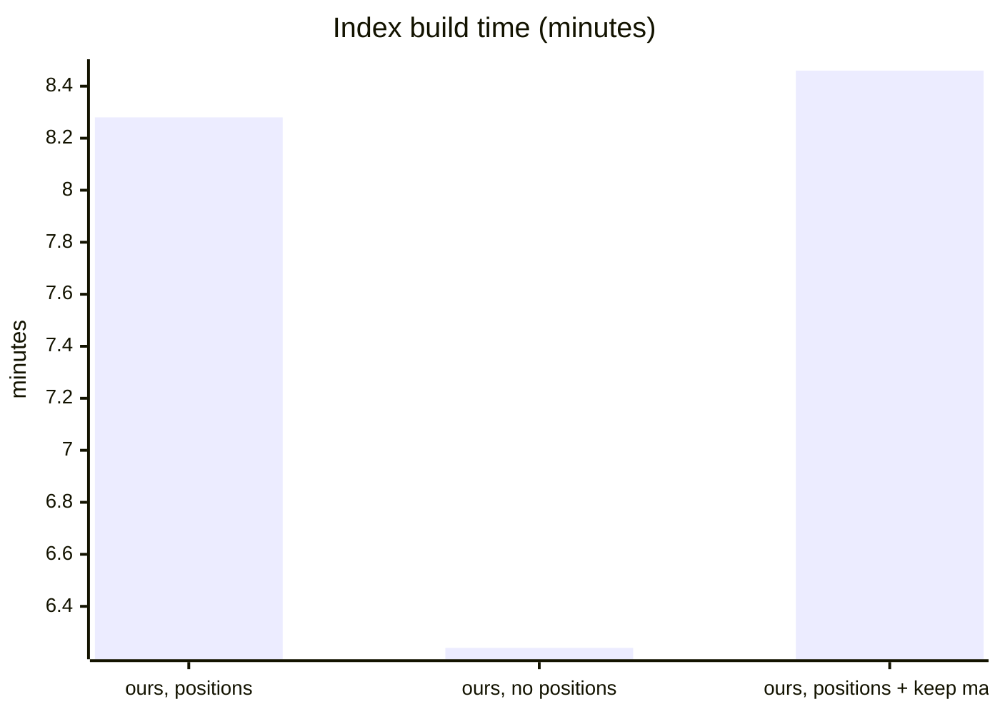

_Bars in order: bar 1 = total._

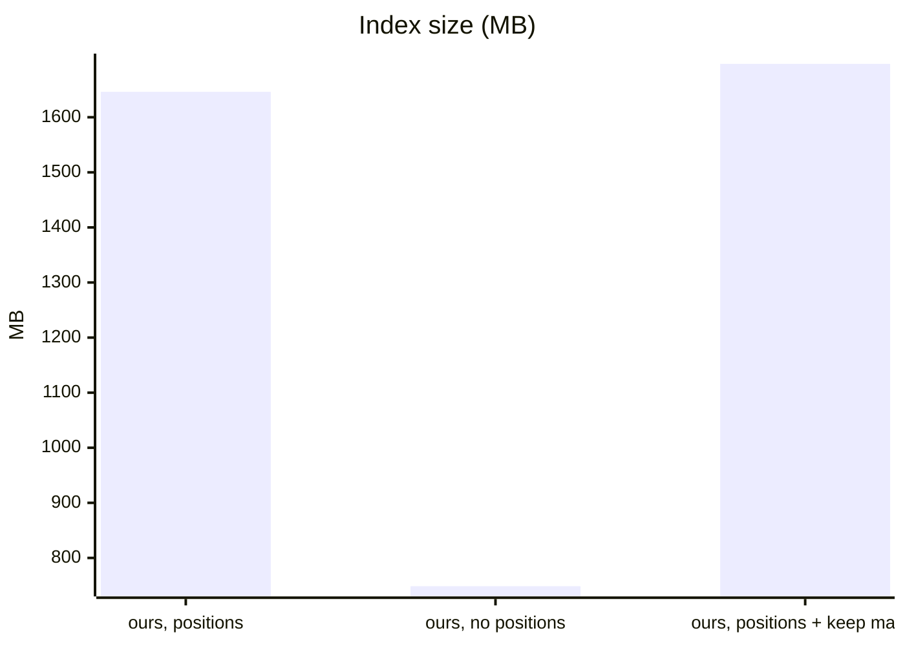

_Bars in order: bar 1 = size._

## Parity with FtsLib (identical lines, first 20,000 hits, both index flavours)

| Set | Positions | No positions |
|---|---|---|
| queries-diff10 | 10/10 | 10/10 |
| queries-large | 61/61 | 61/61 |
| queries-words | 14/14 | 14/14 |
| queries-rules | 21/21 | 21/21 |
| queries-ketiv (ketiv on) | 12/12 | 12/12 |

## Search speed (every hit read, median of 3 runs after one warm-up)

Stages per query: walks + collect (engine), host (text fetch + locate + widening), first batch, total. Otzaria runs only the queries it has an equivalent for (no `*`, `?`, `%`, `|`, phrase); its large-set timings come from an earlier run on a busier machine, so treat them as indicative.

### queries-large.txt (61)

| Engine | Queries run | Total (sum) | Median per query | First batch median | Slowest query |
|---|---|---|---|---|---|
| ours, positions | 61 | 10.46 min | 0.10 min | 262 ms | q41: 0.78 min |
| ours, no positions | 61 | 11.88 min | 0.10 min | 264 ms | q55: 1.00 min |
| FtsLib | pending | | | | |
| Otzaria | 43 | 14.06 min | 0.11 min | 106 ms | q53: 1.91 min |

Over the 43 queries every engine ran:

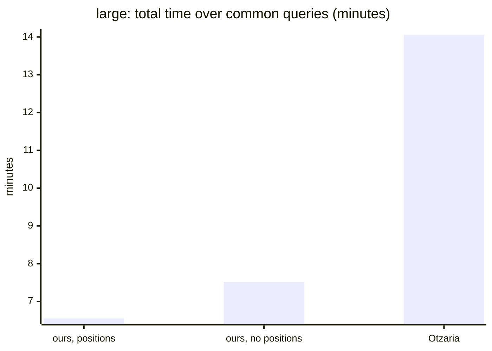

_Bars in order: bar 1 = total._

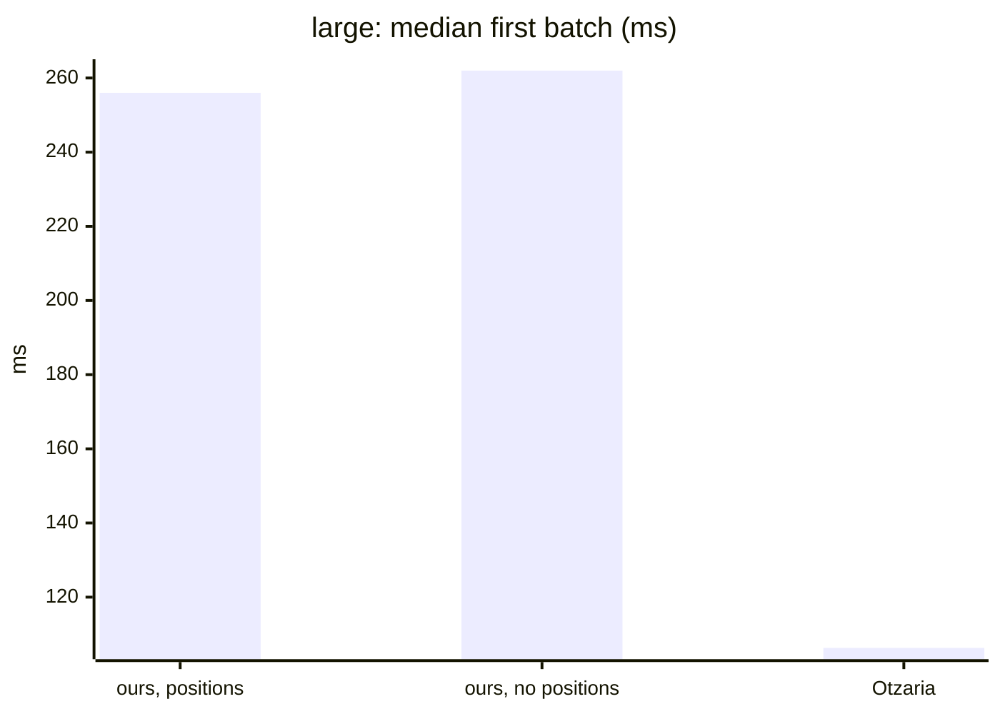

_Bars in order: bar 1 = first._

```mermaid
xychart-beta
    title "large: total per query (minutes)"
    x-axis ["q1", "q2", "q3", "q4", "q5", "q6", "q7", "q8", "q9", "q10", "q11", "q12", "q13", "q14", "q15", "q16", "q17", "q18", "q19", "q20", "q21", "q22", "q23", "q24", "q25", "q26", "q27", "q28", "q29", "q30", "q31", "q32", "q33", "q34", "q35", "q36", "q37", "q38", "q39", "q40", "q41", "q42", "q43", "q44", "q45", "q46", "q47", "q48", "q49", "q50", "q51", "q52", "q53", "q54", "q55", "q56", "q57", "q58", "q59", "q60", "q61"]
    y-axis "minutes"
    bar [0.57, 0.24, 0.33, 0.20, 0.18, 0.07, 0.04, 0.04, 0.01, 0.01, 0.28, 0.04, 0.03, 0.39, 0.28, 0.07, 0.14, 0.05, 0.26, 0.40, 0.01, 0.02, 0.04, 0.02, 0.03, 0.03, 0.06, 0.05, 0.03, 0.03, 0.04, 0.03, 0.14, 0.06, 0.03, 0.28, 0.14, 0.10, 0.23, 0.16, 0.78, 0.24, 0.24, 0.26, 0.15, 0.13, 0.44, 0.12, 0.21, 0.04, 0.15, 0.07, 0.71, 0.63, 0.73, 0.30, 0.07, 0.03, 0.01, 0.01, 0.01]
    bar [0.56, 0.25, 0.33, 0.20, 0.18, 0.07, 0.04, 0.05, 0.01, 0.01, 0.28, 0.04, 0.03, 0.44, 0.31, 0.10, 0.18, 0.04, 0.30, 0.39, 0.01, 0.02, 0.04, 0.02, 0.03, 0.03, 0.06, 0.05, 0.03, 0.03, 0.05, 0.03, 0.17, 0.07, 0.04, 0.44, 0.12, 0.08, 0.28, 0.15, 0.94, 0.27, 0.27, 0.33, 0.15, 0.14, 0.45, 0.11, 0.20, 0.04, 0.15, 0.07, 0.91, 0.87, 1.00, 0.29, 0.07, 0.03, 0.01, 0.01, 0.00]
    bar [1.45, 0.54, 0.73, 0.37, 0.35, 0.11, 0.06, 0.09, 0.01, 0.01, 0.55, 0.06, 0.04, 1.04, 0.54, 0.13, 0.26, 0.06, 0.75, 0.88, 0.03, 0.06, 0.11, 0.03, 0.07, 0.06, 0.22, 0.19, 0.01, 0.02, 0.03, 0.04, 0.20, 0.13, 0.06, 0.00, 0.00, 0.00, 0.00, 0.00, 0.00, 0.00, 0.00, 0.00, 0.00, 0.00, 0.00, 0.00, 0.00, 0.00, 0.34, 0.25, 1.91, 1.22, 1.00, 0.00, 0.00, 0.00, 0.01, 0.02, 0.02]
```

_Bars in order: bar 1 = ours, positions / bar 2 = ours, no positions / bar 3 = Otzaria._

Per query, each stage

| q | Query | Engine | Hits | Walks + collect | Host | First batch | Total |
|---|---|---|---|---|---|---|---|
| q1 | `אמר`  | ours, positions | 802,677 | 64 ms | 0.57 min | 339 ms | 0.57 min |
| q1 | `אמר`  | ours, no positions | 802,677 | 62 ms | 0.56 min | 343 ms | 0.56 min |
| q1 | `אמר`  | Otzaria | 802,579 | n/a | n/a | 101 ms | 1.45 min |
| q2 | `תורה`  | ours, positions | 234,374 | 31 ms | 0.23 min | 273 ms | 0.24 min |
| q2 | `תורה`  | ours, no positions | 234,374 | 28 ms | 0.24 min | 249 ms | 0.25 min |
| q2 | `תורה`  | Otzaria | 234,264 | n/a | n/a | 116 ms | 0.54 min |
| q3 | `ישראל`  | ours, positions | 441,158 | 41 ms | 0.33 min | 281 ms | 0.33 min |
| q3 | `ישראל`  | ours, no positions | 441,158 | 42 ms | 0.33 min | 283 ms | 0.33 min |
| q3 | `ישראל`  | Otzaria | 441,028 | n/a | n/a | 76 ms | 0.73 min |
| q4 | `שבת`  | ours, positions | 230,796 | 30 ms | 0.20 min | 264 ms | 0.20 min |
| q4 | `שבת`  | ours, no positions | 230,796 | 30 ms | 0.19 min | 263 ms | 0.20 min |
| q4 | `שבת`  | Otzaria | 230,606 | n/a | n/a | 80 ms | 0.37 min |
| q5 | `מצוה`  | ours, positions | 171,942 | 28 ms | 0.18 min | 272 ms | 0.18 min |
| q5 | `מצוה`  | ours, no positions | 171,942 | 27 ms | 0.18 min | 265 ms | 0.18 min |
| q5 | `מצוה`  | Otzaria | 171,890 | n/a | n/a | 87 ms | 0.35 min |
| q6 | `פסח`  | ours, positions | 54,950 | 19 ms | 0.07 min | 247 ms | 0.07 min |
| q6 | `פסח`  | ours, no positions | 54,950 | 18 ms | 0.07 min | 248 ms | 0.07 min |
| q6 | `פסח`  | Otzaria | 54,911 | n/a | n/a | 85 ms | 0.11 min |
| q7 | `ירושלים`  | ours, positions | 25,927 | 17 ms | 0.04 min | 256 ms | 0.04 min |
| q7 | `ירושלים`  | ours, no positions | 25,927 | 17 ms | 0.04 min | 252 ms | 0.04 min |
| q7 | `ירושלים`  | Otzaria | 25,912 | n/a | n/a | 93 ms | 0.06 min |
| q8 | `אלקים`  | ours, positions | 35,375 | 14 ms | 0.04 min | 245 ms | 0.04 min |
| q8 | `אלקים`  | ours, no positions | 35,375 | 13 ms | 0.05 min | 235 ms | 0.05 min |
| q8 | `אלקים`  | Otzaria | 35,369 | n/a | n/a | 98 ms | 0.09 min |
| q9 | `נבוכדנצר`  | ours, positions | 4,239 | 9 ms | 629 ms | 231 ms | 638 ms |
| q9 | `נבוכדנצר`  | ours, no positions | 4,239 | 9 ms | 622 ms | 228 ms | 631 ms |
| q9 | `נבוכדנצר`  | Otzaria | 4,238 | n/a | n/a | 81 ms | 734 ms |
| q10 | `אחשורוש`  | ours, positions | 5,377 | 10 ms | 765 ms | 272 ms | 775 ms |
| q10 | `אחשורוש`  | ours, no positions | 5,377 | 8 ms | 704 ms | 228 ms | 713 ms |
| q10 | `אחשורוש`  | Otzaria | 5,376 | n/a | n/a | 80 ms | 829 ms |
| q11 | `רש"י`  | ours, positions | 322,523 | 35 ms | 0.28 min | 279 ms | 0.28 min |
| q11 | `רש"י`  | ours, no positions | 322,523 | 35 ms | 0.28 min | 282 ms | 0.28 min |
| q11 | `רש"י`  | Otzaria | 320,864 | n/a | n/a | 89 ms | 0.55 min |
| q12 | `רמב"ם`  | ours, positions | 37,670 | 14 ms | 0.04 min | 237 ms | 0.04 min |
| q12 | `רמב"ם`  | ours, no positions | 37,670 | 14 ms | 0.04 min | 232 ms | 0.04 min |
| q12 | `רמב"ם`  | Otzaria | 37,576 | n/a | n/a | 88 ms | 0.06 min |
| q13 | `רמב"ן`  | ours, positions | 16,317 | 11 ms | 0.03 min | 250 ms | 0.03 min |
| q13 | `רמב"ן`  | ours, no positions | 16,317 | 11 ms | 0.03 min | 244 ms | 0.03 min |
| q13 | `רמב"ן`  | Otzaria | 16,271 | n/a | n/a | 84 ms | 0.04 min |
| q14 | `ז"ל`  | ours, positions | 462,256 | 42 ms | 0.39 min | 299 ms | 0.39 min |
| q14 | `ז"ל`  | ours, no positions | 462,256 | 41 ms | 0.44 min | 293 ms | 0.44 min |
| q14 | `ז"ל`  | Otzaria | 461,312 | n/a | n/a | 88 ms | 1.04 min |
| q15 | `ע"ש`  | ours, positions | 271,118 | 32 ms | 0.28 min | 293 ms | 0.28 min |
| q15 | `ע"ש`  | ours, no positions | 271,118 | 50 ms | 0.31 min | 383 ms | 0.31 min |
| q15 | `ע"ש`  | Otzaria | 269,905 | n/a | n/a | 92 ms | 0.54 min |
| q16 | `חז"ל`  | ours, positions | 52,702 | 17 ms | 0.07 min | 287 ms | 0.07 min |
| q16 | `חז"ל`  | ours, no positions | 52,702 | 21 ms | 0.10 min | 375 ms | 0.10 min |
| q16 | `חז"ל`  | Otzaria | 52,613 | n/a | n/a | 106 ms | 0.13 min |
| q17 | `תוס'`  | ours, positions | 156,168 | 23 ms | 0.14 min | 264 ms | 0.14 min |
| q17 | `תוס'`  | ours, no positions | 156,168 | 26 ms | 0.18 min | 316 ms | 0.18 min |
| q17 | `תוס'`  | Otzaria | 155,773 | n/a | n/a | 106 ms | 0.26 min |
| q18 | `רמבם`  | ours, positions | 37,670 | 14 ms | 0.05 min | 238 ms | 0.05 min |
| q18 | `רמבם`  | ours, no positions | 37,670 | 14 ms | 0.04 min | 241 ms | 0.04 min |
| q18 | `רמבם`  | Otzaria | 37,629 | n/a | n/a | 97 ms | 0.06 min |
| q19 | `רשי`  | ours, positions | 322,523 | 34 ms | 0.26 min | 274 ms | 0.26 min |
| q19 | `רשי`  | ours, no positions | 322,523 | 35 ms | 0.30 min | 279 ms | 0.30 min |
| q19 | `רשי`  | Otzaria | 322,300 | n/a | n/a | 98 ms | 0.75 min |
| q20 | `זל`  | ours, positions | 462,256 | 42 ms | 0.39 min | 292 ms | 0.40 min |
| q20 | `זל`  | ours, no positions | 462,256 | 43 ms | 0.39 min | 306 ms | 0.39 min |
| q20 | `זל`  | Otzaria | 461,818 | n/a | n/a | 94 ms | 0.88 min |
| q21 | `משה רבנו`  | ours, positions | 3,295 | 8 ms | 711 ms | 223 ms | 719 ms |
| q21 | `משה רבנו`  | ours, no positions | 3,295 | 9 ms | 793 ms | 268 ms | 802 ms |
| q21 | `משה רבנו`  | Otzaria | 2,870 | n/a | n/a | 455 ms | 0.03 min |
| q22 | `אברהם יצחק יעקב`  | ours, positions | 9,670 | 14 ms | 0.02 min | 233 ms | 0.02 min |
| q22 | `אברהם יצחק יעקב`  | ours, no positions | 9,670 | 14 ms | 0.02 min | 245 ms | 0.02 min |
| q22 | `אברהם יצחק יעקב`  | Otzaria | 9,102 | n/a | n/a | 326 ms | 0.06 min |
| q23 | `בית המקדש`  | ours, positions | 19,957 | 17 ms | 0.04 min | 241 ms | 0.04 min |
| q23 | `בית המקדש`  | ours, no positions | 19,957 | 17 ms | 0.04 min | 248 ms | 0.04 min |
| q23 | `בית המקדש`  | Otzaria | 20,183 | n/a | n/a | 300 ms | 0.11 min |
| q24 | `קריאת שמע`  | ours, positions | 7,696 | 11 ms | 975 ms | 243 ms | 986 ms |
| q24 | `קריאת שמע`  | ours, no positions | 7,696 | 11 ms | 0.02 min | 245 ms | 0.02 min |
| q24 | `קריאת שמע`  | Otzaria | 7,578 | n/a | n/a | 294 ms | 0.03 min |
| q25 | `תלמוד תורה`  | ours, positions | 8,769 | 14 ms | 0.03 min | 235 ms | 0.03 min |
| q25 | `תלמוד תורה`  | ours, no positions | 8,769 | 14 ms | 0.03 min | 242 ms | 0.03 min |
| q25 | `תלמוד תורה`  | Otzaria | 8,097 | n/a | n/a | 336 ms | 0.07 min |
| q26 | `עבודה זרה`  | ours, positions | 17,819 | 14 ms | 0.03 min | 231 ms | 0.03 min |
| q26 | `עבודה זרה`  | ours, no positions | 17,819 | 14 ms | 0.03 min | 243 ms | 0.03 min |
| q26 | `עבודה זרה`  | Otzaria | 17,843 | n/a | n/a | 102 ms | 0.06 min |
| q27 | `יום טוב`  | ours, positions | 40,454 | 20 ms | 0.06 min | 263 ms | 0.06 min |
| q27 | `יום טוב`  | ours, no positions | 40,454 | 21 ms | 0.06 min | 270 ms | 0.06 min |
| q27 | `יום טוב`  | Otzaria | 41,081 | n/a | n/a | 385 ms | 0.22 min |
| q28 | `ארץ ישראל`  | ours, positions | 31,885 | 19 ms | 0.05 min | 237 ms | 0.05 min |
| q28 | `ארץ ישראל`  | ours, no positions | 31,885 | 20 ms | 0.05 min | 247 ms | 0.05 min |
| q28 | `ארץ ישראל`  | Otzaria | 31,644 | n/a | n/a | 281 ms | 0.19 min |
| q29 | `משה אהרן` 0 | ours, positions | 665 | 14 ms | 0.03 min | 204 ms | 0.03 min |
| q29 | `משה אהרן` 0 | ours, no positions | 665 | 15 ms | 0.03 min | 203 ms | 0.03 min |
| q29 | `משה אהרן` 0 | Otzaria | 588 | n/a | n/a | 171 ms | 384 ms |
| q30 | `משה אהרן` 3 | ours, positions | 5,624 | 14 ms | 0.03 min | 216 ms | 0.03 min |
| q30 | `משה אהרן` 3 | ours, no positions | 5,624 | 16 ms | 0.03 min | 237 ms | 0.03 min |
| q30 | `משה אהרן` 3 | Otzaria | 4,443 | n/a | n/a | 403 ms | 0.02 min |
| q31 | `שמע ישראל` 0 | ours, positions | 5,648 | 17 ms | 0.04 min | 233 ms | 0.04 min |
| q31 | `שמע ישראל` 0 | ours, no positions | 5,648 | 18 ms | 0.04 min | 283 ms | 0.05 min |
| q31 | `שמע ישראל` 0 | Otzaria | 5,455 | n/a | n/a | 200 ms | 0.03 min |
| q32 | `ויאמר משה` 2 | ours, positions | 7,677 | 15 ms | 0.03 min | 216 ms | 0.03 min |
| q32 | `ויאמר משה` 2 | ours, no positions | 7,677 | 15 ms | 0.03 min | 223 ms | 0.03 min |
| q32 | `ויאמר משה` 2 | Otzaria | 6,973 | n/a | n/a | 634 ms | 0.04 min |
| q33 | `אמר רבי` 1 | ours, positions | 90,507 | 34 ms | 0.14 min | 236 ms | 0.14 min |
| q33 | `אמר רבי` 1 | ours, no positions | 90,507 | 39 ms | 0.17 min | 292 ms | 0.17 min |
| q33 | `אמר רבי` 1 | Otzaria | 80,074 | n/a | n/a | 200 ms | 0.20 min |
| q34 | `רבי יוחנן` 0 | ours, positions | 37,641 | 21 ms | 0.06 min | 226 ms | 0.06 min |
| q34 | `רבי יוחנן` 0 | ours, no positions | 37,641 | 23 ms | 0.07 min | 262 ms | 0.07 min |
| q34 | `רבי יוחנן` 0 | Otzaria | 37,533 | n/a | n/a | 138 ms | 0.13 min |
| q35 | `רבי עקיבא` 5 | ours, positions | 18,267 | 16 ms | 0.03 min | 237 ms | 0.03 min |
| q35 | `רבי עקיבא` 5 | ours, no positions | 18,267 | 18 ms | 0.03 min | 267 ms | 0.04 min |
| q35 | `רבי עקיבא` 5 | Otzaria | 18,145 | n/a | n/a | 170 ms | 0.06 min |
| q36 | `%שבת`  | ours, positions | 385,432 | 39 ms | 0.28 min | 271 ms | 0.28 min |
| q36 | `%שבת`  | ours, no positions | 385,432 | 49 ms | 0.44 min | 358 ms | 0.44 min |
| q37 | `%ברכה`  | ours, positions | 123,966 | 28 ms | 0.14 min | 306 ms | 0.14 min |
| q37 | `%ברכה`  | ours, no positions | 123,966 | 28 ms | 0.12 min | 322 ms | 0.12 min |
| q38 | `ברכה%`  | ours, positions | 71,827 | 25 ms | 0.10 min | 290 ms | 0.10 min |
| q38 | `ברכה%`  | ours, no positions | 71,827 | 20 ms | 0.08 min | 248 ms | 0.08 min |
| q39 | `%מלך%`  | ours, positions | 271,721 | 45 ms | 0.23 min | 322 ms | 0.23 min |
| q39 | `%מלך%`  | ours, no positions | 271,721 | 42 ms | 0.28 min | 325 ms | 0.28 min |
| q40 | `%כהן`  | ours, positions | 154,179 | 30 ms | 0.15 min | 272 ms | 0.16 min |
| q40 | `%כהן`  | ours, no positions | 154,179 | 26 ms | 0.15 min | 240 ms | 0.15 min |
| q41 | `דבר%`  | ours, positions | 1,048,096 | 73 ms | 0.78 min | 347 ms | 0.78 min |
| q41 | `דבר%`  | ours, no positions | 1,048,096 | 173 ms | 0.94 min | 510 ms | 0.94 min |
| q42 | `שלו*`  | ours, positions | 269,944 | 34 ms | 0.24 min | 260 ms | 0.24 min |
| q42 | `שלו*`  | ours, no positions | 269,944 | 37 ms | 0.27 min | 326 ms | 0.27 min |
| q43 | `שבת*`  | ours, positions | 302,665 | 37 ms | 0.24 min | 261 ms | 0.24 min |
| q43 | `שבת*`  | ours, no positions | 302,665 | 36 ms | 0.27 min | 264 ms | 0.27 min |
| q44 | `*לום`  | ours, positions | 261,285 | 37 ms | 0.26 min | 266 ms | 0.26 min |
| q44 | `*לום`  | ours, no positions | 261,285 | 239 ms | 0.33 min | 578 ms | 0.33 min |
| q45 | `*כהן`  | ours, positions | 155,268 | 31 ms | 0.15 min | 262 ms | 0.15 min |
| q45 | `*כהן`  | ours, no positions | 155,268 | 34 ms | 0.15 min | 306 ms | 0.15 min |
| q46 | `*יצח*`  | ours, positions | 121,819 | 27 ms | 0.13 min | 260 ms | 0.13 min |
| q46 | `*יצח*`  | ours, no positions | 121,819 | 29 ms | 0.14 min | 269 ms | 0.14 min |
| q47 | `*דוש*`  | ours, positions | 500,638 | 53 ms | 0.44 min | 339 ms | 0.44 min |
| q47 | `*דוש*`  | ours, no positions | 500,638 | 57 ms | 0.45 min | 373 ms | 0.45 min |
| q48 | `שלו?ם`  | ours, positions | 102,774 | 23 ms | 0.12 min | 247 ms | 0.12 min |
| q48 | `שלו?ם`  | ours, no positions | 102,774 | 23 ms | 0.11 min | 248 ms | 0.11 min |
| q49 | `מ?צוה`  | ours, positions | 197,601 | 29 ms | 0.21 min | 254 ms | 0.21 min |
| q49 | `מ?צוה`  | ours, no positions | 197,601 | 27 ms | 0.20 min | 229 ms | 0.20 min |
| q50 | `ירושל?ים`  | ours, positions | 25,931 | 18 ms | 0.04 min | 256 ms | 0.04 min |
| q50 | `ירושל?ים`  | ours, no positions | 25,931 | 17 ms | 0.04 min | 238 ms | 0.04 min |
| q51 | `יצחק~1`  | ours, positions | 130,680 | 27 ms | 0.15 min | 268 ms | 0.15 min |
| q51 | `יצחק~1`  | ours, no positions | 130,680 | 24 ms | 0.15 min | 252 ms | 0.15 min |
| q51 | `יצחק~1`  | Otzaria | 130,667 | n/a | n/a | 96 ms | 0.34 min |
| q52 | `ירושלים~1`  | ours, positions | 52,693 | 21 ms | 0.07 min | 250 ms | 0.07 min |
| q52 | `ירושלים~1`  | ours, no positions | 52,693 | 20 ms | 0.07 min | 243 ms | 0.07 min |
| q52 | `ירושלים~1`  | Otzaria | 52,669 | n/a | n/a | 121 ms | 0.25 min |
| q53 | `אברהם~2`  | ours, positions | 973,729 | 79 ms | 0.71 min | 384 ms | 0.71 min |
| q53 | `אברהם~2`  | ours, no positions | 973,729 | 85 ms | 0.90 min | 440 ms | 0.91 min |
| q53 | `אברהם~2`  | Otzaria | 976,935 | n/a | n/a | 143 ms | 1.91 min |
| q54 | `שבת~1`  | ours, positions | 881,826 | 73 ms | 0.63 min | 359 ms | 0.63 min |
| q54 | `שבת~1`  | ours, no positions | 881,826 | 234 ms | 0.87 min | 643 ms | 0.87 min |
| q54 | `שבת~1`  | Otzaria | 883,124 | n/a | n/a | 64 ms | 1.22 min |
| q55 | `רש"י~1`  | ours, positions | 1,031,823 | 78 ms | 0.73 min | 400 ms | 0.73 min |
| q55 | `רש"י~1`  | ours, no positions | 1,031,823 | 225 ms | 1.00 min | 653 ms | 1.00 min |
| q55 | `רש"י~1`  | Otzaria | 556,757 | n/a | n/a | 170 ms | 1.00 min |
| q56 | `רשי | רמבם`  | ours, positions | 353,659 | 40 ms | 0.30 min | 283 ms | 0.30 min |
| q56 | `רשי | רמבם`  | ours, no positions | 353,659 | 38 ms | 0.29 min | 278 ms | 0.29 min |
| q57 | `שבת | יום טוב`  | ours, positions | 50,790 | 29 ms | 0.07 min | 272 ms | 0.07 min |
| q57 | `שבת | יום טוב`  | ours, no positions | 50,790 | 27 ms | 0.07 min | 261 ms | 0.07 min |
| q58 | `משה | אהרן כהן`  | ours, positions | 10,121 | 19 ms | 0.03 min | 256 ms | 0.03 min |
| q58 | `משה | אהרן כהן`  | ours, no positions | 10,121 | 18 ms | 0.03 min | 245 ms | 0.03 min |
| q59 | `תלמוד תורה כנגד כולם`  | ours, positions | 315 | 8 ms | 325 ms | 315 ms | 333 ms |
| q59 | `תלמוד תורה כנגד כולם`  | ours, no positions | 315 | 7 ms | 316 ms | 306 ms | 323 ms |
| q59 | `תלמוד תורה כנגד כולם`  | Otzaria | 163 | n/a | n/a | 645 ms | 859 ms |
| q60 | `אלו דברים שאין להם שיעור`  | ours, positions | 1,157 | 13 ms | 831 ms | 280 ms | 845 ms |
| q60 | `אלו דברים שאין להם שיעור`  | ours, no positions | 1,157 | 12 ms | 825 ms | 276 ms | 837 ms |
| q60 | `אלו דברים שאין להם שיעור`  | Otzaria | 382 | n/a | n/a | 0.02 min | 0.02 min |
| q61 | `שמע ישראל ה' אלקינו ה' אחד`  | ours, positions | 666 | 12 ms | 301 ms | 257 ms | 313 ms |
| q61 | `שמע ישראל ה' אלקינו ה' אחד`  | ours, no positions | 666 | 11 ms | 285 ms | 243 ms | 296 ms |
| q61 | `שמע ישראל ה' אלקינו ה' אחד`  | Otzaria | 587 | n/a | n/a | 0.03 min | 0.02 min |

### queries-words.txt (14)

| Engine | Queries run | Total (sum) | Median per query | First batch median | Slowest query |
|---|---|---|---|---|---|
| ours, positions | 14 | 3.46 min | 0.02 min | 238 ms | q12: 2.43 min |
| ours, no positions | 14 | 4.12 min | 0.02 min | 258 ms | q12: 3.34 min |
| FtsLib | pending | | | | |
| Otzaria | 13 | 5.33 min | 0.03 min | 308 ms | q12: 3.93 min |

Over the 13 queries every engine ran:

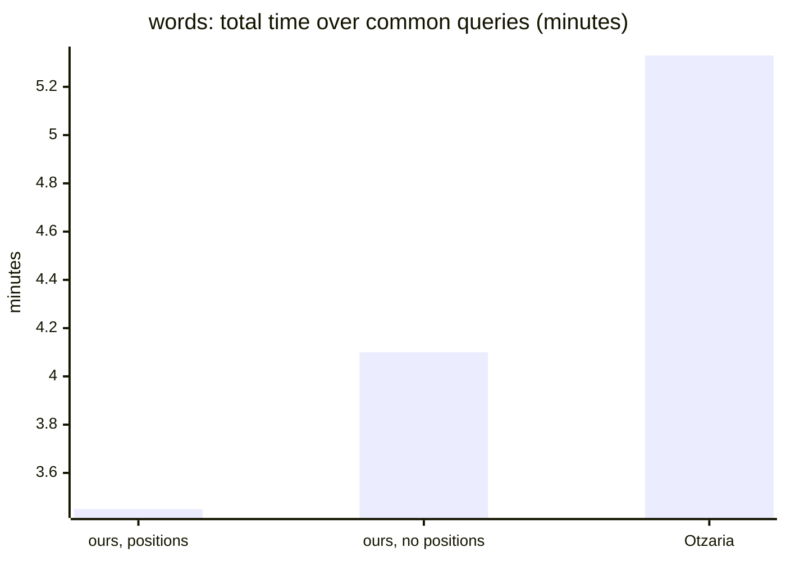

_Bars in order: bar 1 = total._

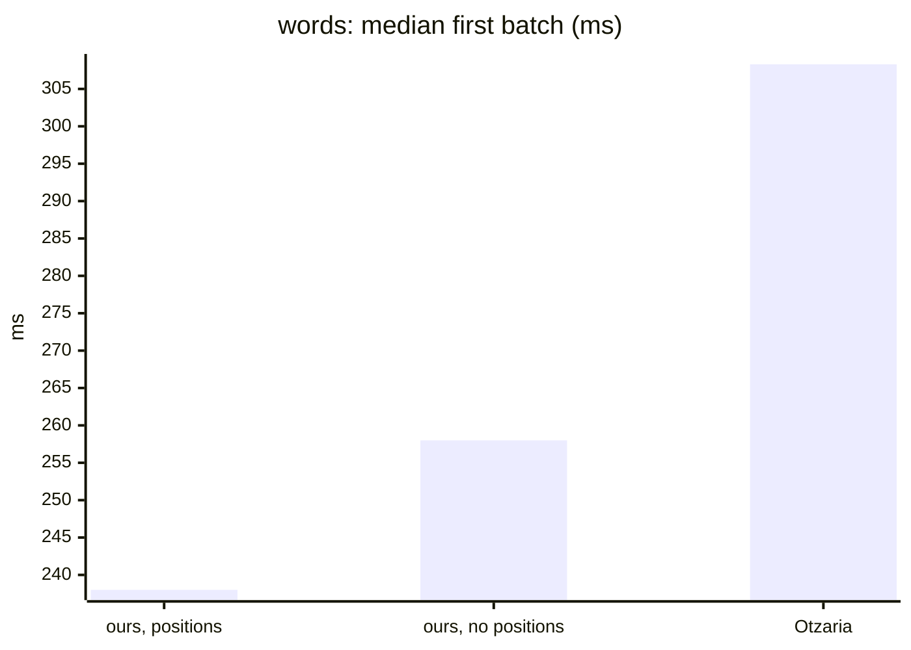

_Bars in order: bar 1 = first._

```mermaid
xychart-beta
    title "words: total per query (minutes)"
    x-axis ["q1", "q2", "q3", "q4", "q5", "q6", "q7", "q8", "q9", "q10", "q11", "q12", "q13", "q14"]
    y-axis "minutes"
    bar [0.05, 0.03, 0.16, 0.15, 0.03, 0.01, 0.01, 0.00, 0.00, 0.00, 0.02, 2.43, 0.57, 0.01]
    bar [0.06, 0.05, 0.24, 0.18, 0.03, 0.01, 0.01, 0.00, 0.00, 0.00, 0.02, 3.34, 0.17, 0.00]
    bar [0.18, 0.05, 0.17, 0.87, 0.03, 0.00, 0.02, 0.01, 0.01, 0.00, 0.00, 3.93, 0.06, 0.00]
```

_Bars in order: bar 1 = ours, positions / bar 2 = ours, no positions / bar 3 = Otzaria._

Per query, each stage

| q | Query | Engine | Hits | Walks + collect | Host | First batch | Total |
|---|---|---|---|---|---|---|---|
| q1 | `ה' אלהים`  | ours, positions | 28,579 | 17 ms | 0.05 min | 247 ms | 0.05 min |
| q1 | `ה' אלהים`  | ours, no positions | 28,579 | 21 ms | 0.06 min | 325 ms | 0.06 min |
| q1 | `ה' אלהים`  | Otzaria | 29,106 | n/a | n/a | 319 ms | 0.18 min |
| q2 | `ר' עקיבא` 0 | ours, positions | 10,117 | 14 ms | 0.03 min | 227 ms | 0.03 min |
| q2 | `ר' עקיבא` 0 | ours, no positions | 10,117 | 18 ms | 0.05 min | 335 ms | 0.05 min |
| q2 | `ר' עקיבא` 0 | Otzaria | 10,073 | n/a | n/a | 117 ms | 0.05 min |
| q3 | `אמר ר` 0 | ours, positions | 36,706 | 30 ms | 0.16 min | 236 ms | 0.16 min |
| q3 | `אמר ר` 0 | ours, no positions | 36,706 | 37 ms | 0.24 min | 338 ms | 0.24 min |
| q3 | `אמר ר` 0 | Otzaria | 36,598 | n/a | n/a | 151 ms | 0.17 min |
| q4 | `ב ג`  | ours, positions | 124,360 | 32 ms | 0.15 min | 249 ms | 0.15 min |
| q4 | `ב ג`  | ours, no positions | 124,360 | 34 ms | 0.18 min | 258 ms | 0.18 min |
| q4 | `ב ג`  | Otzaria | 143,836 | n/a | n/a | 678 ms | 0.87 min |
| q5 | `משה אהרן` 1 | ours, positions | 3,531 | 14 ms | 0.03 min | 237 ms | 0.03 min |
| q5 | `משה אהרן` 1 | ours, no positions | 3,531 | 15 ms | 0.03 min | 225 ms | 0.03 min |
| q5 | `משה אהרן` 1 | Otzaria | 3,052 | n/a | n/a | 557 ms | 0.03 min |
| q6 | `משה ו אהרן` 0 | ours, positions | 1 | 10 ms | 662 ms | 540 ms | 672 ms |
| q6 | `משה ו אהרן` 0 | ours, no positions | 1 | 10 ms | 732 ms | 595 ms | 743 ms |
| q6 | `משה ו אהרן` 0 | Otzaria | 1 | n/a | n/a | 77 ms | 73 ms |
| q7 | `פרק 1`  | ours, positions | 4,266 | 6 ms | 419 ms | 238 ms | 425 ms |
| q7 | `פרק 1`  | ours, no positions | 4,266 | 6 ms | 408 ms | 228 ms | 413 ms |
| q7 | `פרק 1`  | Otzaria | 1,490 | n/a | n/a | 430 ms | 990 ms |
| q8 | `סימן 12`  | ours, positions | 228 | 4 ms | 227 ms | 227 ms | 231 ms |
| q8 | `סימן 12`  | ours, no positions | 228 | 5 ms | 226 ms | 228 ms | 231 ms |
| q8 | `סימן 12`  | Otzaria | 70 | n/a | n/a | 524 ms | 516 ms |
| q9 | `דף 2 עמוד` 1 | ours, positions | 0 | 5 ms | 172 ms | n/a | 177 ms |
| q9 | `דף 2 עמוד` 1 | ours, no positions | 0 | 5 ms | 183 ms | n/a | 188 ms |
| q9 | `דף 2 עמוד` 1 | Otzaria | 0 | n/a | n/a | 365 ms | 361 ms |
| q10 | `ב5`  | ours, positions | 2 | 3 ms | 189 ms | 190 ms | 192 ms |
| q10 | `ב5`  | ours, no positions | 2 | 3 ms | 204 ms | 205 ms | 207 ms |
| q10 | `ב5`  | Otzaria | 2 | n/a | n/a | 53 ms | 53 ms |
| q11 | `12*`  | ours, positions | 14,733 | 9 ms | 0.02 min | 227 ms | 0.02 min |
| q11 | `12*`  | ours, no positions | 14,733 | 9 ms | 0.02 min | 213 ms | 0.02 min |
| q12 | `א~1`  | ours, positions | 4,843,052 | 328 ms | 2.42 min | 0.02 min | 2.43 min |
| q12 | `א~1`  | ours, no positions | 4,843,052 | 436 ms | 3.32 min | 0.03 min | 3.34 min |
| q12 | `א~1`  | Otzaria | 4,841,951 | n/a | n/a | 121 ms | 3.93 min |
| q13 | `אמר ה` 2 | ours, positions | 23,367 | 82 ms | 0.57 min | 576 ms | 0.57 min |
| q13 | `אמר ה` 2 | ours, no positions | 23,367 | 35 ms | 0.17 min | 224 ms | 0.17 min |
| q13 | `אמר ה` 2 | Otzaria | 16,216 | n/a | n/a | 308 ms | 0.06 min |
| q14 | `ס"ק 3` 0 | ours, positions | 1 | 6 ms | 472 ms | 476 ms | 478 ms |
| q14 | `ס"ק 3` 0 | ours, no positions | 1 | 5 ms | 284 ms | 288 ms | 289 ms |
| q14 | `ס"ק 3` 0 | Otzaria | 1 | n/a | n/a | 56 ms | 59 ms |

### queries-rules.txt (21)

| Engine | Queries run | Total (sum) | Median per query | First batch median | Slowest query |
|---|---|---|---|---|---|
| ours, positions | 21 | 2.20 min | 0.03 min | 257 ms | q15: 0.57 min |
| ours, no positions | 21 | 2.03 min | 0.03 min | 246 ms | q15: 0.43 min |
| FtsLib | pending | | | | |
| Otzaria | 21 | 2.04 min | 688 ms | 79 ms | q14: 0.44 min |

Over the 21 queries every engine ran:

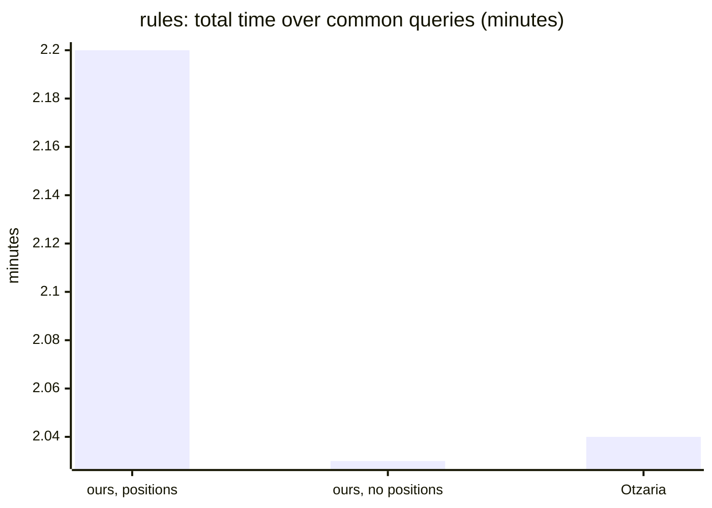

_Bars in order: bar 1 = total._

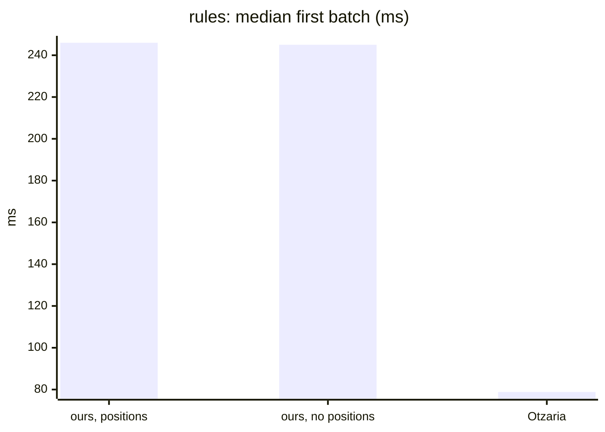

_Bars in order: bar 1 = first._

```mermaid
xychart-beta
    title "rules: total per query (minutes)"
    x-axis ["q1", "q2", "q3", "q4", "q5", "q6", "q7", "q8", "q9", "q10", "q11", "q12", "q13", "q14", "q15", "q16", "q17", "q18", "q19", "q20", "q21"]
    y-axis "minutes"
    bar [0.43, 0.26, 0.07, 0.09, 0.03, 0.01, 0.00, 0.00, 0.00, 0.00, 0.16, 0.07, 0.09, 0.29, 0.57, 0.01, 0.08, 0.00, 0.00, 0.02, 0.01]
    bar [0.27, 0.26, 0.08, 0.08, 0.03, 0.00, 0.00, 0.00, 0.00, 0.00, 0.14, 0.08, 0.09, 0.43, 0.43, 0.01, 0.09, 0.00, 0.00, 0.01, 0.01]
    bar [0.36, 0.33, 0.10, 0.11, 0.01, 0.00, 0.00, 0.01, 0.00, 0.00, 0.21, 0.13, 0.22, 0.44, 0.00, 0.01, 0.08, 0.00, 0.01, 0.00, 0.01]
```

_Bars in order: bar 1 = ours, positions / bar 2 = ours, no positions / bar 3 = Otzaria._

Per query, each stage

| q | Query | Engine | Hits | Walks + collect | Host | First batch | Total |
|---|---|---|---|---|---|---|---|
| q1 | `ע.ש`  | ours, positions | 271,118 | 72 ms | 0.43 min | 0.02 min | 0.43 min |
| q1 | `ע.ש`  | ours, no positions | 271,118 | 34 ms | 0.27 min | 305 ms | 0.27 min |
| q1 | `ע.ש`  | Otzaria | 270,946 | n/a | n/a | 79 ms | 0.36 min |
| q2 | `עש`  | ours, positions | 271,118 | 34 ms | 0.25 min | 307 ms | 0.26 min |
| q2 | `עש`  | ours, no positions | 271,118 | 33 ms | 0.25 min | 506 ms | 0.26 min |
| q2 | `עש`  | Otzaria | 270,946 | n/a | n/a | 90 ms | 0.33 min |
| q3 | `א.ב`  | ours, positions | 53,499 | 19 ms | 0.07 min | 241 ms | 0.07 min |
| q3 | `א.ב`  | ours, no positions | 53,499 | 28 ms | 0.08 min | 358 ms | 0.08 min |
| q3 | `א.ב`  | Otzaria | 53,485 | n/a | n/a | 70 ms | 0.10 min |
| q4 | `וי[א]מר`  | ours, positions | 68,093 | 23 ms | 0.09 min | 278 ms | 0.09 min |
| q4 | `וי[א]מר`  | ours, no positions | 68,093 | 21 ms | 0.08 min | 246 ms | 0.08 min |
| q4 | `וי[א]מר`  | Otzaria | 68,072 | n/a | n/a | 53 ms | 0.11 min |
| q5 | `ויאמר‏ משה` 0 | ours, positions | 3,575 | 15 ms | 0.03 min | 221 ms | 0.03 min |
| q5 | `ויאמר‏ משה` 0 | ours, no positions | 3,575 | 15 ms | 0.03 min | 228 ms | 0.03 min |
| q5 | `ויאמר‏ משה` 0 | Otzaria | 3,174 | n/a | n/a | 120 ms | 688 ms |
| q6 | `the`  | ours, positions | 1,394 | 4 ms | 345 ms | 272 ms | 349 ms |
| q6 | `the`  | ours, no positions | 1,394 | 4 ms | 282 ms | 222 ms | 286 ms |
| q6 | `the`  | Otzaria | 1,393 | n/a | n/a | 66 ms | 91 ms |
| q7 | `torah`  | ours, positions | 20 | 3 ms | 191 ms | 192 ms | 194 ms |
| q7 | `torah`  | ours, no positions | 20 | 3 ms | 195 ms | 197 ms | 198 ms |
| q7 | `torah`  | Otzaria | 20 | n/a | n/a | 44 ms | 45 ms |
| q8 | `de la`  | ours, positions | 4 | 3 ms | 178 ms | 179 ms | 181 ms |
| q8 | `de la`  | ours, no positions | 4 | 3 ms | 185 ms | 186 ms | 188 ms |
| q8 | `de la`  | Otzaria | 3 | n/a | n/a | 360 ms | 362 ms |
| q9 | `בabc`  | ours, positions | 0 | 3 ms | 121 ms | n/a | 124 ms |
| q9 | `בabc`  | ours, no positions | 0 | 3 ms | 123 ms | n/a | 126 ms |
| q9 | `בabc`  | Otzaria | 0 | n/a | n/a | 36 ms | 31 ms |
| q10 | `και`  | ours, positions | 0 | 3 ms | 119 ms | n/a | 122 ms |
| q10 | `και`  | ours, no positions | 0 | 3 ms | 119 ms | n/a | 122 ms |
| q10 | `και`  | Otzaria | 0 | n/a | n/a | 33 ms | 32 ms |
| q11 | `תוס'`  | ours, positions | 156,168 | 26 ms | 0.16 min | 288 ms | 0.16 min |
| q11 | `תוס'`  | ours, no positions | 156,168 | 23 ms | 0.14 min | 258 ms | 0.14 min |
| q11 | `תוס'`  | Otzaria | 155,773 | n/a | n/a | 95 ms | 0.21 min |
| q12 | `תוס' ד״ה` 2 | ours, positions | 42,873 | 20 ms | 0.07 min | 243 ms | 0.07 min |
| q12 | `תוס' ד״ה` 2 | ours, no positions | 42,873 | 20 ms | 0.07 min | 245 ms | 0.08 min |
| q12 | `תוס' ד״ה` 2 | Otzaria | 42,598 | n/a | n/a | 231 ms | 0.13 min |
| q13 | `ר' יוחנן` 0 | ours, positions | 39,568 | 21 ms | 0.09 min | 246 ms | 0.09 min |
| q13 | `ר' יוחנן` 0 | ours, no positions | 39,568 | 22 ms | 0.09 min | 257 ms | 0.09 min |
| q13 | `ר' יוחנן` 0 | Otzaria | 39,427 | n/a | n/a | 123 ms | 0.22 min |
| q14 | `רש”י`  | ours, positions | 322,523 | 43 ms | 0.29 min | 499 ms | 0.29 min |
| q14 | `רש”י`  | ours, no positions | 322,523 | 59 ms | 0.42 min | 481 ms | 0.43 min |
| q14 | `רש”י`  | Otzaria | 320,864 | n/a | n/a | 77 ms | 0.44 min |
| q15 | `ז’ל`  | ours, positions | 462,256 | 50 ms | 0.56 min | 388 ms | 0.57 min |
| q15 | `ז’ל`  | ours, no positions | 462,256 | 45 ms | 0.43 min | 289 ms | 0.43 min |
| q15 | `ז’ל`  | Otzaria | 32 | n/a | n/a | 68 ms | 56 ms |
| q16 | `רמב”ם הלכות` 3 | ours, positions | 1,425 | 8 ms | 672 ms | 325 ms | 680 ms |
| q16 | `רמב”ם הלכות` 3 | ours, no positions | 1,425 | 8 ms | 533 ms | 261 ms | 541 ms |
| q16 | `רמב”ם הלכות` 3 | Otzaria | 1,383 | n/a | n/a | 134 ms | 568 ms |
| q17 | `שׂלום`  | ours, positions | 53,351 | 22 ms | 0.08 min | 449 ms | 0.08 min |
| q17 | `שׂלום`  | ours, no positions | 53,351 | 21 ms | 0.09 min | 334 ms | 0.09 min |
| q17 | `שׂלום`  | Otzaria | 53,339 | n/a | n/a | 62 ms | 0.08 min |
| q18 | `(הוצא) [היצא]`  | ours, positions | 229 | 4 ms | 226 ms | 228 ms | 230 ms |
| q18 | `(הוצא) [היצא]`  | ours, no positions | 229 | 4 ms | 235 ms | 237 ms | 239 ms |
| q18 | `(הוצא) [היצא]`  | Otzaria | 229 | n/a | n/a | 85 ms | 87 ms |
| q19 | `היצא אותם` 1 | ours, positions | 1 | 4 ms | 167 ms | 169 ms | 171 ms |
| q19 | `היצא אותם` 1 | ours, no positions | 1 | 4 ms | 178 ms | 181 ms | 182 ms |
| q19 | `היצא אותם` 1 | Otzaria | 1 | n/a | n/a | 569 ms | 421 ms |
| q20 | `משה אאאאאאאאאאאאאאאאאאאאאאאאאאאאאאאאאאאאאאאאאאאאאאאאאאאאאאאאאאאאאאאא רבנו` 1 | ours, positions | 2,058 | 9 ms | 954 ms | 257 ms | 963 ms |
| q20 | `משה אאאאאאאאאאאאאאאאאאאאאאאאאאאאאאאאאאאאאאאאאאאאאאאאאאאאאאאאאאאאאאאא רבנו` 1 | ours, no positions | 2,058 | 9 ms | 740 ms | 235 ms | 749 ms |
| q20 | `משה אאאאאאאאאאאאאאאאאאאאאאאאאאאאאאאאאאאאאאאאאאאאאאאאאאאאאאאאאאאאאאאא רבנו` 1 | Otzaria | 0 | n/a | n/a | 43 ms | 44 ms |
| q21 | `משה רבנו` 0 | ours, positions | 2,021 | 9 ms | 724 ms | 219 ms | 732 ms |
| q21 | `משה רבנו` 0 | ours, no positions | 2,021 | 9 ms | 790 ms | 244 ms | 799 ms |
| q21 | `משה רבנו` 0 | Otzaria | 1,633 | n/a | n/a | 128 ms | 706 ms |

## Hit-count comparison with Otzaria

Pending: filled in from the comparison run (same queries, equivalent options; differences analysed: whose bug).
