# FTS specs and comparisons

_Generated by `tools/report/specs_report.py` on 2026-10-22 17:25. Kept up to date as the engine changes (see CLAUDE.md). Units: ms below one second, minutes otherwise._

Current index formats: ours `tantivy11`, FtsLib `fts9`.

## Machine

From `machine.txt` (run-all.sh detect, written by the report step).

| Item | Value |
|---|---|
| OS | mac (Darwin 27.0.0), arch: arm64 |
| CPU | Apple M4, cores 10, RAM 16 GB |
| disk free at out dir | 151Gi |
| cargo | cargo 1.97.1 (c980f4866 2026-06-30) |
| dotnet SDKs | 10.0.402 |
| python | Python 3.14.3 |

## Engines compared

| Engine | What it is |
|---|---|
| ours, positions | this repo: modified tantivy + hebrew-fts walks, index with positions (span queries) |
| ours, no positions | same engine, index without positions; distance/order checked on the text by the locator |
| FtsLib | KitveiHakodesh FtsLib (SQLite FTS5, `detail=none`, index fts9) |
| Otzaria | otzaria_search_engine v5.0.0 (tantivy), driven by `tools/bench/otzaria-driver` |

## Feature specs (ours)

| Feature | Status |
|---|---|
| FtsLib query syntax (`* ? % ~N \|`), results identical to FtsLib | done, parity below |
| Every option one FST walk per word, shortest first, cap 2000 per segment, matched terms returned | done |
| Otzaria word options (grammar/advanced/Aramaic prefixes+suffixes, ktiv, part of word, typo modes, quotes) | done |
| Ketiv rule sets: Otzaria's or FtsLib's KetivExpander (`ktiv_rules`) | done |
| One search options object, per-word options (negative words too), alternatives, acronyms | done |
| Otzaria proximity (per-pair gaps, any order), word match (all/any/most/at least N) | done |
| Otzaria tokenizer rules (one-letter words, digits, joiners, geresh, paired readings, 128-byte limit) in both engines | done |
| Vocalized matching (nikud / te'amim) as a walk on a keep-marks index | done |
| Exact totals + per-book counts, cancellation, pull streaming | done |
| User regex `/.../` (word, sequence, line kinds) | done |
| Relevance / generation order (option; catalog default) + notice when positions are needed | done |
| Truncated flag when a cap is hit | done |
| Cross-line phrases (one break, any search type; line-edge enumerators skipped as Otzaria) and same-section scope | built; unit tests; full-DB verification pending |
| Fuzzy: a swap of two adjacent letters is one edit (Otzaria; FtsLib changed too) | done |
| Snippets from index positions (`locate_lines`, per-batch cost rule) | done |

## Index builds (full DB, 7,019,636 lines)

| Build | Indexing | Merge | FM sidecar | Total | Size |
|---|---|---|---|---|---|
| ours, positions | 2.56 min | 0.90 min | 900 ms | 3.48 min | 1,585.5 MB |
| ours, no positions | 2.34 min | 0.46 min | 900 ms | 2.82 min | 711.7 MB |
| ours, positions + keep marks | 2.57 min | 0.93 min | 0.02 min | 3.52 min | 1,634.2 MB |
| FtsLib (fts9) | n/a | n/a | n/a | 1.95 min | 738.1 MB |
| Otzaria v5.0.0 | n/a | n/a | n/a | 1.42 min | 1,886.0 MB |

Otzaria's index is not merged to one segment.

**ours, positions, per file:** `.idx` 731.9 MB, `.pos` 704.6 MB, `.fmi` 43.8 MB, `.term` 37.5 MB, `.store` 28.2 MB, `.fast` 25.5 MB, `.fieldnorm` 14.0 MB

**ours, no positions, per file:** `.idx` 566.4 MB, `.fmi` 43.8 MB, `.term` 33.8 MB, `.store` 28.2 MB, `.fast` 25.5 MB, `.fieldnorm` 14.0 MB

**ours, positions + keep marks, per file:** `.idx` 745.1 MB, `.pos` 704.4 MB, `.fmi` 61.4 MB, `.term` 48.5 MB, `.store` 28.2 MB, `.fast` 25.5 MB, `.fieldnorm` 21.1 MB

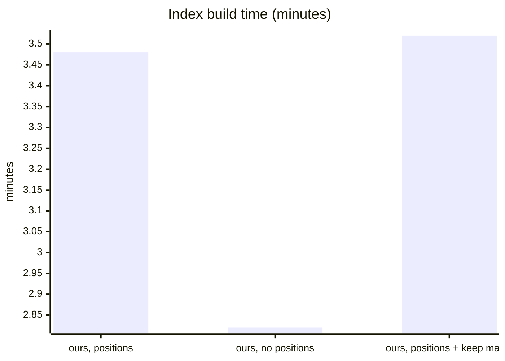

_Bars in order: bar 1 = total._

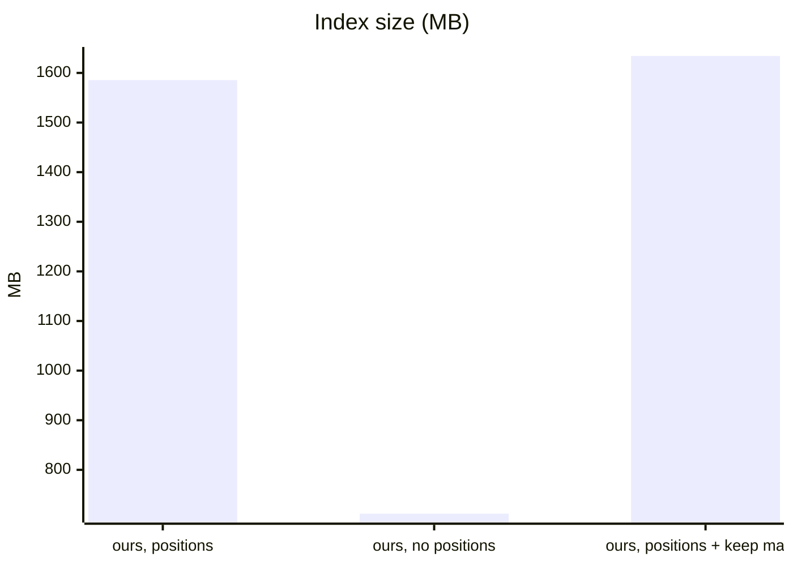

_Bars in order: bar 1 = size._

## Parity with FtsLib (identical lines, first 20,000 hits, both index flavours)

From this run's compare logs (`logs/parity-<set>-<flavour>-compare.log`).

| Set | Positions | No positions |
|---|---|---|
| queries-diff10 | 10/10 | 10/10 |
| queries-large | 61/61 | 61/61 |
| queries-words | 14/14 | 14/14 |
| queries-rules | 21/21 | 21/21 |
| queries-ketiv (ketiv on) | 12/12 | 12/12 |

## Search speed (every hit read, median of 3 runs after one warm-up)

Stages per query: walks + collect (engine), host (text fetch + locate + widening), first batch, total. Otzaria runs only the queries it has an equivalent for (no `*`, `?`, `%`, `|`, phrase); where its hit count differs from ours the two did not do the same work (see the analysis below).

### queries-large.txt (61)

| Engine | Queries run | Total (sum) | Median per query | First batch median | Slowest query |
|---|---|---|---|---|---|
| ours, positions | 61 | 3.88 min | 0.02 min | 41 ms | q55: 0.40 min |
| ours, no positions | 61 | 3.81 min | 0.02 min | 41 ms | q55: 0.41 min |
| FtsLib | 61 | 4.20 min | 0.02 min | 56 ms | q53: 0.41 min |
| Otzaria | 43 | 3.79 min | 0.02 min | 17 ms | q53: 0.45 min |

Over the 43 queries every engine ran:

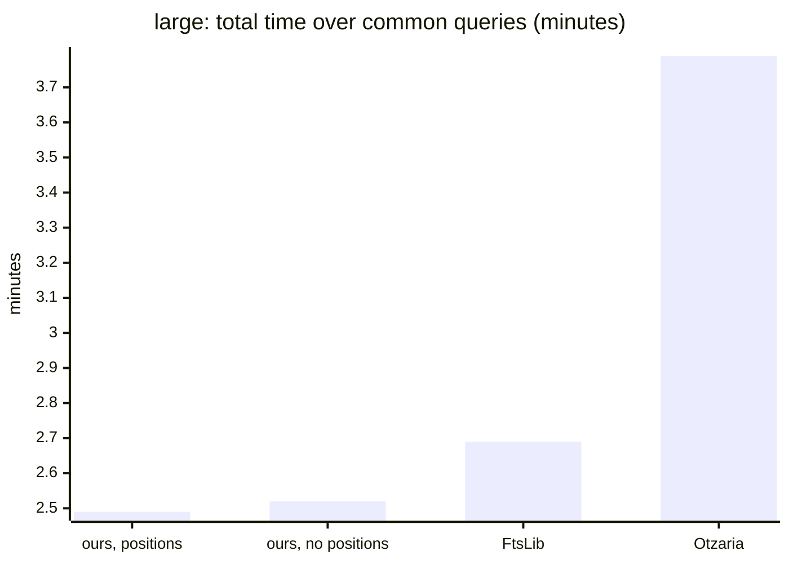

_Bars in order: bar 1 = total._

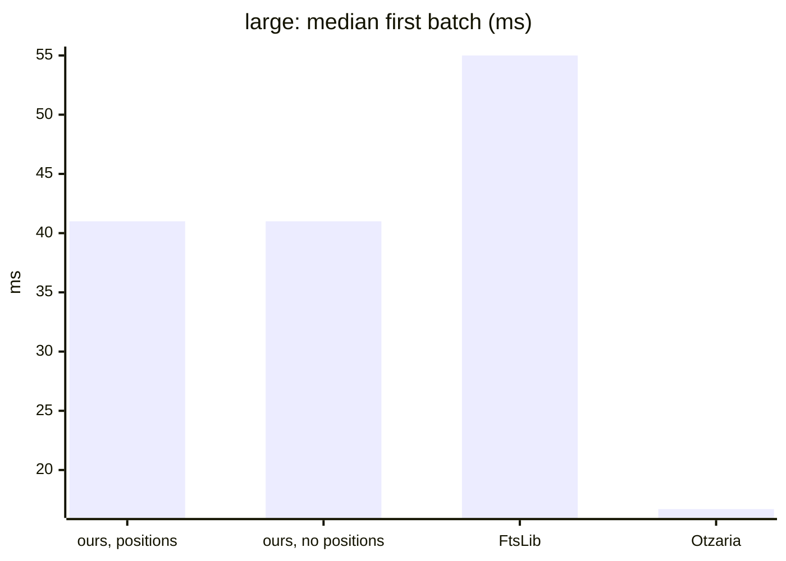

_Bars in order: bar 1 = first._

```mermaid
xychart-beta
    title "large: total per query (minutes)"
    x-axis ["q1", "q2", "q3", "q4", "q5", "q6", "q7", "q8", "q9", "q10", "q11", "q12", "q13", "q14", "q15", "q16", "q17", "q18", "q19", "q20", "q21", "q22", "q23", "q24", "q25", "q26", "q27", "q28", "q29", "q30", "q31", "q32", "q33", "q34", "q35", "q36", "q37", "q38", "q39", "q40", "q41", "q42", "q43", "q44", "q45", "q46", "q47", "q48", "q49", "q50", "q51", "q52", "q53", "q54", "q55", "q56", "q57", "q58", "q59", "q60", "q61"]
    y-axis "minutes"
    bar [0.32, 0.06, 0.09, 0.05, 0.05, 0.02, 0.01, 0.01, 0.00, 0.00, 0.08, 0.01, 0.01, 0.11, 0.06, 0.02, 0.04, 0.01, 0.08, 0.11, 0.00, 0.01, 0.01, 0.00, 0.01, 0.01, 0.02, 0.01, 0.01, 0.01, 0.01, 0.01, 0.04, 0.02, 0.01, 0.08, 0.03, 0.02, 0.06, 0.04, 0.38, 0.07, 0.07, 0.07, 0.04, 0.03, 0.28, 0.03, 0.05, 0.01, 0.04, 0.02, 0.37, 0.35, 0.40, 0.08, 0.02, 0.01, 0.00, 0.00, 0.00]
    bar [0.33, 0.06, 0.10, 0.05, 0.05, 0.02, 0.01, 0.01, 0.00, 0.00, 0.08, 0.01, 0.01, 0.11, 0.06, 0.02, 0.04, 0.01, 0.08, 0.11, 0.00, 0.01, 0.01, 0.00, 0.01, 0.01, 0.02, 0.01, 0.01, 0.01, 0.01, 0.01, 0.04, 0.02, 0.01, 0.09, 0.03, 0.02, 0.07, 0.04, 0.38, 0.07, 0.07, 0.07, 0.04, 0.04, 0.16, 0.03, 0.06, 0.01, 0.04, 0.02, 0.38, 0.35, 0.41, 0.09, 0.02, 0.01, 0.00, 0.00, 0.00]
    bar [0.33, 0.07, 0.10, 0.06, 0.06, 0.02, 0.01, 0.02, 0.00, 0.00, 0.09, 0.01, 0.01, 0.11, 0.07, 0.02, 0.04, 0.02, 0.08, 0.11, 0.00, 0.01, 0.01, 0.01, 0.01, 0.01, 0.02, 0.01, 0.01, 0.01, 0.01, 0.01, 0.05, 0.02, 0.01, 0.09, 0.03, 0.02, 0.07, 0.05, 0.38, 0.08, 0.08, 0.09, 0.05, 0.04, 0.31, 0.04, 0.06, 0.01, 0.04, 0.02, 0.41, 0.37, 0.40, 0.09, 0.02, 0.01, 0.00, 0.01, 0.00]
    bar [0.39, 0.21, 0.27, 0.07, 0.06, 0.02, 0.01, 0.01, 0.00, 0.00, 0.23, 0.01, 0.01, 0.27, 0.09, 0.02, 0.04, 0.01, 0.23, 0.28, 0.01, 0.02, 0.03, 0.01, 0.02, 0.01, 0.05, 0.04, 0.00, 0.01, 0.01, 0.01, 0.04, 0.03, 0.01, 0.00, 0.00, 0.00, 0.00, 0.00, 0.00, 0.00, 0.00, 0.00, 0.00, 0.00, 0.00, 0.00, 0.00, 0.00, 0.05, 0.02, 0.45, 0.41, 0.33, 0.00, 0.00, 0.00, 0.00, 0.00, 0.00]
```

_Bars in order: bar 1 = ours, positions / bar 2 = ours, no positions / bar 3 = FtsLib / bar 4 = Otzaria._

Per query, each stage

| q | Query | Engine | Hits | Walks + collect | Host | First batch | Total |
|---|---|---|---|---|---|---|---|
| q1 | `אמר`  | ours, positions | 798,997 | 13 ms | 0.32 min | 52 ms | 0.32 min |
| q1 | `אמר`  | ours, no positions | 798,997 | 25 ms | 0.33 min | 67 ms | 0.33 min |
| q1 | `אמר`  | FtsLib | 798,997 | n/a | 0.33 min | 53 ms | 0.33 min |
| q1 | `אמר`  | Otzaria | 798,923 | n/a | n/a | 13 ms | 0.39 min |
| q2 | `תורה`  | ours, positions | 230,328 | 5 ms | 0.06 min | 43 ms | 0.06 min |
| q2 | `תורה`  | ours, no positions | 230,328 | 5 ms | 0.06 min | 42 ms | 0.06 min |
| q2 | `תורה`  | FtsLib | 230,328 | n/a | 0.07 min | 56 ms | 0.07 min |
| q2 | `תורה`  | Otzaria | 230,198 | n/a | n/a | 14 ms | 0.21 min |
| q3 | `ישראל`  | ours, positions | 436,031 | 8 ms | 0.09 min | 44 ms | 0.09 min |
| q3 | `ישראל`  | ours, no positions | 436,031 | 8 ms | 0.10 min | 43 ms | 0.10 min |
| q3 | `ישראל`  | FtsLib | 436,031 | n/a | 0.10 min | 50 ms | 0.10 min |
| q3 | `ישראל`  | Otzaria | 435,869 | n/a | n/a | 11 ms | 0.27 min |
| q4 | `שבת`  | ours, positions | 226,218 | 5 ms | 0.05 min | 42 ms | 0.05 min |
| q4 | `שבת`  | ours, no positions | 226,218 | 5 ms | 0.05 min | 41 ms | 0.05 min |
| q4 | `שבת`  | FtsLib | 226,218 | n/a | 0.06 min | 54 ms | 0.06 min |
| q4 | `שבת`  | Otzaria | 226,121 | n/a | n/a | 14 ms | 0.07 min |
| q5 | `מצוה`  | ours, positions | 167,705 | 4 ms | 0.05 min | 42 ms | 0.05 min |
| q5 | `מצוה`  | ours, no positions | 167,705 | 4 ms | 0.05 min | 42 ms | 0.05 min |
| q5 | `מצוה`  | FtsLib | 167,705 | n/a | 0.06 min | 56 ms | 0.06 min |
| q5 | `מצוה`  | Otzaria | 167,636 | n/a | n/a | 16 ms | 0.06 min |
| q6 | `פסח`  | ours, positions | 54,709 | 2 ms | 0.02 min | 40 ms | 0.02 min |
| q6 | `פסח`  | ours, no positions | 54,709 | 2 ms | 0.02 min | 40 ms | 0.02 min |
| q6 | `פסח`  | FtsLib | 54,709 | n/a | 0.02 min | 55 ms | 0.02 min |
| q6 | `פסח`  | Otzaria | 54,648 | n/a | n/a | 17 ms | 0.02 min |
| q7 | `ירושלים`  | ours, positions | 25,268 | 2 ms | 554 ms | 40 ms | 556 ms |
| q7 | `ירושלים`  | ours, no positions | 25,268 | 2 ms | 641 ms | 40 ms | 643 ms |
| q7 | `ירושלים`  | FtsLib | 25,268 | n/a | 672 ms | 56 ms | 672 ms |
| q7 | `ירושלים`  | Otzaria | 25,251 | n/a | n/a | 15 ms | 604 ms |
| q8 | `אלקים`  | ours, positions | 34,846 | 2 ms | 677 ms | 37 ms | 679 ms |
| q8 | `אלקים`  | ours, no positions | 34,846 | 2 ms | 764 ms | 38 ms | 766 ms |
| q8 | `אלקים`  | FtsLib | 34,846 | n/a | 957 ms | 52 ms | 957 ms |
| q8 | `אלקים`  | Otzaria | 34,842 | n/a | n/a | 17 ms | 706 ms |
| q9 | `נבוכדנצר`  | ours, positions | 4,222 | 1 ms | 108 ms | 38 ms | 109 ms |
| q9 | `נבוכדנצר`  | ours, no positions | 4,222 | 1 ms | 108 ms | 39 ms | 109 ms |
| q9 | `נבוכדנצר`  | FtsLib | 4,222 | n/a | 175 ms | 56 ms | 175 ms |
| q9 | `נבוכדנצר`  | Otzaria | 4,221 | n/a | n/a | 14 ms | 118 ms |
| q10 | `אחשורוש`  | ours, positions | 5,423 | 1 ms | 124 ms | 38 ms | 125 ms |
| q10 | `אחשורוש`  | ours, no positions | 5,423 | 1 ms | 125 ms | 38 ms | 126 ms |
| q10 | `אחשורוש`  | FtsLib | 5,423 | n/a | 202 ms | 54 ms | 202 ms |
| q10 | `אחשורוש`  | Otzaria | 5,421 | n/a | n/a | 13 ms | 130 ms |
| q11 | `רש"י`  | ours, positions | 318,664 | 6 ms | 0.08 min | 45 ms | 0.08 min |
| q11 | `רש"י`  | ours, no positions | 318,664 | 6 ms | 0.08 min | 48 ms | 0.08 min |
| q11 | `רש"י`  | FtsLib | 318,664 | n/a | 0.09 min | 55 ms | 0.09 min |
| q11 | `רש"י`  | Otzaria | 317,069 | n/a | n/a | 14 ms | 0.23 min |
| q12 | `רמב"ם`  | ours, positions | 36,952 | 2 ms | 635 ms | 39 ms | 637 ms |
| q12 | `רמב"ם`  | ours, no positions | 36,952 | 2 ms | 619 ms | 39 ms | 621 ms |
| q12 | `רמב"ם`  | FtsLib | 36,952 | n/a | 758 ms | 54 ms | 758 ms |
| q12 | `רמב"ם`  | Otzaria | 36,854 | n/a | n/a | 13 ms | 597 ms |
| q13 | `רמב"ן`  | ours, positions | 15,930 | 1 ms | 476 ms | 39 ms | 477 ms |
| q13 | `רמב"ן`  | ours, no positions | 15,930 | 1 ms | 438 ms | 39 ms | 439 ms |
| q13 | `רמב"ן`  | FtsLib | 15,930 | n/a | 645 ms | 55 ms | 645 ms |
| q13 | `רמב"ן`  | Otzaria | 15,893 | n/a | n/a | 14 ms | 401 ms |
| q14 | `ז"ל`  | ours, positions | 450,405 | 8 ms | 0.11 min | 47 ms | 0.11 min |
| q14 | `ז"ל`  | ours, no positions | 450,405 | 8 ms | 0.11 min | 46 ms | 0.11 min |
| q14 | `ז"ל`  | FtsLib | 450,405 | n/a | 0.11 min | 54 ms | 0.11 min |
| q14 | `ז"ל`  | Otzaria | 449,710 | n/a | n/a | 16 ms | 0.27 min |
| q15 | `ע"ש`  | ours, positions | 262,656 | 5 ms | 0.06 min | 44 ms | 0.06 min |
| q15 | `ע"ש`  | ours, no positions | 262,656 | 5 ms | 0.06 min | 44 ms | 0.06 min |
| q15 | `ע"ש`  | FtsLib | 262,656 | n/a | 0.07 min | 53 ms | 0.07 min |
| q15 | `ע"ש`  | Otzaria | 261,464 | n/a | n/a | 16 ms | 0.09 min |
| q16 | `חז"ל`  | ours, positions | 51,884 | 2 ms | 0.02 min | 42 ms | 0.02 min |
| q16 | `חז"ל`  | ours, no positions | 51,884 | 2 ms | 0.02 min | 42 ms | 0.02 min |
| q16 | `חז"ל`  | FtsLib | 51,884 | n/a | 0.02 min | 56 ms | 0.02 min |
| q16 | `חז"ל`  | Otzaria | 51,829 | n/a | n/a | 17 ms | 0.02 min |
| q17 | `תוס'`  | ours, positions | 151,435 | 3 ms | 0.04 min | 38 ms | 0.04 min |
| q17 | `תוס'`  | ours, no positions | 151,435 | 3 ms | 0.04 min | 38 ms | 0.04 min |
| q17 | `תוס'`  | FtsLib | 151,435 | n/a | 0.04 min | 50 ms | 0.04 min |
| q17 | `תוס'`  | Otzaria | 151,267 | n/a | n/a | 16 ms | 0.04 min |
| q18 | `רמבם`  | ours, positions | 36,952 | 2 ms | 610 ms | 39 ms | 612 ms |
| q18 | `רמבם`  | ours, no positions | 36,952 | 2 ms | 627 ms | 39 ms | 629 ms |
| q18 | `רמבם`  | FtsLib | 36,952 | n/a | 909 ms | 55 ms | 909 ms |
| q18 | `רמבם`  | Otzaria | 36,910 | n/a | n/a | 14 ms | 623 ms |
| q19 | `רשי`  | ours, positions | 318,664 | 6 ms | 0.08 min | 46 ms | 0.08 min |
| q19 | `רשי`  | ours, no positions | 318,664 | 6 ms | 0.08 min | 46 ms | 0.08 min |
| q19 | `רשי`  | FtsLib | 318,664 | n/a | 0.08 min | 55 ms | 0.08 min |
| q19 | `רשי`  | Otzaria | 318,492 | n/a | n/a | 15 ms | 0.23 min |
| q20 | `זל`  | ours, positions | 450,405 | 8 ms | 0.11 min | 47 ms | 0.11 min |
| q20 | `זל`  | ours, no positions | 450,405 | 8 ms | 0.11 min | 46 ms | 0.11 min |
| q20 | `זל`  | FtsLib | 450,405 | n/a | 0.11 min | 55 ms | 0.11 min |
| q20 | `זל`  | Otzaria | 450,205 | n/a | n/a | 16 ms | 0.28 min |
| q21 | `משה רבנו`  | ours, positions | 3,227 | 1 ms | 144 ms | 37 ms | 145 ms |
| q21 | `משה רבנו`  | ours, no positions | 3,227 | 1 ms | 145 ms | 37 ms | 146 ms |
| q21 | `משה רבנו`  | FtsLib | 3,227 | n/a | 239 ms | 53 ms | 239 ms |
| q21 | `משה רבנו`  | Otzaria | 2,799 | n/a | n/a | 64 ms | 376 ms |
| q22 | `אברהם יצחק יעקב`  | ours, positions | 9,701 | 3 ms | 313 ms | 40 ms | 316 ms |
| q22 | `אברהם יצחק יעקב`  | ours, no positions | 9,701 | 2 ms | 316 ms | 39 ms | 319 ms |
| q22 | `אברהם יצחק יעקב`  | FtsLib | 9,701 | n/a | 463 ms | 53 ms | 463 ms |
| q22 | `אברהם יצחק יעקב`  | Otzaria | 9,125 | n/a | n/a | 79 ms | 0.02 min |
| q23 | `בית המקדש`  | ours, positions | 19,769 | 2 ms | 535 ms | 41 ms | 537 ms |
| q23 | `בית המקדש`  | ours, no positions | 19,769 | 2 ms | 541 ms | 41 ms | 543 ms |
| q23 | `בית המקדש`  | FtsLib | 19,769 | n/a | 723 ms | 57 ms | 723 ms |
| q23 | `בית המקדש`  | Otzaria | 19,990 | n/a | n/a | 62 ms | 0.03 min |
| q24 | `קריאת שמע`  | ours, positions | 7,649 | 1 ms | 195 ms | 40 ms | 196 ms |
| q24 | `קריאת שמע`  | ours, no positions | 7,649 | 1 ms | 200 ms | 41 ms | 201 ms |
| q24 | `קריאת שמע`  | FtsLib | 7,649 | n/a | 304 ms | 57 ms | 304 ms |
| q24 | `קריאת שמע`  | Otzaria | 7,529 | n/a | n/a | 60 ms | 455 ms |
| q25 | `תלמוד תורה`  | ours, positions | 8,695 | 2 ms | 325 ms | 39 ms | 327 ms |
| q25 | `תלמוד תורה`  | ours, no positions | 8,695 | 2 ms | 331 ms | 39 ms | 333 ms |
| q25 | `תלמוד תורה`  | FtsLib | 8,695 | n/a | 483 ms | 54 ms | 483 ms |
| q25 | `תלמוד תורה`  | Otzaria | 8,033 | n/a | n/a | 71 ms | 933 ms |
| q26 | `עבודה זרה`  | ours, positions | 17,687 | 2 ms | 406 ms | 40 ms | 408 ms |
| q26 | `עבודה זרה`  | ours, no positions | 17,687 | 2 ms | 399 ms | 40 ms | 401 ms |
| q26 | `עבודה זרה`  | FtsLib | 17,687 | n/a | 537 ms | 57 ms | 537 ms |
| q26 | `עבודה זרה`  | Otzaria | 17,709 | n/a | n/a | 55 ms | 850 ms |
| q27 | `יום טוב`  | ours, positions | 40,542 | 4 ms | 938 ms | 45 ms | 942 ms |
| q27 | `יום טוב`  | ours, no positions | 40,542 | 4 ms | 938 ms | 45 ms | 942 ms |
| q27 | `יום טוב`  | FtsLib | 40,542 | n/a | 0.02 min | 60 ms | 0.02 min |
| q27 | `יום טוב`  | Otzaria | 41,199 | n/a | n/a | 88 ms | 0.05 min |
| q28 | `ארץ ישראל`  | ours, positions | 31,627 | 3 ms | 731 ms | 40 ms | 734 ms |
| q28 | `ארץ ישראל`  | ours, no positions | 31,627 | 3 ms | 722 ms | 41 ms | 725 ms |
| q28 | `ארץ ישראל`  | FtsLib | 31,627 | n/a | 899 ms | 55 ms | 899 ms |
| q28 | `ארץ ישראל`  | Otzaria | 31,369 | n/a | n/a | 63 ms | 0.04 min |
| q29 | `משה אהרן` 0 | ours, positions | 662 | 2 ms | 407 ms | 36 ms | 409 ms |
| q29 | `משה אהרן` 0 | ours, no positions | 662 | 2 ms | 397 ms | 34 ms | 399 ms |
| q29 | `משה אהרן` 0 | FtsLib | 662 | n/a | 578 ms | 46 ms | 578 ms |
| q29 | `משה אהרן` 0 | Otzaria | 587 | n/a | n/a | 32 ms | 59 ms |
| q30 | `משה אהרן` 3 | ours, positions | 5,593 | 2 ms | 401 ms | 38 ms | 403 ms |
| q30 | `משה אהרן` 3 | ours, no positions | 5,593 | 2 ms | 409 ms | 38 ms | 411 ms |
| q30 | `משה אהרן` 3 | FtsLib | 5,593 | n/a | 574 ms | 50 ms | 574 ms |
| q30 | `משה אהרן` 3 | Otzaria | 4,424 | n/a | n/a | 54 ms | 314 ms |
| q31 | `שמע ישראל` 0 | ours, positions | 5,656 | 3 ms | 544 ms | 42 ms | 547 ms |
| q31 | `שמע ישראל` 0 | ours, no positions | 5,656 | 3 ms | 550 ms | 42 ms | 553 ms |
| q31 | `שמע ישראל` 0 | FtsLib | 5,656 | n/a | 756 ms | 56 ms | 756 ms |
| q31 | `שמע ישראל` 0 | Otzaria | 5,463 | n/a | n/a | 28 ms | 341 ms |
| q32 | `ויאמר משה` 2 | ours, positions | 7,658 | 2 ms | 443 ms | 39 ms | 445 ms |
| q32 | `ויאמר משה` 2 | ours, no positions | 7,658 | 2 ms | 452 ms | 39 ms | 454 ms |
| q32 | `ויאמר משה` 2 | FtsLib | 7,658 | n/a | 613 ms | 52 ms | 613 ms |
| q32 | `ויאמר משה` 2 | Otzaria | 6,956 | n/a | n/a | 128 ms | 510 ms |
| q33 | `אמר רבי` 1 | ours, positions | 90,184 | 8 ms | 0.04 min | 42 ms | 0.04 min |
| q33 | `אמר רבי` 1 | ours, no positions | 90,184 | 8 ms | 0.04 min | 41 ms | 0.04 min |
| q33 | `אמר רבי` 1 | FtsLib | 90,184 | n/a | 0.05 min | 50 ms | 0.05 min |
| q33 | `אמר רבי` 1 | Otzaria | 79,821 | n/a | n/a | 39 ms | 0.04 min |
| q34 | `רבי יוחנן` 0 | ours, positions | 37,472 | 4 ms | 978 ms | 39 ms | 982 ms |
| q34 | `רבי יוחנן` 0 | ours, no positions | 37,472 | 4 ms | 992 ms | 39 ms | 996 ms |
| q34 | `רבי יוחנן` 0 | FtsLib | 37,472 | n/a | 0.02 min | 52 ms | 0.02 min |
| q34 | `רבי יוחנן` 0 | Otzaria | 37,364 | n/a | n/a | 32 ms | 0.03 min |
| q35 | `רבי עקיבא` 5 | ours, positions | 18,123 | 2 ms | 478 ms | 42 ms | 480 ms |
| q35 | `רבי עקיבא` 5 | ours, no positions | 18,123 | 2 ms | 486 ms | 42 ms | 488 ms |
| q35 | `רבי עקיבא` 5 | FtsLib | 18,123 | n/a | 732 ms | 57 ms | 732 ms |
| q35 | `רבי עקיבא` 5 | Otzaria | 18,009 | n/a | n/a | 34 ms | 779 ms |
| q36 | `%שבת`  | ours, positions | 378,531 | 8 ms | 0.08 min | 45 ms | 0.08 min |
| q36 | `%שבת`  | ours, no positions | 378,531 | 7 ms | 0.09 min | 45 ms | 0.09 min |
| q36 | `%שבת`  | FtsLib | 378,531 | n/a | 0.09 min | 55 ms | 0.09 min |
| q37 | `%ברכה`  | ours, positions | 122,458 | 4 ms | 0.03 min | 41 ms | 0.03 min |
| q37 | `%ברכה`  | ours, no positions | 122,458 | 4 ms | 0.03 min | 41 ms | 0.03 min |
| q37 | `%ברכה`  | FtsLib | 122,458 | n/a | 0.03 min | 56 ms | 0.03 min |
| q38 | `ברכה%`  | ours, positions | 70,992 | 2 ms | 0.02 min | 40 ms | 0.02 min |
| q38 | `ברכה%`  | ours, no positions | 70,992 | 2 ms | 0.02 min | 40 ms | 0.02 min |
| q38 | `ברכה%`  | FtsLib | 70,992 | n/a | 0.02 min | 56 ms | 0.02 min |
| q39 | `%מלך%`  | ours, positions | 268,775 | 6 ms | 0.06 min | 43 ms | 0.06 min |
| q39 | `%מלך%`  | ours, no positions | 268,775 | 6 ms | 0.07 min | 43 ms | 0.07 min |
| q39 | `%מלך%`  | FtsLib | 268,775 | n/a | 0.07 min | 57 ms | 0.07 min |
| q40 | `%כהן`  | ours, positions | 152,504 | 4 ms | 0.04 min | 40 ms | 0.04 min |
| q40 | `%כהן`  | ours, no positions | 152,504 | 4 ms | 0.04 min | 40 ms | 0.04 min |
| q40 | `%כהן`  | FtsLib | 152,504 | n/a | 0.05 min | 50 ms | 0.05 min |
| q41 | `דבר%`  | ours, positions | 1,034,069 | 17 ms | 0.38 min | 58 ms | 0.38 min |
| q41 | `דבר%`  | ours, no positions | 1,034,069 | 32 ms | 0.38 min | 71 ms | 0.38 min |
| q41 | `דבר%`  | FtsLib | 1,034,069 | n/a | 0.38 min | 56 ms | 0.38 min |
| q42 | `שלו*`  | ours, positions | 265,234 | 6 ms | 0.07 min | 44 ms | 0.07 min |
| q42 | `שלו*`  | ours, no positions | 265,234 | 6 ms | 0.07 min | 43 ms | 0.07 min |
| q42 | `שלו*`  | FtsLib | 265,234 | n/a | 0.08 min | 58 ms | 0.08 min |
| q43 | `שבת*`  | ours, positions | 297,537 | 7 ms | 0.07 min | 45 ms | 0.07 min |
| q43 | `שבת*`  | ours, no positions | 297,537 | 7 ms | 0.07 min | 44 ms | 0.07 min |
| q43 | `שבת*`  | FtsLib | 297,537 | n/a | 0.08 min | 58 ms | 0.08 min |
| q44 | `*לום`  | ours, positions | 257,244 | 7 ms | 0.07 min | 45 ms | 0.07 min |
| q44 | `*לום`  | ours, no positions | 257,244 | 7 ms | 0.07 min | 45 ms | 0.07 min |
| q44 | `*לום`  | FtsLib | 257,244 | n/a | 0.09 min | 60 ms | 0.09 min |
| q45 | `*כהן`  | ours, positions | 153,580 | 5 ms | 0.04 min | 41 ms | 0.04 min |
| q45 | `*כהן`  | ours, no positions | 153,580 | 4 ms | 0.04 min | 41 ms | 0.04 min |
| q45 | `*כהן`  | FtsLib | 153,580 | n/a | 0.05 min | 54 ms | 0.05 min |
| q46 | `*יצח*`  | ours, positions | 120,878 | 4 ms | 0.03 min | 41 ms | 0.03 min |
| q46 | `*יצח*`  | ours, no positions | 120,878 | 4 ms | 0.04 min | 41 ms | 0.04 min |
| q46 | `*יצח*`  | FtsLib | 120,878 | n/a | 0.04 min | 57 ms | 0.04 min |
| q47 | `*דוש*`  | ours, positions | 490,907 | 11 ms | 0.28 min | 72 ms | 0.28 min |
| q47 | `*דוש*`  | ours, no positions | 490,907 | 125 ms | 0.16 min | 201 ms | 0.16 min |
| q47 | `*דוש*`  | FtsLib | 490,907 | n/a | 0.31 min | 197 ms | 0.31 min |
| q48 | `שלו?ם`  | ours, positions | 101,624 | 3 ms | 0.03 min | 40 ms | 0.03 min |
| q48 | `שלו?ם`  | ours, no positions | 101,624 | 3 ms | 0.03 min | 41 ms | 0.03 min |
| q48 | `שלו?ם`  | FtsLib | 101,624 | n/a | 0.04 min | 54 ms | 0.04 min |
| q49 | `מ?צוה`  | ours, positions | 193,201 | 4 ms | 0.05 min | 38 ms | 0.05 min |
| q49 | `מ?צוה`  | ours, no positions | 193,201 | 4 ms | 0.06 min | 36 ms | 0.06 min |
| q49 | `מ?צוה`  | FtsLib | 193,201 | n/a | 0.06 min | 50 ms | 0.06 min |
| q50 | `ירושל?ים`  | ours, positions | 25,272 | 2 ms | 550 ms | 40 ms | 551 ms |
| q50 | `ירושל?ים`  | ours, no positions | 25,272 | 2 ms | 560 ms | 40 ms | 562 ms |
| q50 | `ירושל?ים`  | FtsLib | 25,272 | n/a | 694 ms | 56 ms | 694 ms |
| q51 | `יצחק~1`  | ours, positions | 129,690 | 4 ms | 0.04 min | 41 ms | 0.04 min |
| q51 | `יצחק~1`  | ours, no positions | 129,690 | 4 ms | 0.04 min | 41 ms | 0.04 min |
| q51 | `יצחק~1`  | FtsLib | 129,690 | n/a | 0.04 min | 57 ms | 0.04 min |
| q51 | `יצחק~1`  | Otzaria | 129,667 | n/a | n/a | 14 ms | 0.05 min |
| q52 | `ירושלים~1`  | ours, positions | 51,412 | 2 ms | 911 ms | 39 ms | 913 ms |
| q52 | `ירושלים~1`  | ours, no positions | 51,412 | 2 ms | 954 ms | 39 ms | 956 ms |
| q52 | `ירושלים~1`  | FtsLib | 51,412 | n/a | 0.02 min | 56 ms | 0.02 min |
| q52 | `ירושלים~1`  | Otzaria | 51,375 | n/a | n/a | 14 ms | 0.02 min |
| q53 | `אברהם~2`  | ours, positions | 966,905 | 17 ms | 0.37 min | 66 ms | 0.37 min |
| q53 | `אברהם~2`  | ours, no positions | 966,905 | 117 ms | 0.38 min | 174 ms | 0.38 min |
| q53 | `אברהם~2`  | FtsLib | 966,905 | n/a | 0.41 min | 141 ms | 0.41 min |
| q53 | `אברהם~2`  | Otzaria | 966,449 | n/a | n/a | 39 ms | 0.45 min |
| q54 | `שבת~1`  | ours, positions | 870,344 | 15 ms | 0.35 min | 58 ms | 0.35 min |
| q54 | `שבת~1`  | ours, no positions | 870,344 | 81 ms | 0.35 min | 138 ms | 0.35 min |
| q54 | `שבת~1`  | FtsLib | 870,344 | n/a | 0.37 min | 80 ms | 0.37 min |
| q54 | `שבת~1`  | Otzaria | 869,818 | n/a | n/a | 16 ms | 0.41 min |
| q55 | `רש"י~1`  | ours, positions | 1,123,320 | 20 ms | 0.40 min | 69 ms | 0.40 min |
| q55 | `רש"י~1`  | ours, no positions | 1,123,320 | 70 ms | 0.41 min | 125 ms | 0.41 min |
| q55 | `רש"י~1`  | FtsLib | 1,123,320 | n/a | 0.40 min | 76 ms | 0.40 min |
| q55 | `רש"י~1`  | Otzaria | 550,524 | n/a | n/a | 19 ms | 0.33 min |
| q56 | `רשי | רמבם`  | ours, positions | 349,296 | 8 ms | 0.08 min | 47 ms | 0.08 min |
| q56 | `רשי | רמבם`  | ours, no positions | 349,296 | 9 ms | 0.09 min | 50 ms | 0.09 min |
| q56 | `רשי | רמבם`  | FtsLib | 349,296 | n/a | 0.09 min | 57 ms | 0.09 min |
| q57 | `שבת | יום טוב`  | ours, positions | 50,714 | 7 ms | 0.02 min | 48 ms | 0.02 min |
| q57 | `שבת | יום טוב`  | ours, no positions | 50,714 | 7 ms | 0.02 min | 48 ms | 0.02 min |
| q57 | `שבת | יום טוב`  | FtsLib | 50,714 | n/a | 0.02 min | 60 ms | 0.02 min |
| q58 | `משה | אהרן כהן`  | ours, positions | 9,993 | 4 ms | 404 ms | 40 ms | 408 ms |
| q58 | `משה | אהרן כהן`  | ours, no positions | 9,993 | 4 ms | 408 ms | 40 ms | 412 ms |
| q58 | `משה | אהרן כהן`  | FtsLib | 9,993 | n/a | 563 ms | 55 ms | 563 ms |
| q59 | `תלמוד תורה כנגד כולם`  | ours, positions | 308 | 2 ms | 61 ms | 60 ms | 63 ms |
| q59 | `תלמוד תורה כנגד כולם`  | ours, no positions | 308 | 2 ms | 63 ms | 62 ms | 65 ms |
| q59 | `תלמוד תורה כנגד כולם`  | FtsLib | 308 | n/a | 112 ms | 105 ms | 112 ms |
| q59 | `תלמוד תורה כנגד כולם`  | Otzaria | 163 | n/a | n/a | 145 ms | 146 ms |
| q60 | `אלו דברים שאין להם שיעור`  | ours, positions | 1,150 | 4 ms | 186 ms | 64 ms | 190 ms |
| q60 | `אלו דברים שאין להם שיעור`  | ours, no positions | 1,150 | 4 ms | 185 ms | 64 ms | 189 ms |
| q60 | `אלו דברים שאין להם שיעור`  | FtsLib | 1,150 | n/a | 319 ms | 99 ms | 319 ms |
| q60 | `אלו דברים שאין להם שיעור`  | Otzaria | 380 | n/a | n/a | 232 ms | 271 ms |
| q61 | `שמע ישראל ה' אלקינו ה' אחד`  | ours, positions | 664 | 5 ms | 54 ms | 47 ms | 59 ms |
| q61 | `שמע ישראל ה' אלקינו ה' אחד`  | ours, no positions | 664 | 5 ms | 53 ms | 46 ms | 58 ms |
| q61 | `שמע ישראל ה' אלקינו ה' אחד`  | FtsLib | 664 | n/a | 91 ms | 67 ms | 91 ms |
| q61 | `שמע ישראל ה' אלקינו ה' אחד`  | Otzaria | 583 | n/a | n/a | 167 ms | 192 ms |

### queries-words.txt (14)

| Engine | Queries run | Total (sum) | Median per query | First batch median | Slowest query |
|---|---|---|---|---|---|
| ours, positions | 14 | 1.08 min | 336 ms | 42 ms | q12: 0.90 min |
| ours, no positions | 14 | 1.07 min | 340 ms | 42 ms | q12: 0.90 min |
| FtsLib | 14 | 1.12 min | 485 ms | 55 ms | q12: 0.91 min |
| Otzaria | 13 | 1.57 min | 317 ms | 72 ms | q12: 1.18 min |

Over the 13 queries every engine ran:

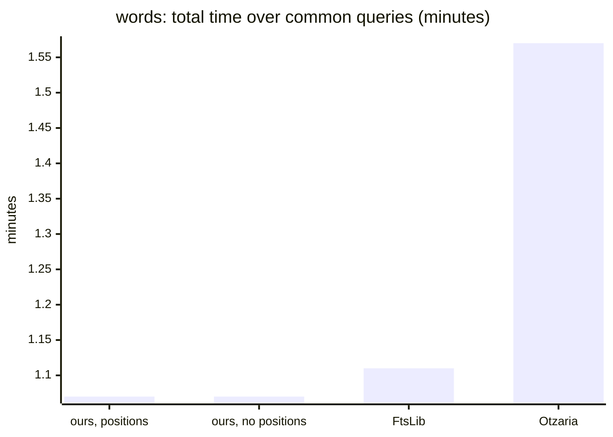

_Bars in order: bar 1 = total._

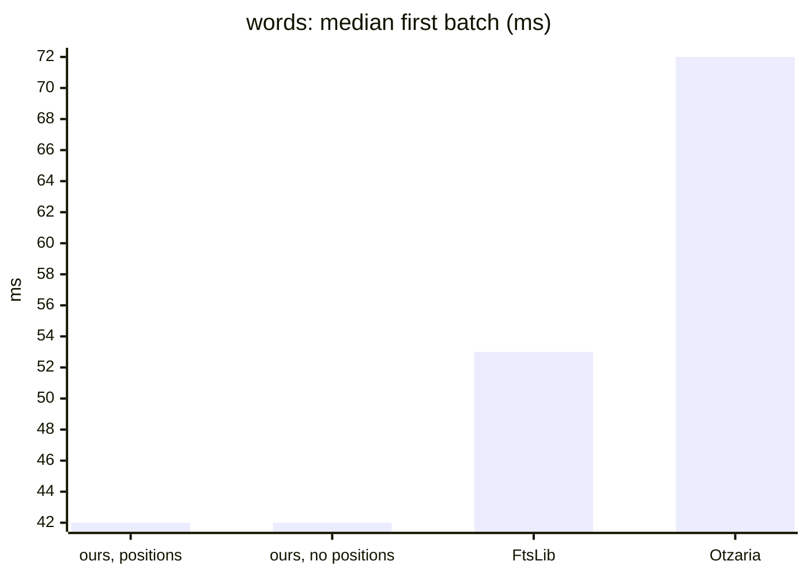

_Bars in order: bar 1 = first._

```mermaid
xychart-beta
    title "words: total per query (minutes)"
    x-axis ["q1", "q2", "q3", "q4", "q5", "q6", "q7", "q8", "q9", "q10", "q11", "q12", "q13", "q14"]
    y-axis "minutes"
    bar [0.01, 0.01, 0.05, 0.04, 0.01, 0.00, 0.00, 0.00, 0.00, 0.00, 0.00, 0.90, 0.05, 0.00]
    bar [0.01, 0.01, 0.05, 0.04, 0.01, 0.00, 0.00, 0.00, 0.00, 0.00, 0.00, 0.90, 0.05, 0.00]
    bar [0.01, 0.01, 0.05, 0.05, 0.01, 0.00, 0.00, 0.00, 0.00, 0.00, 0.01, 0.91, 0.05, 0.00]
    bar [0.05, 0.01, 0.05, 0.24, 0.01, 0.00, 0.00, 0.00, 0.00, 0.00, 0.00, 1.18, 0.02, 0.00]
```

_Bars in order: bar 1 = ours, positions / bar 2 = ours, no positions / bar 3 = FtsLib / bar 4 = Otzaria._

Per query, each stage

| q | Query | Engine | Hits | Walks + collect | Host | First batch | Total |
|---|---|---|---|---|---|---|---|
| q1 | `ה' אלהים`  | ours, positions | 28,858 | 3 ms | 674 ms | 41 ms | 677 ms |
| q1 | `ה' אלהים`  | ours, no positions | 28,858 | 3 ms | 686 ms | 41 ms | 689 ms |
| q1 | `ה' אלהים`  | FtsLib | 28,858 | n/a | 849 ms | 55 ms | 849 ms |
| q1 | `ה' אלהים`  | Otzaria | 29,503 | n/a | n/a | 72 ms | 0.05 min |
| q2 | `ר' עקיבא` 0 | ours, positions | 10,076 | 2 ms | 417 ms | 38 ms | 419 ms |
| q2 | `ר' עקיבא` 0 | ours, no positions | 10,076 | 2 ms | 432 ms | 38 ms | 434 ms |
| q2 | `ר' עקיבא` 0 | FtsLib | 10,076 | n/a | 606 ms | 53 ms | 606 ms |
| q2 | `ר' עקיבא` 0 | Otzaria | 10,032 | n/a | n/a | 30 ms | 830 ms |
| q3 | `אמר ר` 0 | ours, positions | 36,421 | 7 ms | 0.05 min | 42 ms | 0.05 min |
| q3 | `אמר ר` 0 | ours, no positions | 36,421 | 7 ms | 0.05 min | 42 ms | 0.05 min |
| q3 | `אמר ר` 0 | FtsLib | 36,421 | n/a | 0.05 min | 52 ms | 0.05 min |
| q3 | `אמר ר` 0 | Otzaria | 36,317 | n/a | n/a | 33 ms | 0.05 min |
| q4 | `ב ג`  | ours, positions | 121,347 | 8 ms | 0.04 min | 43 ms | 0.04 min |
| q4 | `ב ג`  | ours, no positions | 121,347 | 8 ms | 0.04 min | 43 ms | 0.04 min |
| q4 | `ב ג`  | FtsLib | 121,347 | n/a | 0.05 min | 51 ms | 0.05 min |
| q4 | `ב ג`  | Otzaria | 141,207 | n/a | n/a | 94 ms | 0.24 min |
| q5 | `משה אהרן` 1 | ours, positions | 3,517 | 2 ms | 394 ms | 38 ms | 396 ms |
| q5 | `משה אהרן` 1 | ours, no positions | 3,517 | 2 ms | 402 ms | 38 ms | 404 ms |
| q5 | `משה אהרן` 1 | FtsLib | 3,517 | n/a | 589 ms | 50 ms | 589 ms |
| q5 | `משה אהרן` 1 | Otzaria | 3,046 | n/a | n/a | 132 ms | 317 ms |
| q6 | `משה ו אהרן` 0 | ours, positions | 1 | 2 ms | 145 ms | 121 ms | 147 ms |
| q6 | `משה ו אהרן` 0 | ours, no positions | 1 | 2 ms | 147 ms | 122 ms | 149 ms |
| q6 | `משה ו אהרן` 0 | FtsLib | 1 | n/a | 281 ms | 232 ms | 281 ms |
| q6 | `משה ו אהרן` 0 | Otzaria | 1 | n/a | n/a | 12 ms | 12 ms |
| q7 | `פרק 1`  | ours, positions | 4,311 | 2 ms | 76 ms | 42 ms | 78 ms |
| q7 | `פרק 1`  | ours, no positions | 4,311 | 2 ms | 77 ms | 42 ms | 79 ms |
| q7 | `פרק 1`  | FtsLib | 4,311 | n/a | 121 ms | 58 ms | 121 ms |
| q7 | `פרק 1`  | Otzaria | 1,516 | n/a | n/a | 78 ms | 198 ms |
| q8 | `סימן 12`  | ours, positions | 279 | 1 ms | 40 ms | 39 ms | 41 ms |
| q8 | `סימן 12`  | ours, no positions | 279 | 1 ms | 40 ms | 39 ms | 41 ms |
| q8 | `סימן 12`  | FtsLib | 279 | n/a | 60 ms | 57 ms | 60 ms |
| q8 | `סימן 12`  | Otzaria | 147 | n/a | n/a | 149 ms | 151 ms |
| q9 | `דף 2 עמוד` 1 | ours, positions | 0 | 2 ms | 30 ms | n/a | 32 ms |
| q9 | `דף 2 עמוד` 1 | ours, no positions | 0 | 2 ms | 31 ms | n/a | 33 ms |
| q9 | `דף 2 עמוד` 1 | FtsLib | 0 | n/a | 45 ms | n/a | 45 ms |
| q9 | `דף 2 עמוד` 1 | Otzaria | 0 | n/a | n/a | 118 ms | 117 ms |
| q10 | `ב5`  | ours, positions | 2 | 1 ms | 33 ms | 33 ms | 34 ms |
| q10 | `ב5`  | ours, no positions | 2 | 1 ms | 34 ms | 34 ms | 35 ms |
| q10 | `ב5`  | FtsLib | 2 | n/a | 43 ms | 43 ms | 43 ms |
| q10 | `ב5`  | Otzaria | 2 | n/a | n/a | 8 ms | 9 ms |
| q11 | `12*`  | ours, positions | 14,932 | 2 ms | 274 ms | 39 ms | 276 ms |
| q11 | `12*`  | ours, no positions | 14,932 | 2 ms | 274 ms | 39 ms | 276 ms |
| q11 | `12*`  | FtsLib | 14,932 | n/a | 381 ms | 58 ms | 381 ms |
| q12 | `א~1`  | ours, positions | 4,790,204 | 93 ms | 0.90 min | 226 ms | 0.90 min |
| q12 | `א~1`  | ours, no positions | 4,790,204 | 138 ms | 0.90 min | 269 ms | 0.90 min |
| q12 | `א~1`  | FtsLib | 4,790,204 | n/a | 0.91 min | 71 ms | 0.91 min |
| q12 | `א~1`  | Otzaria | 4,789,497 | n/a | n/a | 27 ms | 1.18 min |
| q13 | `אמר ה` 2 | ours, positions | 23,248 | 10 ms | 0.05 min | 43 ms | 0.05 min |
| q13 | `אמר ה` 2 | ours, no positions | 23,248 | 10 ms | 0.05 min | 43 ms | 0.05 min |
| q13 | `אמר ה` 2 | FtsLib | 23,248 | n/a | 0.05 min | 49 ms | 0.05 min |
| q13 | `אמר ה` 2 | Otzaria | 16,226 | n/a | n/a | 74 ms | 0.02 min |
| q14 | `ס"ק 3` 0 | ours, positions | 1 | 1 ms | 52 ms | 53 ms | 53 ms |
| q14 | `ס"ק 3` 0 | ours, no positions | 1 | 1 ms | 52 ms | 53 ms | 53 ms |
| q14 | `ס"ק 3` 0 | FtsLib | 1 | n/a | 83 ms | 83 ms | 83 ms |
| q14 | `ס"ק 3` 0 | Otzaria | 1 | n/a | n/a | 11 ms | 11 ms |

### queries-rules.txt (21)

| Engine | Queries run | Total (sum) | Median per query | First batch median | Slowest query |
|---|---|---|---|---|---|
| ours, positions | 21 | 0.46 min | 450 ms | 39 ms | q15: 0.11 min |
| ours, no positions | 21 | 0.48 min | 459 ms | 40 ms | q15: 0.12 min |
| FtsLib | 21 | 0.52 min | 619 ms | 55 ms | q15: 0.11 min |
| Otzaria | 21 | 0.46 min | 135 ms | 17 ms | q14: 0.10 min |

Over the 21 queries every engine ran:

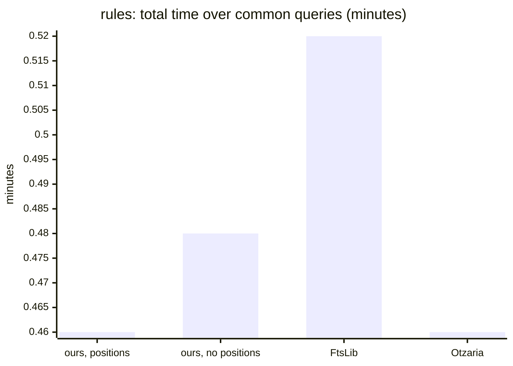

_Bars in order: bar 1 = total._

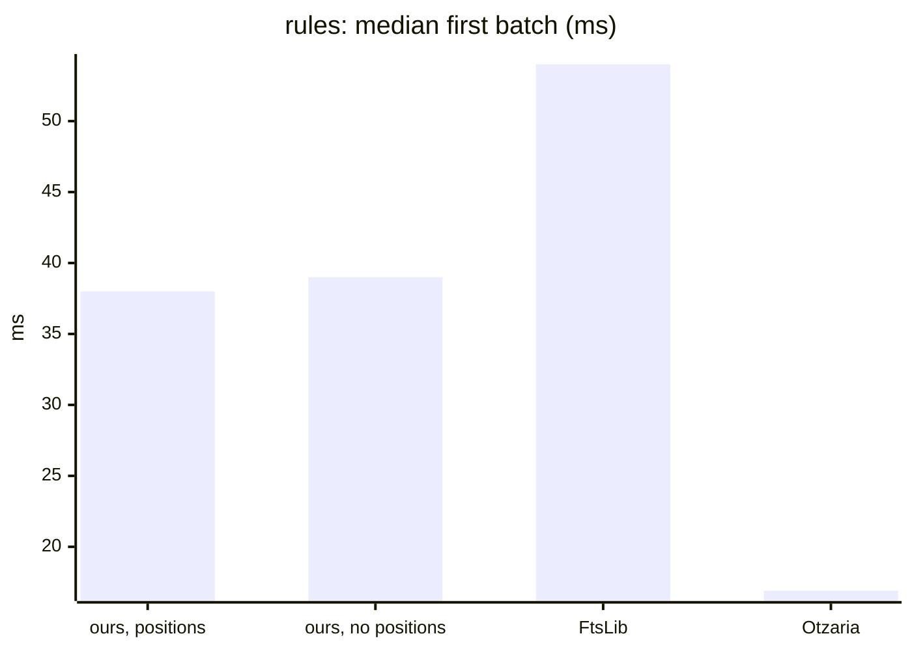

_Bars in order: bar 1 = first._

```mermaid
xychart-beta
    title "rules: total per query (minutes)"
    x-axis ["q1", "q2", "q3", "q4", "q5", "q6", "q7", "q8", "q9", "q10", "q11", "q12", "q13", "q14", "q15", "q16", "q17", "q18", "q19", "q20", "q21"]
    y-axis "minutes"
    bar [0.06, 0.06, 0.02, 0.02, 0.01, 0.00, 0.00, 0.00, 0.00, 0.00, 0.03, 0.02, 0.02, 0.08, 0.11, 0.00, 0.02, 0.00, 0.00, 0.00, 0.00]
    bar [0.06, 0.06, 0.02, 0.02, 0.01, 0.00, 0.00, 0.00, 0.00, 0.00, 0.04, 0.02, 0.02, 0.08, 0.12, 0.00, 0.02, 0.00, 0.00, 0.00, 0.00]
    bar [0.06, 0.06, 0.02, 0.02, 0.01, 0.00, 0.00, 0.00, 0.00, 0.00, 0.04, 0.03, 0.03, 0.09, 0.11, 0.00, 0.02, 0.00, 0.00, 0.00, 0.00]
    bar [0.08, 0.08, 0.02, 0.02, 0.00, 0.00, 0.00, 0.00, 0.00, 0.00, 0.04, 0.03, 0.05, 0.10, 0.00, 0.00, 0.02, 0.00, 0.00, 0.00, 0.00]
```

_Bars in order: bar 1 = ours, positions / bar 2 = ours, no positions / bar 3 = FtsLib / bar 4 = Otzaria._

Per query, each stage

| q | Query | Engine | Hits | Walks + collect | Host | First batch | Total |
|---|---|---|---|---|---|---|---|
| q1 | `ע.ש`  | ours, positions | 262,656 | 5 ms | 0.06 min | 44 ms | 0.06 min |
| q1 | `ע.ש`  | ours, no positions | 262,656 | 5 ms | 0.06 min | 44 ms | 0.06 min |
| q1 | `ע.ש`  | FtsLib | 262,656 | n/a | 0.06 min | 55 ms | 0.06 min |
| q1 | `ע.ש`  | Otzaria | 262,505 | n/a | n/a | 17 ms | 0.08 min |
| q2 | `עש`  | ours, positions | 262,656 | 5 ms | 0.06 min | 44 ms | 0.06 min |
| q2 | `עש`  | ours, no positions | 262,656 | 5 ms | 0.06 min | 44 ms | 0.06 min |
| q2 | `עש`  | FtsLib | 262,656 | n/a | 0.06 min | 55 ms | 0.06 min |
| q2 | `עש`  | Otzaria | 262,505 | n/a | n/a | 17 ms | 0.08 min |
| q3 | `א.ב`  | ours, positions | 53,043 | 2 ms | 0.02 min | 40 ms | 0.02 min |
| q3 | `א.ב`  | ours, no positions | 53,043 | 2 ms | 0.02 min | 40 ms | 0.02 min |
| q3 | `א.ב`  | FtsLib | 53,043 | n/a | 0.02 min | 55 ms | 0.02 min |
| q3 | `א.ב`  | Otzaria | 53,023 | n/a | n/a | 16 ms | 0.02 min |
| q4 | `וי[א]מר`  | ours, positions | 67,786 | 2 ms | 0.02 min | 38 ms | 0.02 min |
| q4 | `וי[א]מר`  | ours, no positions | 67,786 | 2 ms | 0.02 min | 40 ms | 0.02 min |
| q4 | `וי[א]מר`  | FtsLib | 67,786 | n/a | 0.02 min | 49 ms | 0.02 min |
| q4 | `וי[א]מר`  | Otzaria | 67,781 | n/a | n/a | 10 ms | 0.02 min |
| q5 | `ויאמר‏ משה` 0 | ours, positions | 3,577 | 2 ms | 448 ms | 38 ms | 450 ms |
| q5 | `ויאמר‏ משה` 0 | ours, no positions | 3,577 | 2 ms | 457 ms | 39 ms | 459 ms |
| q5 | `ויאמר‏ משה` 0 | FtsLib | 3,577 | n/a | 619 ms | 53 ms | 619 ms |
| q5 | `ויאמר‏ משה` 0 | Otzaria | 3,174 | n/a | n/a | 26 ms | 203 ms |
| q6 | `the`  | ours, positions | 1,412 | 1 ms | 45 ms | 37 ms | 46 ms |
| q6 | `the`  | ours, no positions | 1,412 | 1 ms | 46 ms | 38 ms | 47 ms |
| q6 | `the`  | FtsLib | 1,412 | n/a | 76 ms | 55 ms | 76 ms |
| q6 | `the`  | Otzaria | 1,411 | n/a | n/a | 13 ms | 20 ms |
| q7 | `torah`  | ours, positions | 20 | 1 ms | 34 ms | 34 ms | 35 ms |
| q7 | `torah`  | ours, no positions | 20 | 1 ms | 36 ms | 36 ms | 37 ms |
| q7 | `torah`  | FtsLib | 20 | n/a | 43 ms | 43 ms | 43 ms |
| q7 | `torah`  | Otzaria | 20 | n/a | n/a | 9 ms | 9 ms |
| q8 | `de la`  | ours, positions | 3 | 1 ms | 30 ms | 31 ms | 31 ms |
| q8 | `de la`  | ours, no positions | 3 | 1 ms | 31 ms | 31 ms | 32 ms |
| q8 | `de la`  | FtsLib | 3 | n/a | 41 ms | 41 ms | 41 ms |
| q8 | `de la`  | Otzaria | 2 | n/a | n/a | 117 ms | 117 ms |
| q9 | `בabc`  | ours, positions | 0 | 1 ms | 22 ms | n/a | 23 ms |
| q9 | `בabc`  | ours, no positions | 0 | 1 ms | 22 ms | n/a | 23 ms |
| q9 | `בabc`  | FtsLib | 0 | n/a | 28 ms | n/a | 28 ms |
| q9 | `בabc`  | Otzaria | 0 | n/a | n/a | 8 ms | 8 ms |
| q10 | `και`  | ours, positions | 0 | 0 ms | 22 ms | n/a | 23 ms |
| q10 | `και`  | ours, no positions | 0 | 1 ms | 23 ms | n/a | 24 ms |
| q10 | `και`  | FtsLib | 0 | n/a | 28 ms | n/a | 28 ms |
| q10 | `και`  | Otzaria | 0 | n/a | n/a | 8 ms | 8 ms |
| q11 | `תוס'`  | ours, positions | 151,435 | 3 ms | 0.03 min | 38 ms | 0.03 min |
| q11 | `תוס'`  | ours, no positions | 151,435 | 3 ms | 0.04 min | 39 ms | 0.04 min |
| q11 | `תוס'`  | FtsLib | 151,435 | n/a | 0.04 min | 52 ms | 0.04 min |
| q11 | `תוס'`  | Otzaria | 151,267 | n/a | n/a | 17 ms | 0.04 min |
| q12 | `תוס' ד״ה` 2 | ours, positions | 42,513 | 4 ms | 0.02 min | 40 ms | 0.02 min |
| q12 | `תוס' ד״ה` 2 | ours, no positions | 42,513 | 4 ms | 0.02 min | 41 ms | 0.02 min |
| q12 | `תוס' ד״ה` 2 | FtsLib | 42,513 | n/a | 0.03 min | 54 ms | 0.03 min |
| q12 | `תוס' ד״ה` 2 | Otzaria | 42,331 | n/a | n/a | 53 ms | 0.03 min |
| q13 | `ר' יוחנן` 0 | ours, positions | 39,258 | 4 ms | 0.02 min | 40 ms | 0.02 min |
| q13 | `ר' יוחנן` 0 | ours, no positions | 39,258 | 4 ms | 0.02 min | 40 ms | 0.02 min |
| q13 | `ר' יוחנן` 0 | FtsLib | 39,258 | n/a | 0.03 min | 53 ms | 0.03 min |
| q13 | `ר' יוחנן` 0 | Otzaria | 39,111 | n/a | n/a | 32 ms | 0.05 min |
| q14 | `רש”י`  | ours, positions | 318,664 | 6 ms | 0.08 min | 46 ms | 0.08 min |
| q14 | `רש”י`  | ours, no positions | 318,664 | 6 ms | 0.08 min | 45 ms | 0.08 min |
| q14 | `רש”י`  | FtsLib | 318,664 | n/a | 0.09 min | 56 ms | 0.09 min |
| q14 | `רש”י`  | Otzaria | 317,069 | n/a | n/a | 15 ms | 0.10 min |
| q15 | `ז’ל`  | ours, positions | 450,405 | 8 ms | 0.11 min | 47 ms | 0.11 min |
| q15 | `ז’ל`  | ours, no positions | 450,405 | 8 ms | 0.12 min | 47 ms | 0.12 min |
| q15 | `ז’ל`  | FtsLib | 450,405 | n/a | 0.11 min | 54 ms | 0.11 min |
| q15 | `ז’ל`  | Otzaria | 32 | n/a | n/a | 12 ms | 13 ms |
| q16 | `רמב”ם הלכות` 3 | ours, positions | 1,498 | 1 ms | 99 ms | 42 ms | 100 ms |
| q16 | `רמב”ם הלכות` 3 | ours, no positions | 1,498 | 1 ms | 99 ms | 41 ms | 100 ms |
| q16 | `רמב”ם הלכות` 3 | FtsLib | 1,498 | n/a | 173 ms | 55 ms | 173 ms |
| q16 | `רמב”ם הלכות` 3 | Otzaria | 1,445 | n/a | n/a | 27 ms | 92 ms |
| q17 | `שׂלום`  | ours, positions | 52,386 | 2 ms | 942 ms | 39 ms | 944 ms |
| q17 | `שׂלום`  | ours, no positions | 52,386 | 2 ms | 994 ms | 39 ms | 996 ms |
| q17 | `שׂלום`  | FtsLib | 52,386 | n/a | 0.02 min | 57 ms | 0.02 min |
| q17 | `שׂלום`  | Otzaria | 52,366 | n/a | n/a | 14 ms | 0.02 min |
| q18 | `(הוצא) [היצא]`  | ours, positions | 229 | 1 ms | 39 ms | 39 ms | 40 ms |
| q18 | `(הוצא) [היצא]`  | ours, no positions | 229 | 1 ms | 39 ms | 40 ms | 40 ms |
| q18 | `(הוצא) [היצא]`  | FtsLib | 229 | n/a | 58 ms | 58 ms | 58 ms |
| q18 | `(הוצא) [היצא]`  | Otzaria | 229 | n/a | n/a | 20 ms | 19 ms |
| q19 | `היצא אותם` 1 | ours, positions | 1 | 1 ms | 31 ms | 32 ms | 32 ms |
| q19 | `היצא אותם` 1 | ours, no positions | 1 | 1 ms | 32 ms | 32 ms | 33 ms |
| q19 | `היצא אותם` 1 | FtsLib | 1 | n/a | 45 ms | 45 ms | 45 ms |
| q19 | `היצא אותם` 1 | Otzaria | 1 | n/a | n/a | 90 ms | 90 ms |
| q20 | `משה אאאאאאאאאאאאאאאאאאאאאאאאאאאאאאאאאאאאאאאאאאאאאאאאאאאאאאאאאאאאאאאא רבנו` 1 | ours, positions | 2,039 | 1 ms | 145 ms | 37 ms | 146 ms |
| q20 | `משה אאאאאאאאאאאאאאאאאאאאאאאאאאאאאאאאאאאאאאאאאאאאאאאאאאאאאאאאאאאאאאאא רבנו` 1 | ours, no positions | 2,039 | 1 ms | 148 ms | 38 ms | 149 ms |
| q20 | `משה אאאאאאאאאאאאאאאאאאאאאאאאאאאאאאאאאאאאאאאאאאאאאאאאאאאאאאאאאאאאאאאא רבנו` 1 | FtsLib | 2,039 | n/a | 242 ms | 56 ms | 242 ms |
| q20 | `משה אאאאאאאאאאאאאאאאאאאאאאאאאאאאאאאאאאאאאאאאאאאאאאאאאאאאאאאאאאאאאאאא רבנו` 1 | Otzaria | 0 | n/a | n/a | 10 ms | 10 ms |
| q21 | `משה רבנו` 0 | ours, positions | 2,003 | 1 ms | 144 ms | 37 ms | 145 ms |
| q21 | `משה רבנו` 0 | ours, no positions | 2,003 | 1 ms | 148 ms | 37 ms | 149 ms |
| q21 | `משה רבנו` 0 | FtsLib | 2,003 | n/a | 249 ms | 56 ms | 249 ms |
| q21 | `משה רבנו` 0 | Otzaria | 1,617 | n/a | n/a | 28 ms | 135 ms |

## Snippets from positions

Snippet location from the index positions (`locate_lines`) against the text path, on an index with positions: median of 15 runs, first 4000 hits, 8 cores. The per-batch cost rule keeps the text path where reading positions would cost more.

| Query | Text path | From positions | Saved |
|---|---|---|---|
| two words | 23 ms | 20 ms | 16% |
| two words, distance 0 | 23 ms | 19 ms | 18% |
| two words, proximity | 25 ms | 20 ms | 19% |
| wildcard both sides | 20 ms | 15 ms | 24% |
| fuzzy ~1 | 20 ms | 15 ms | 23% |
| three words | text path (no change) | | |
| one common word | text path (no change) | | |
| prefixes + suffixes | text path (no change) | | |
| capped wildcard | text path (no change) | | |

## Where each engine is slower, and why

Measured on the run above: Apple M4 (10 cores, 16 GB), macOS, `seforim.db` of Zayit (7,019,636 lines in the index),
`tantivy11` / `fts9`, timings are medians of 3 runs after a warm-up, every run in a fresh process. Units: ms below one
second, minutes otherwise. "Equal hits" means the engines returned the same hit count (within 1%), so they did the same
work. Where a cause is an inference and not a measurement, the text says so.

### Summary

| Stage | Slower | Numbers | Why | Evidence |
|---|---|---|---|---|
| Index build | ours (positions) vs FtsLib and Otzaria | 3.48 min vs 1.95 min (FtsLib) and 1.42 min (Otzaria); no positions 2.82 min | ours merges to one segment (0.90 min, 26% of the build) and Otzaria's index is not merged; positions add 0.66 min | build logs (indexing 2.56 min, merge 0.90 min) |
| Index size | ours (positions) vs FtsLib | 1,585.5 MB vs 738.1 MB (FtsLib); Otzaria 1,886.0 MB | the positions file `.pos` is 704.6 MB (44%); without positions ours is 711.7 MB, on par with FtsLib | build logs, per-file sizes |
| First batch (first 256 hits) | ours vs Otzaria; ours is faster than FtsLib | median over each set (ours / Otzaria / FtsLib): large 41 / 17 / 56 ms, rules 39 / 17 / 55 ms; the words set is the exception: 42 / 72 / 55 ms | (a) the first search of a fresh process pays the SQLite corpus open, JIT and first FFI call, and our clock starts before them while the Otzaria driver's clock starts after it opened its index; (b) the first page waits until every hit is collected, so it grows with the hit count | see "First batch" below |
| Total, small result sets (up to 1,000 hits, equal hits) | ours vs Otzaria; ours is faster than FtsLib | median 32-44 ms vs 9-12 ms (Otzaria) vs 43-64 ms (FtsLib) | the same fixed first-search cost; there is almost no work left | rules q9 (0 hits): 23 ms vs 8 ms; words q10 (2 hits): 34 ms vs 9 ms |
| Total, mid result sets (15-40k hits, equal hits) | no consistent direction | `רמב"ן` 477 ms vs Otzaria 401 ms (+19%), `רמב"ם` 637 vs 597 (+7%), `ירושלים` 556 vs 604 (ours faster), `אלקים` 679 vs 706 (ours faster) | the host stage (text fetch from SQLite, locate, widening) is 99.7% of our total; Otzaria keeps the text in its index (inference: no stage split exists for Otzaria) | search reports |
| Total, large result sets (200k+ hits, equal hits) | Otzaria | over the 28 equal-hit queries of the large set: ours 1.97 min (19.1 µs/hit), FtsLib 2.13 min (20.6 µs/hit), Otzaria 3.27 min (31.6 µs/hit) | ours is the fastest here | search reports |
| Several words with a distance | ours (and FtsLib) vs Otzaria | `משה אהרן` 0: 409 ms vs 59 ms; `משה אהרן` 3: 403 vs 314 ms; `שמע ישראל` 0: 547 vs 341 ms; `אמר ה` 2: 0.05 min vs 0.02 min | (a) not the same work: Otzaria's advanced mode is ordered, ours here is unordered (662 vs 587, 5,593 vs 4,424, 5,656 vs 5,463, 23,248 vs 16,226 hits); (b) the host path fetches and checks the text of every candidate line instead of using the positions | see "Distance queries" below |
| Fuzzy `~1` / `~2` on very broad words | ours (no positions) vs FtsLib, first batch | `שבת~1`: 138 ms vs 80 ms; `רש"י~1`: 125 vs 76 ms; `א~1` (4.79M hits): 226 ms (positions) / 269 ms (no positions) vs 71 ms | the walk plus collecting every hit of a very broad fuzzy expansion; totals are equal or better than FtsLib | cause of the positions / no-positions gap not isolated (re-measured in process: collect 63-240 ms, noisy) |

Where our totals are lower than the others: against FtsLib the median of the per-query total ratio (ours, positions / FtsLib) is
large 0.84, words 0.72, rules 0.78, and no query is slower on the positions index (0 of 96); on the no-positions index three are
slightly slower (large q1 and q55 by 0.1% and 1%, rules q15 by 6%). Against Otzaria: the 28 large-set queries with equal hits
(0.60 of its time).

Not slower, only different: `ז’ל` (curly quote) returns 450,405 hits in the benchmark's FtsLib-rules path (the same count as `זל`,
the curly quote is ignorable there) and 32 in Otzaria, which the engine called directly with a plain request also gives (32); `רש"י~1` returns 1,123,320 hits in ours and 550,524 in Otzaria (Otzaria's fuzzy
semantics differ), so Otzaria's lower total there (0.33 min vs 0.40 min) is half the work.

### First batch

The two tools time the first batch differently (see the README of `tools/bench`): ours starts the clock before the search
call of a fresh process, Otzaria's driver opens its index and configures its line source first. Findings:

1. A fixed cost per fresh process, independent of the query. A zero-hit query takes 23 ms in ours (8 ms Otzaria, 28 ms
   FtsLib) and a 2-hit query 33 ms (8 / 43 ms). In one process the same searches repeated take 1 ms (0 hits), 1 ms (2 hits)
   and 3-5 ms for a 4,222-hit word, so the cost is the first search of a process (SQLite corpus open, JIT, first FFI
   call) and not the engine.
2. A cost that grows with the hit count, warm in process: first batch 4-8 ms for 25,268 hits, 30-35 ms for 230,328 hits and
   44-48 ms for 798,997 hits, while the engine's collect is 1, 5 and 17-34 ms. The first page is produced only after
   all hits are collected and listed (Otzaria answers a top-K query); the rest of the growth is the work around the
   collect, not separated further (no per-stage counter for it).
3. Compared per query (more than 10% and more than 5 ms apart), ours is slower than Otzaria on the first batch in 28 of the 43
   large-set queries and in 16 of 19 rules queries; against FtsLib it is never slower on the positions index (0 of 61, 0 of 19)
   and slower on 5 of 61 on the no-positions index (large q1, q41 with 1.03M hits, and the fuzzy q53-q55). In the words set the Otzaria median is higher
   than ours (72 ms vs 42 ms), because its first page for several words takes up to 149 ms (words q5 132 ms, q8 149 ms).

The earlier table of this section (a Windows profile on `tantivy9`: first batch 350-420 ms for a 802,677-hit word, Otzaria 55-110 ms)
listed a pooled SQLite corpus and a pre-sorted index as built but not yet measured; they are in this run's index and host, and the
first batch is now 41 ms (median, large set). It is another machine and DB, so the two are not a like-for-like before / after.

Proposed, not done (the runbook forbids engine changes without the user's OK): start the first page from a top-K pass
and build the full hit list lazily; time the first batch the same way in both tools (clock after the index is open) so
the comparison measures the engine only.

### Distance queries

For `משה אהרן` with distance 0, 1 and 3 the engine returns the same 14,606 candidate lines (every line holding both
words) and the host fetches 14,621 line texts to check the distance on the text (cold: 158 ms in the locate batches; the
whole host stage 394-407 ms), although the final hits are only 662, 3,517 and 5,593. That is 22 times more texts than hits.
The host path is the same on the positions and the no-positions index (host 407 ms vs 397 ms), so the positions index does
not help this path. FtsLib (`detail=none`, no positions either) does the same work and needs 578 ms; ours is 30% faster
than FtsLib but slower than Otzaria.

The engine's own span query (the path of the hit-count comparison: ordered, gaps, cross-line) answers the same questions
in 11-14 ms and gets Otzaria's counts within 2 hits (ours / Otzaria: 587 / 587, 4,423 / 4,424, 5,465 / 5,463) - but it counts only and
no text is read, so the figures are not a total. Proposed, not done: route distance queries of the host searcher through the
span path when the index has positions, and read text only for the final hits.

## Hit-count comparison with Otzaria

Every query Otzaria ran (`otz_report.py`: one word = exact, several words = advanced with the TAB distance or 1000, `w~k` = fuzzy), against ours on the positions index (tantivy11) with Otzaria-mode options: one word plain; several words `proximity: ordered, gaps = distance` and `cross_line: true` (Otzaria's advanced mode is ordered and crosses one line break); fuzzy with `ignore_quotes: true` (Otzaria's quote is transparent). Hits = matching lines. Each difference was diffed line by line (Otzaria book+segment mapped to line ids), sample lines read, and every differing line tagged by cause (scratchpad `hc_diff.py`, `hc_class.py`, `hc_fz.py`, logs `hc-*.log`).

| Class | Queries |
|---|---|
| Otzaria bug | 30 |
| mixed | 19 |
| equal | 19 |
| deliberate deviation | 5 |
| our bug | 2 |
| not equivalent query | 1 |

### queries-large.txt (61)

| q | Query | Otzaria mode | Otzaria hits | Ours hits | Diff | Class | Reason |
|---|---|---|---|---|---|---|---|
| q1 | `אמר`  | exact | 798,923 | 798,997 | +74 | Otzaria bug | 74 ours-only lines: a footnote marker is glued to the word by Otzaria's tag stripping (`5word`, `word.5`; Otzaria's rule replayed line by line) |
| q2 | `תורה`  | exact | 230,198 | 230,328 | +130 | Otzaria bug | 130 ours-only lines: a footnote marker is glued to the word by Otzaria's tag stripping (`5word`, `word.5`; Otzaria's rule replayed line by line) |
| q3 | `ישראל`  | exact | 435,869 | 436,031 | +162 | Otzaria bug | 162 ours-only lines: a footnote marker is glued to the word by Otzaria's tag stripping (`5word`, `word.5`; Otzaria's rule replayed line by line) |
| q4 | `שבת`  | exact | 226,121 | 226,218 | +97 | Otzaria bug | 97 ours-only lines: a footnote marker is glued to the word by Otzaria's tag stripping (`5word`, `word.5`; Otzaria's rule replayed line by line) |
| q5 | `מצוה`  | exact | 167,636 | 167,705 | +69 | Otzaria bug | 69 ours-only lines: a footnote marker is glued to the word by Otzaria's tag stripping (`5word`, `word.5`; Otzaria's rule replayed line by line) |
| q6 | `פסח`  | exact | 54,648 | 54,709 | +61 | Otzaria bug | 61 ours-only lines: a footnote marker is glued to the word by Otzaria's tag stripping (`5word`, `word.5`; Otzaria's rule replayed line by line) |
| q7 | `ירושלים`  | exact | 25,251 | 25,268 | +17 | Otzaria bug | 17 ours-only lines: a footnote marker is glued to the word by Otzaria's tag stripping (`5word`, `word.5`; Otzaria's rule replayed line by line) |
| q8 | `אלקים`  | exact | 34,842 | 34,846 | +4 | Otzaria bug | 4 ours-only lines: a footnote marker is glued to the word by Otzaria's tag stripping (`5word`, `word.5`; Otzaria's rule replayed line by line) |
| q9 | `נבוכדנצר`  | exact | 4,221 | 4,222 | +1 | Otzaria bug | 1 ours-only lines: a footnote marker is glued to the word by Otzaria's tag stripping (`5word`, `word.5`; Otzaria's rule replayed line by line) |
| q10 | `אחשורוש`  | exact | 5,421 | 5,423 | +2 | Otzaria bug | 2 ours-only lines: a footnote marker is glued to the word by Otzaria's tag stripping (`5word`, `word.5`; Otzaria's rule replayed line by line) |
| q11 | `רש"י`  | exact | 317,069 | 317,240 | +171 | mixed | 173 ours-only lines: a footnote marker is glued to the word by Otzaria's tag stripping (`5word`, `word.5`; Otzaria's rule replayed line by line); 1422 ours-only lines: quote-free matching (ours matches the word with the query's quote missing, moved or of another kind; Otzaria needs it) |
| q12 | `רמב"ם`  | exact | 36,854 | 36,896 | +42 | mixed | 42 ours-only lines: a footnote marker is glued to the word by Otzaria's tag stripping (`5word`, `word.5`; Otzaria's rule replayed line by line); 56 ours-only lines: quote-free matching (ours matches the word with the query's quote missing, moved or of another kind; Otzaria needs it) |
| q13 | `רמב"ן`  | exact | 15,893 | 15,910 | +17 | mixed | 17 ours-only lines: a footnote marker is glued to the word by Otzaria's tag stripping (`5word`, `word.5`; Otzaria's rule replayed line by line); 20 ours-only lines: quote-free matching (ours matches the word with the query's quote missing, moved or of another kind; Otzaria needs it) |
| q14 | `ז"ל`  | exact | 449,710 | 449,910 | +200 | mixed | 200 ours-only lines: a footnote marker is glued to the word by Otzaria's tag stripping (`5word`, `word.5`; Otzaria's rule replayed line by line); 495 ours-only lines: quote-free matching (ours matches the word with the query's quote missing, moved or of another kind; Otzaria needs it) |
| q15 | `ע"ש`  | exact | 261,464 | 261,615 | +151 | mixed | 162 ours-only lines: a footnote marker is glued to the word by Otzaria's tag stripping (`5word`, `word.5`; Otzaria's rule replayed line by line); 1030 ours-only lines: quote-free matching (ours matches the word with the query's quote missing, moved or of another kind; Otzaria needs it) |
| q16 | `חז"ל`  | exact | 51,829 | 51,856 | +27 | mixed | 27 ours-only lines: a footnote marker is glued to the word by Otzaria's tag stripping (`5word`, `word.5`; Otzaria's rule replayed line by line); 28 ours-only lines: quote-free matching (ours matches the word with the query's quote missing, moved or of another kind; Otzaria needs it) |
| q17 | `תוס'`  | exact | 151,267 | 151,320 | +53 | mixed | 61 ours-only lines: a footnote marker is glued to the word by Otzaria's tag stripping (`5word`, `word.5`; Otzaria's rule replayed line by line); 106 ours-only lines: quote-free matching (ours matches the word with the query's quote missing, moved or of another kind; Otzaria needs it); 1 ours-only and 0 Otzaria-only lines not explained by these two causes (open; sample ids [5992919]) |
| q18 | `רמבם`  | exact | 36,910 | 36,952 | +42 | Otzaria bug | 42 ours-only lines: a footnote marker is glued to the word by Otzaria's tag stripping (`5word`, `word.5`; Otzaria's rule replayed line by line) |
| q19 | `רשי`  | exact | 318,492 | 318,664 | +172 | Otzaria bug | 172 ours-only lines: a footnote marker is glued to the word by Otzaria's tag stripping (`5word`, `word.5`; Otzaria's rule replayed line by line) |
| q20 | `זל`  | exact | 450,205 | 450,405 | +200 | Otzaria bug | 200 ours-only lines: a footnote marker is glued to the word by Otzaria's tag stripping (`5word`, `word.5`; Otzaria's rule replayed line by line) |
| q21 | `משה רבנו`  | advanced | 2,799 | 2,801 | +2 | Otzaria bug | 2 ours-only lines: a footnote marker is glued to the word by Otzaria's tag stripping (`5word`, `word.5`; Otzaria's rule replayed line by line) |
| q22 | `אברהם יצחק יעקב`  | advanced | 9,125 | 9,132 | +7 | Otzaria bug | 7 ours-only lines: a footnote marker is glued to the word by Otzaria's tag stripping (`5word`, `word.5`; Otzaria's rule replayed line by line) |
| q23 | `בית המקדש`  | advanced | 19,990 | 19,997 | +7 | Otzaria bug | 7 ours-only lines: a footnote marker is glued to the word by Otzaria's tag stripping (`5word`, `word.5`; Otzaria's rule replayed line by line) |
| q24 | `קריאת שמע`  | advanced | 7,529 | 7,530 | +1 | Otzaria bug | 1 ours-only lines: a footnote marker is glued to the word by Otzaria's tag stripping (`5word`, `word.5`; Otzaria's rule replayed line by line) |
| q25 | `תלמוד תורה`  | advanced | 8,033 | 8,037 | +4 | Otzaria bug | 4 ours-only lines: a footnote marker is glued to the word by Otzaria's tag stripping (`5word`, `word.5`; Otzaria's rule replayed line by line) |
| q26 | `עבודה זרה`  | advanced | 17,709 | 17,717 | +8 | Otzaria bug | 8 ours-only lines: a footnote marker is glued to the word by Otzaria's tag stripping (`5word`, `word.5`; Otzaria's rule replayed line by line) |
| q27 | `יום טוב`  | advanced | 41,199 | 41,210 | +11 | mixed | 10 ours-only lines: a footnote marker is glued to the word by Otzaria's tag stripping (`5word`, `word.5`; Otzaria's rule replayed line by line); 1 ours-only and 0 Otzaria-only lines not explained by these two causes (open; sample ids [697743]) |
| q28 | `ארץ ישראל`  | advanced | 31,369 | 31,389 | +20 | mixed | 15 ours-only lines: a footnote marker is glued to the word by Otzaria's tag stripping (`5word`, `word.5`; Otzaria's rule replayed line by line); 5 ours-only and 0 Otzaria-only lines not explained by these two causes (open; sample ids [3649958, 3650065, 3650217]) |
| q29 | `משה אהרן` (distance 0) | advanced | 587 | 587 | +0 | equal | same count |
| q30 | `משה אהרן` (distance 3) | advanced | 4,424 | 4,423 | -1 | our bug | cross-line: Otzaria skips line-edge enumerators like (b) / [yg] / (49), ours counts them as words (all 34 lines) | this run (tools/bench/hitdiff.py, line by line): ours-only 0 lines (footnote glue 0, unexplained 0), Otzaria-only 1 lines |
| q31 | `שמע ישראל` (distance 0) | advanced | 5,463 | 5,465 | +2 | Otzaria bug | 2 ours-only lines: a footnote marker is glued to the word by Otzaria's tag stripping (`5word`, `word.5`; Otzaria's rule replayed line by line) |
| q32 | `ויאמר משה` (distance 2) | advanced | 6,956 | 6,956 | +0 | equal | same count |
| q33 | `אמר רבי` (distance 1) | advanced | 79,821 | 79,880 | +59 | mixed | footnote marker: Otzaria glues `` to the word (word5), ours ends the word at `` (FtsLib rule) (+86); cross-line: Otzaria skips line-edge enumerators like (b) / [yg] / (49), ours counts them as words (-2) | this run (tools/bench/hitdiff.py, line by line): ours-only 59 lines (footnote glue 29, unexplained 30), Otzaria-only 0 lines |
| q34 | `רבי יוחנן` (distance 0) | advanced | 37,364 | 37,370 | +6 | mixed | 5 ours-only lines: a footnote marker is glued to the word by Otzaria's tag stripping (`5word`, `word.5`; Otzaria's rule replayed line by line); 1 ours-only and 0 Otzaria-only lines not explained by these two causes (open; sample ids [6918511]) |
| q35 | `רבי עקיבא` (distance 5) | advanced | 18,009 | 18,012 | +3 | mixed | footnote marker: Otzaria glues `` to the word (word5), ours ends the word at `` (FtsLib rule) (+4); cross-line: Otzaria skips line-edge enumerators like (b) / [yg] / (49), ours counts them as words (-3) | this run (tools/bench/hitdiff.py, line by line): ours-only 3 lines (footnote glue 3, unexplained 0), Otzaria-only 0 lines |
| q51 | `יצחק~1`  | fuzzy | 129,667 | 129,690 | +23 | deliberate deviation | Otzaria fuzzy is Damerau (transposition = 1 edit), ours FtsLib's plain Levenshtein (-3); footnote marker: Otzaria glues `` to the word (word5), ours ends the word at `` (FtsLib rule) (+16) |
| q52 | `ירושלים~1`  | fuzzy | 51,375 | 51,412 | +37 | deliberate deviation | Otzaria fuzzy is Damerau (transposition = 1 edit), ours FtsLib's plain Levenshtein (-1); footnote marker: Otzaria glues `` to the word (word5), ours ends the word at `` (FtsLib rule) (+25) |
| q53 | `אברהם~2`  | fuzzy | 966,449 | 966,905 | +456 | deliberate deviation | Otzaria fuzzy is Damerau (transposition = 1 edit), ours FtsLib's plain Levenshtein (-3,673); footnote marker: Otzaria glues `` to the word (word5), ours ends the word at `` (FtsLib rule) (+467) |
| q54 | `שבת~1`  | fuzzy | 869,818 | 870,344 | +526 | deliberate deviation | Otzaria fuzzy is Damerau (transposition = 1 edit), ours FtsLib's plain Levenshtein (-1,707); footnote marker: Otzaria glues `` to the word (word5), ours ends the word at `` (FtsLib rule) (+409) |
| q55 | `רש"י~1`  | fuzzy | 550,524 | 1,123,320 | +572,796 | not equivalent query | quote word: Otzaria counts the gershayim as an edit on the query, ours (ignore_quotes) measures quote-free forms (1,031,823 hits); with the quote counted ours is 555,281; rest Otzaria fuzzy is Damerau (transposition = 1 edit), ours FtsLib's plain Levenshtein |
| q59 | `תלמוד תורה כנגד כולם`  | advanced | 163 | 163 | +0 | equal | same count |
| q60 | `אלו דברים שאין להם שיעור`  | advanced | 380 | 380 | +0 | equal | same count |
| q61 | `שמע ישראל ה' אלקינו ה' אחד`  | advanced | 583 | 583 | +0 | equal | same count |

### queries-words.txt (14)

| q | Query | Otzaria mode | Otzaria hits | Ours hits | Diff | Class | Reason |
|---|---|---|---|---|---|---|---|
| q1 | `ה' אלהים`  | advanced | 29,503 | 29,514 | +11 | mixed | 7 ours-only lines: a footnote marker is glued to the word by Otzaria's tag stripping (`5word`, `word.5`; Otzaria's rule replayed line by line); 5 ours-only and 0 Otzaria-only lines not explained by these two causes (open; sample ids [350351, 3649025, 6917776]) |
| q2 | `ר' עקיבא` (distance 0) | advanced | 10,032 | 10,036 | +4 | Otzaria bug | 4 ours-only lines: a footnote marker is glued to the word by Otzaria's tag stripping (`5word`, `word.5`; Otzaria's rule replayed line by line) |
| q3 | `אמר ר` (distance 0) | advanced | 36,317 | 36,317 | +0 | equal | same count |
| q4 | `ב ג`  | advanced | 141,207 | 141,630 | +423 | our bug | cross-line: Otzaria skips line-edge enumerators like (b) / [yg] / (49), ours counts them as words: the one-letter word matches a leading enumerator letter of the next line | this run (tools/bench/hitdiff.py, line by line): ours-only 423 lines (footnote glue 382, unexplained 41), Otzaria-only 0 lines |
| q5 | `משה אהרן` (distance 1) | advanced | 3,046 | 3,046 | +0 | equal | same count |
| q6 | `משה ו אהרן` (distance 0) | advanced | 1 | 1 | +0 | equal | same count |
| q7 | `פרק 1`  | advanced | 1,516 | 1,587 | +71 | Otzaria bug | footnote marker: Otzaria glues `` to the word (word5), ours ends the word at `` (FtsLib rule) (marker digits on the next line become our cross-line hits) | this run (tools/bench/hitdiff.py, line by line): ours-only 71 lines (footnote glue 49, unexplained 22), Otzaria-only 0 lines |
| q8 | `סימן 12`  | advanced | 147 | 197 | +50 | Otzaria bug | footnote marker: Otzaria glues `` to the word (word5), ours ends the word at `` (FtsLib rule) (marker digits on the next line become our cross-line hits) | this run (tools/bench/hitdiff.py, line by line): ours-only 50 lines (footnote glue 16, unexplained 34), Otzaria-only 0 lines |
| q9 | `דף 2 עמוד` (distance 1) | advanced | 0 | 0 | +0 | equal | same count |
| q10 | `ב5`  | exact | 2 | 2 | +0 | equal | same count |
| q12 | `א~1`  | fuzzy | 4,789,497 | 4,790,204 | +707 | Otzaria bug | footnote marker: Otzaria glues `` to the word (word5), ours ends the word at `` (FtsLib rule) (not line-checked: 4.8M hits; magnitude as the other sup rows) |
| q13 | `אמר ה` (distance 2) | advanced | 16,226 | 16,231 | +5 | mixed | cross-line: Otzaria skips line-edge enumerators like (b) / [yg] / (49), ours counts them as words (29 lines, the one-letter word = an enumerator); footnote marker: Otzaria glues `` to the word (word5), ours ends the word at `` (FtsLib rule) (7) | this run (tools/bench/hitdiff.py, line by line): ours-only 6 lines (footnote glue 4, unexplained 2), Otzaria-only 1 lines |
| q14 | `ס"ק 3` (distance 0) | advanced | 1 | 1 | +0 | equal | same count |

### queries-rules.txt (21)

| q | Query | Otzaria mode | Otzaria hits | Ours hits | Diff | Class | Reason |
|---|---|---|---|---|---|---|---|
| q1 | `ע.ש`  | exact | 262,505 | 262,656 | +151 | Otzaria bug | 151 ours-only lines: a footnote marker is glued to the word by Otzaria's tag stripping (`5word`, `word.5`; Otzaria's rule replayed line by line) |
| q2 | `עש`  | exact | 262,505 | 262,656 | +151 | Otzaria bug | 151 ours-only lines: a footnote marker is glued to the word by Otzaria's tag stripping (`5word`, `word.5`; Otzaria's rule replayed line by line) |
| q3 | `א.ב`  | exact | 53,023 | 53,043 | +20 | Otzaria bug | 21 ours-only lines: a footnote marker is glued to the word by Otzaria's tag stripping (`5word`, `word.5`; Otzaria's rule replayed line by line) |
| q4 | `וי[א]מר`  | exact | 67,781 | 67,786 | +5 | Otzaria bug | 5 ours-only lines: a footnote marker is glued to the word by Otzaria's tag stripping (`5word`, `word.5`; Otzaria's rule replayed line by line) |
| q5 | `ויאמר‏ משה` (distance 0) | advanced | 3,174 | 3,174 | +0 | equal | same count |
| q6 | `the`  | exact | 1,411 | 1,412 | +1 | Otzaria bug | 1 ours-only lines: a footnote marker is glued to the word by Otzaria's tag stripping (`5word`, `word.5`; Otzaria's rule replayed line by line) |
| q7 | `torah`  | exact | 20 | 20 | +0 | equal | same count |
| q8 | `de la`  | advanced | 2 | 2 | +0 | equal | same count |
| q9 | `בabc`  | exact | 0 | 0 | +0 | equal | same count |
| q10 | `και`  | exact | 0 | 0 | +0 | equal | same count |
| q11 | `תוס'`  | exact | 151,267 | 151,320 | +53 | mixed | 61 ours-only lines: a footnote marker is glued to the word by Otzaria's tag stripping (`5word`, `word.5`; Otzaria's rule replayed line by line); 106 ours-only lines: quote-free matching (ours matches the word with the query's quote missing, moved or of another kind; Otzaria needs it); 1 ours-only and 0 Otzaria-only lines not explained by these two causes (open; sample ids [5992919]) |
| q12 | `תוס' ד״ה` (distance 2) | advanced | 42,331 | 42,336 | +5 | mixed | footnote marker: Otzaria glues `` to the word (word5), ours ends the word at `` (FtsLib rule) (+26); cross-line: Otzaria skips line-edge enumerators like (b) / [yg] / (49), ours counts them as words (-5) | this run (tools/bench/hitdiff.py, line by line): ours-only 5 lines (footnote glue 4, unexplained 1), Otzaria-only 0 lines |
| q13 | `ר' יוחנן` (distance 0) | advanced | 39,111 | 39,133 | +22 | mixed | 14 ours-only lines: a footnote marker is glued to the word by Otzaria's tag stripping (`5word`, `word.5`; Otzaria's rule replayed line by line); 8 ours-only and 0 Otzaria-only lines not explained by these two causes (open; sample ids [7426882, 7430870, 7440551]) |
| q14 | `רש”י`  | exact | 317,069 | 317,240 | +171 | mixed | 173 ours-only lines: a footnote marker is glued to the word by Otzaria's tag stripping (`5word`, `word.5`; Otzaria's rule replayed line by line); 1422 ours-only lines: quote-free matching (ours matches the word with the query's quote missing, moved or of another kind; Otzaria needs it) |
| q15 | `ז’ל`  | exact | 32 | 32 | +0 | equal | same count |
| q16 | `רמב”ם הלכות` (distance 3) | advanced | 1,445 | 1,467 | +22 | mixed | 18 ours-only lines: a footnote marker is glued to the word by Otzaria's tag stripping (`5word`, `word.5`; Otzaria's rule replayed line by line); 4 ours-only and 0 Otzaria-only lines not explained by these two causes (open; sample ids [1962692, 1967060, 1968980]) |
| q17 | `שׂלום`  | exact | 52,366 | 52,386 | +20 | Otzaria bug | 20 ours-only lines: a footnote marker is glued to the word by Otzaria's tag stripping (`5word`, `word.5`; Otzaria's rule replayed line by line) |
| q19 | `היצא אותם` (distance 1) | advanced | 1 | 1 | +0 | equal | same count |
| q20 | `משה אאאאאאאאאאאאאאאאאאאאאאאאאאאאאאאאאאאאאאאאאאאאאאאאאאאאאאאאאאאאאאאא רבנו` (distance 1) | advanced | 0 | 1,661 | +1,661 | deliberate deviation | a 128-byte word is unindexable: ours skips it and keeps its position (FtsLib/our rule), Otzaria requires it and finds nothing |
| q21 | `משה רבנו` (distance 0) | advanced | 1,617 | 1,617 | +0 | equal | same count |

**Causes, with evidence:**

- Quote-free matching (deliberate deviation, FtsLib's rule): a query word with a quote or geresh (`"`, `'`, gershayim, geresh) matches the word with the quote missing, in another place or of another kind (`ר"שי`, `רש׳י`, `רש'י`); Otzaria needs the quote of the query. Rows `large q11..q17`, `rules q11`, `rules q14` (numbers as shown): every ours-only line checked (tools/bench/hitdiff.py); with the footnote glue they account for all but a handful of lines.
- Footnote marker glue, exact numbers of this run: every ours-only line of the plain single-word rows (large q2..q10, q18..q20 and the rules rows) is a line where Otzaria's `strip_html_for_indexing` glues a `` marker to the word on either side or across punctuation (`word.30` -> `word30`, `<i>word` -> `5word`): 100% of the lines checked, no Otzaria-only line.
- Footnote markers (most rows, ours +0.02..0.1%): Otzaria removes inline tags with no separator (`strip_html_for_indexing`; `sup` is inline), so `word5` indexes as one token `word5` and the word is lost; ours ends a word at ``/`` (FtsLib's scanner rule). Every ours-only line of the exact rows has a `` (checked all; samples 8576169, 7692606, 2451902).
- Cross-line enumerators (our bug): Otzaria's `cross_line::content_range` skips a leading `(b)`, `[yg]`, `{x}` and a trailing `(49)` / `(dp"d):` when it joins two lines; ours counts them as words, so a gap is one too wide (Otzaria-only, e.g. 6175732, 6199135, 8985366) or a one-letter query word matches the enumerator (ours-only, e.g. 6172879, 6185728).
- Unterminated `<` (our bug): line 5850708 has `...ayy< rbynw...` with no `>` after it; our scanner skips to the end of the line as if in a tag, so every word after it is unindexed. Otzaria keeps the `<` and indexes the rest.
- Bare `&` (Otzaria bug): line 3760145 `Shiur & made ... pocket;` - Otzaria's entity rule `&[^;]+;` deletes everything up to the next `;`.
- Fuzzy: Otzaria builds `FuzzyTermQuery(term, d, transposition=true)`; ours keeps FtsLib's Levenshtein (named deviation). Without `ignore_quotes` ours also misses quote words such as `wyc"xq` (quote counted as an edit), which Otzaria matches by the quote-free form.
- Without `cross_line` our multi-word counts are lower by up to 39% (e.g. words q4: 87,256 vs 143,836): Otzaria's advanced mode always crosses one line break.
