# FTS specs and comparisons

_Generated by `tools/report/specs_report.py` on 2026-11-17 09:10. Kept up to date as the engine changes (see CLAUDE.md). Units: ms below one second, minutes otherwise._

Current index formats: ours `tantivy17`, FtsLib `fts14`.

## Machine

From `machine.txt` (run-all.sh detect, written by the report step).

| Item | Value |
|---|---|
| OS | windows (GitHub Actions windows-latest runner, shared: builds and speed are this runner's, all four engines measured in the same job) |
| CPU | GitHub-hosted runner (4 vCPU class) |

> **Stale results (full-DB rerun pending):**
>
> - The keep-marks build was not rebuilt (its row is the old dev-machine `tantivy9` number); every other result is from fullrun run 43815271560 (2026-11-16, `tantivy17` / `fts14`, one GitHub windows runner per job).

## Engines compared

| Engine | What it is |
|---|---|
| ours, positions | this repo: modified tantivy + hebrew-fts walks, index with positions (span queries) |
| ours, no positions | same engine, index without positions; distance/order checked on the text by the locator |
| FtsLib | KitveiHakodesh FtsLib (SQLite FTS5, `detail=none`, index fts14) |
| Otzaria | otzaria_search_engine 5babbce (tantivy), driven by tools/bench/otzaria-driver |

## Feature specs (ours)

| Feature | Status |
|---|---|
| FtsLib query syntax (`* ? % ~N \|`), results identical to FtsLib | done, parity below |
| Every option one FST walk per word, shortest first, cap per request (default 2000, 0 = none) across all segments, exact word kept, matched terms returned | done |
| Otzaria word options (grammar/advanced/Aramaic prefixes+suffixes, ktiv, part of word, typo modes, quotes); typo as Otzaria engine 7.0.1 (single-letter edits in phrases and beside other options, exact option forms first when a typo expansion overflows; issue #36) | done; Otzaria 7.0.1 cases |
| Ketiv rule sets: Otzaria's or FtsLib's KetivExpander (`ktiv_rules`) | done |
| One search options object, per-word options (negative words too), alternatives, acronyms | done |
| Divine-name placeholder spellings (issue #39): a word in one spelling of the tetragrammaton (full, U+05E7 / U+05D3 placeholders, double yod) or of Elohim (U+05E7 for U+05D4) also finds the other spellings, up to two prefixes, other-word prefix pairs excluded, always on, every literal word and quoted phrase (both engines) | done; unit tests; parity rerun pending |
| Otzaria proximity (per-pair gaps, any order), word match (all/any/most/at least N) | done |
| Otzaria tokenizer rules (one-letter words, digits, joiners, geresh, paired readings, 128-byte limit) in both engines | done |
| Vocalized matching (nikud / te'amim) as a walk on a keep-marks index (plain, wildcard and fuzzy words) | done |
| Exact totals + per-book counts, cancellation, pull streaming | done |
| Substring find (FtsLib `FindSubstringCandidates`, issue G-K1): `substring` query (every term containing each fragment, FM sidecar, no budget), `position_ranges` filter, `decline_over_cap`; C# Core-shaped coordinator (build, progress, reset, DB change, one-shot / streamed / lines search, related forms) | done; unit tests + selftest; parity on fixtures only |
| Per-book updates by seforim.db `contentHash` (delete by book, crash-safe pending record) + background full merge / repack at low priority, restarted on open (issue #29) | built; unit tests; full-DB not measured |
| Hits decided from positions during the search, streamed in batches (issue #21): exact totals with no text, word-tightest window | done |
| Non-blocking search in the packages (Dart worker isolate `SearchWorker`, also serving the index writer (#38), C# `SearchAsync` / `IAsyncEnumerable` batches) | done |
| Release rebuildable caches without closing the index (`releaseMemory`, #40) | done |
| Packaging (issue #17): C ABI version check at load (`se_abi_version`), Dart Native Assets hook (SHA-256 pinned prebuilt download / cargo / local file), NuGet RIDs win/linux/osx x64+arm64, release workflow + sync check | done |
| Resume after a catalog position (FtsLib's `afterPosition`; C# demo `PositionOfLine`, Core's `StreamSearch` with `Restarted`) | done |
| User regex `/.../` (word, sequence, line kinds) | done |
| Relevance / generation order (option; catalog default) + notice when positions are needed | done |
| Truncated flag when a cap is hit | done |
| Locate match mode: best window (default) or ALL MATCHES (whole text, every full occurrence marked, session locates; Core passes it through); find in an open text without an index (`se_find_all_matches`: words or phrase, quotes / marks options; both engines) | done; unit tests |
| Footnotes (schema 7 `line_note`) as a virtual notes book after each book; ids in a reserved 64-bit range (2^52+, JS-safe), hit maps to the source line (both engines) | done; unit tests; full-DB rerun pending |
| Cross-line phrases (one break, any search type; line-edge enumerators skipped as Otzaria) and same-section scope | built; unit tests; full-DB verification pending |
| Fuzzy: a swap of two adjacent letters is one edit (Otzaria; FtsLib changed too) | done |
| Quoted phrases (Otzaria's rule, both engines): a whole-query phrase is literal and may cross a line (ours); a phrase among words is required in the line; in lexical fuzzy mode each quoted word keeps its slot (fuzzy, forms), in order, at most 1 word between | done; unit tests; FtsLib per line only |
| Snippets from index positions (`locate_lines`, per-batch cost rule) | done |
| Morphology (Otzaria's MagicDictionary over lexical.db) as host lexicon: Dart `LexicalDb` (package `seforim_search_sqlite`) + expansion step (opt-in per word), dictionary forms as `lexical_forms` (lexical tier in relevance), blacklisted forms searched but not marked (`unmarked_alternatives` / `unmarked_lexical_forms`), per-word cap | done (Dart package host); unit tests + real lexical.db smoke test |
| Negative query defaults to the positive proximity (Otzaria's negativeDistance; `proximity_base` under a custom spacing) | done |
| Semantic search (issue #18), like Otzaria: Otzaria's downloaded vector set is the only copy (set directory: CURRENT / gen-N / `.del` / `.links`, base + delta segments, or one base `.oxv`; read-only, nothing converted or built); Otzaria's exact scan ported step for step (integer kernels i8-sym-vec / i8-sym-dim / rot192-i8i4 with the query rotated once, scalar / AVX2 / NEON bit-identical; threads half the cores, at most 8; book filter as slot ranges + extras / foreign slots; window and alias penalty 0.04; total order score, key, slot; cancellation); the host maps each book's line ordinals to its line ids, with Otzaria's text check from the raw rows (keys recomputed, rows holding a newline split, moved lines found within 16, failing records dropped and counted; one result per line); hybrid = Otzaria's hybrid session: its smart exact query's top window by BM25 (book filter; a phrase on an index without positions counted from the line texts) fused with Otzaria's semantic side (top_k = window x the profile's multiplier, a foundational-books query by share) by Otzaria's fuse_candidates under its RankingProfile (default = otzaria_search_engine's: RRF 60, threshold 0.55, foundational bonus 0.002; presets Fast / Balanced / Best, every bonus), the window doubling per page as Otzaria's (Meivin model: query embedding in the host demos) | built; unit tests (synthetic base + delta set, both codecs, kernels vs float) + local read-only runs on the real v36 rot set (10.0 M slots, ~400 ms per query, 4 threads) and the v37 QA491 i8 base (~240 ms); full-library latency on CI (vectors.yml) |
| Vector set install / verify / compaction (issue #18): the sidecar's install in the engine (`se_vectors_install`: block CRCs, header vs manifest, a delta's tombstones / duplicates / foreign links, generations written as Otzaria writes them; `se_oxv_verify`), its compaction (`se_vectors_compact`, its segment writer ported), Dart host API; release lookup and download stay in the host app (Otzaria's own downloaders) | built; unit tests (base + delta install opened by the set reader, equal to a hand-written set; corrupted block refused), Dart test (base + delta chain installed from fixtures on a worker, then compacted); compaction unit tests (merged set searches the same, same bytes twice, cancel, re-anchoring on a live key source); the real installed Otzaria segments verify against their manifests |

## Index builds (full DB, 7,080,797 lines)

| Build | Indexing | Merge | FM sidecar | Total | Size | Peak memory (indexing / merge / FM) |
|---|---|---|---|---|---|---|
| ours, positions | 9.04 min | 8.66 min | 0.06 min | 17.76 min | 1,757.9 MB | 415 MB / 3,940 MB / 232 MB |
| ours, no positions | 8.06 min | 3.11 min | 0.06 min | 11.23 min | 807.6 MB | 506 MB / 1,873 MB / 346 MB |
| ours, positions + keep marks | 6.54 min | 1.86 min | 0.06 min | 8.46 min | 1,696.9 MB | not measured (next full build) |
| FtsLib (fts14) | n/a | n/a | n/a | 7.82 min | 817.0 MB | n/a |
| Otzaria 5babbce | n/a | n/a | n/a | 5.52 min | 2,182.0 MB | n/a |

Peak memory = the process's peak working set during each build stage (issue #20: sampled every 50 ms, raised to the OS lifetime peak when the stage set it).

Otzaria's index is not merged to one segment.

**ours, positions, per file:** `.idx` 812.6 MB, `.pos` 765.2 MB, `.term` 47.2 MB, `.fmi` 45.9 MB, `.fast` 39.3 MB, `.store` 31.9 MB, `.fieldnorm` 15.8 MB

**ours, no positions, per file:** `.idx` 631.4 MB, `.fmi` 45.9 MB, `.term` 43.2 MB, `.fast` 39.3 MB, `.store` 31.9 MB, `.fieldnorm` 15.8 MB

**ours, positions + keep marks, per file:** `.idx` 767.1 MB, `.pos` 720.9 MB, `.fmi` 61.5 MB, `.term` 52.5 MB, `.fast` 45.1 MB, `.store` 28.5 MB, `.fieldnorm` 21.2 MB

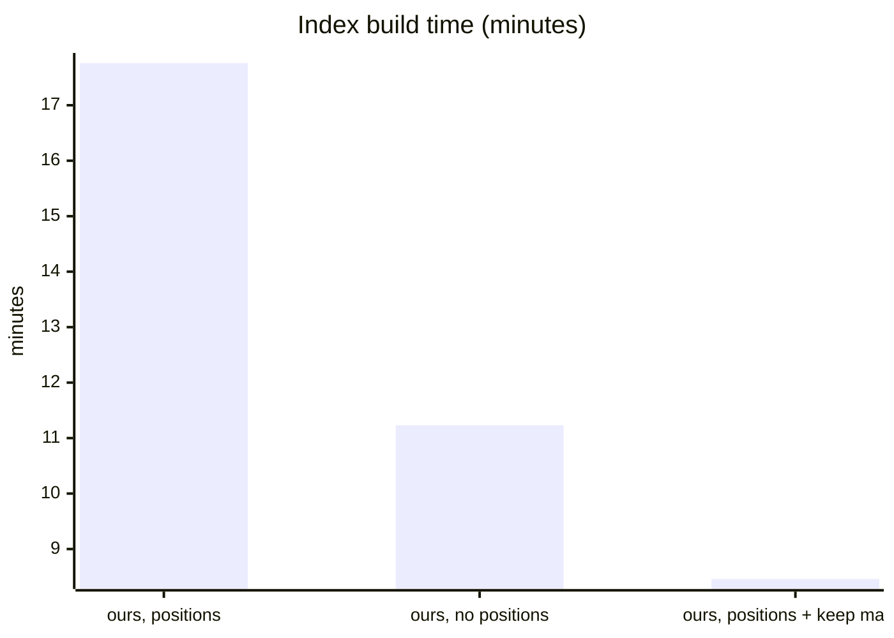

_Bars in order: bar 1 = total._

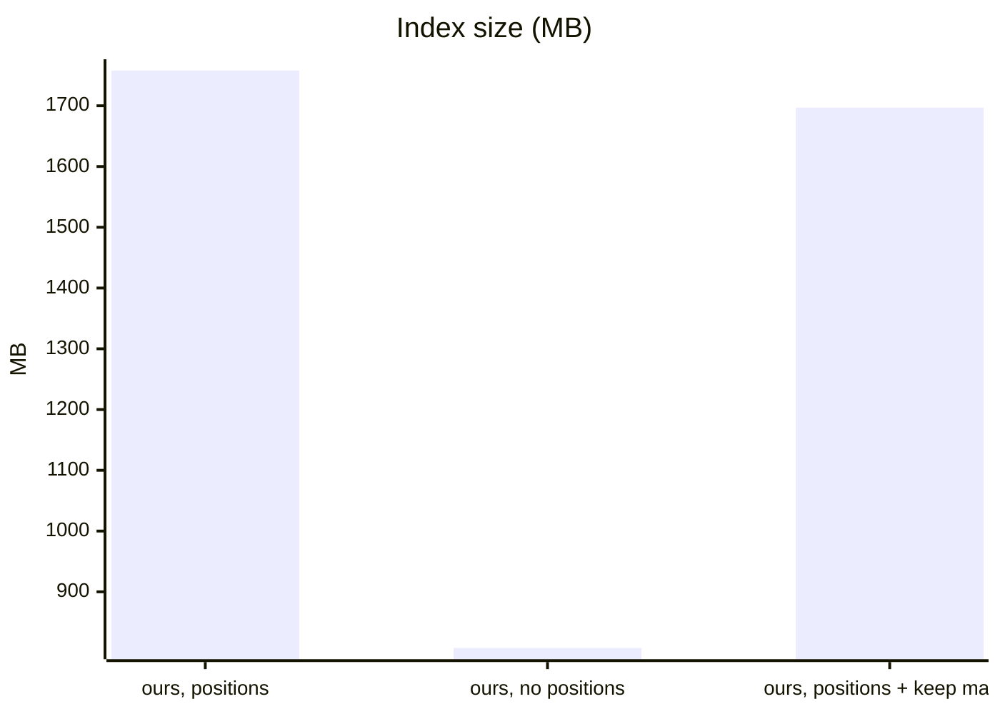

_Bars in order: bar 1 = size._

## Parity with FtsLib (identical lines, first 20,000 hits, both index flavours)

| Set | Positions | No positions |
|---|---|---|
| queries-diff10 | 10/10 identical hit sets, issue #21 rule ok | 10/10 |
| queries-large | 61/61 identical hit sets, issue #21 rule ok | 61/61 |
| queries-words | 14/14 identical hit sets, issue #21 rule ok | 14/14 |
| queries-rules | 21/21 identical hit sets, issue #21 rule ok | 21/21 |
| queries-ketiv (ketiv on) | 12/12 identical hit sets, issue #21 rule ok | 12/12 |

## Search speed (every hit read, median of 3 runs after one warm-up)

Stages per query: walks + collect (engine), host (text fetch + locate + widening), first batch, total. Otzaria runs only the queries it has an equivalent for (no `*`, `?`, `%`, `|`, phrase). All four engines run in one fullrun workflow job on the same GitHub windows runner, so they compare with each other; absolute times are the shared runner's, not a user machine's.

### queries-large.txt (61)

| Engine | Queries run | Total (sum) | Median per query | First batch median | Slowest query |
|---|---|---|---|---|---|
| ours, positions | 61 | 2.09 min | 0.02 min | 239 ms | q55: 0.15 min |
| ours, no positions | 61 | 9.63 min | 0.09 min | 216 ms | q41: 0.72 min |
| FtsLib | 61 | 10.73 min | 0.11 min | 220 ms | q41: 0.77 min |
| Otzaria | 43 | 9.63 min | 0.08 min | 50 ms | q53: 1.26 min |

Over the 43 queries every engine ran:

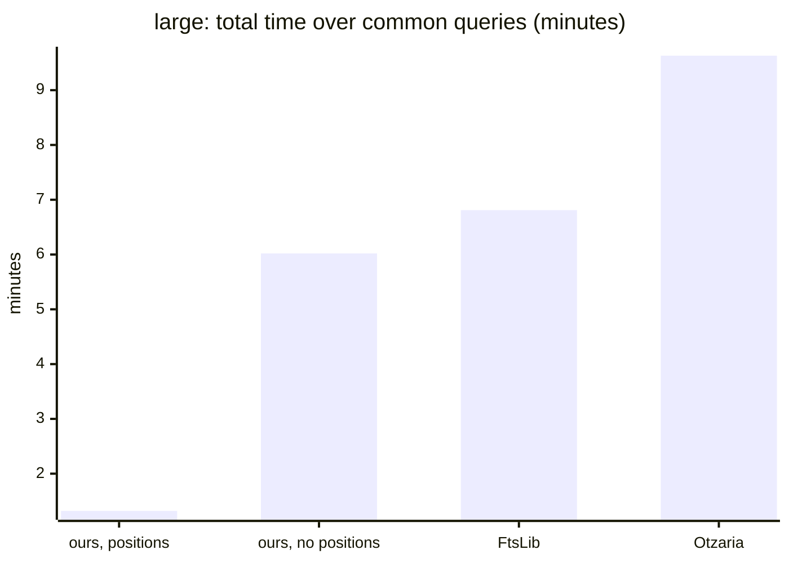

_Bars in order: bar 1 = total._

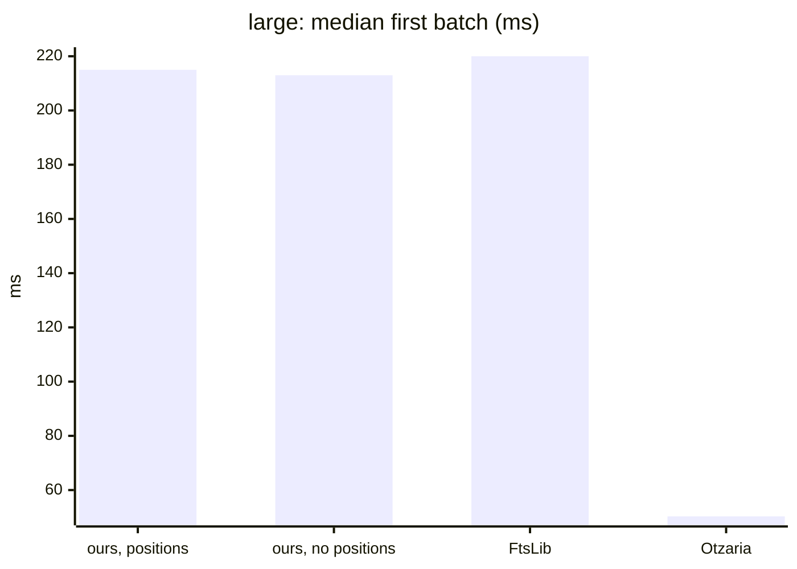

_Bars in order: bar 1 = first._

```mermaid
xychart-beta
    title "large: total per query (minutes)"
    x-axis ["q1", "q2", "q3", "q4", "q5", "q6", "q7", "q8", "q9", "q10", "q11", "q12", "q13", "q14", "q15", "q16", "q17", "q18", "q19", "q20", "q21", "q22", "q23", "q24", "q25", "q26", "q27", "q28", "q29", "q30", "q31", "q32", "q33", "q34", "q35", "q36", "q37", "q38", "q39", "q40", "q41", "q42", "q43", "q44", "q45", "q46", "q47", "q48", "q49", "q50", "q51", "q52", "q53", "q54", "q55", "q56", "q57", "q58", "q59", "q60", "q61"]
    y-axis "minutes"
    bar [0.11, 0.04, 0.07, 0.04, 0.03, 0.02, 0.01, 0.02, 0.00, 0.00, 0.06, 0.01, 0.01, 0.07, 0.05, 0.02, 0.03, 0.01, 0.06, 0.07, 0.00, 0.01, 0.01, 0.01, 0.01, 0.01, 0.01, 0.01, 0.00, 0.00, 0.01, 0.01, 0.02, 0.01, 0.01, 0.06, 0.03, 0.02, 0.05, 0.03, 0.14, 0.05, 0.05, 0.05, 0.03, 0.03, 0.08, 0.02, 0.04, 0.01, 0.03, 0.02, 0.13, 0.12, 0.15, 0.06, 0.02, 0.01, 0.00, 0.00, 0.00]
    bar [0.51, 0.20, 0.30, 0.17, 0.15, 0.06, 0.04, 0.09, 0.01, 0.01, 0.26, 0.04, 0.03, 0.36, 0.22, 0.06, 0.12, 0.04, 0.25, 0.36, 0.01, 0.02, 0.03, 0.02, 0.02, 0.03, 0.05, 0.05, 0.03, 0.03, 0.03, 0.03, 0.12, 0.05, 0.03, 0.26, 0.10, 0.07, 0.20, 0.13, 0.72, 0.24, 0.23, 0.23, 0.16, 0.14, 0.42, 0.12, 0.19, 0.04, 0.13, 0.07, 0.66, 0.58, 0.71, 0.27, 0.06, 0.03, 0.00, 0.01, 0.01]
    bar [0.55, 0.23, 0.34, 0.19, 0.17, 0.08, 0.05, 0.11, 0.01, 0.01, 0.28, 0.05, 0.04, 0.39, 0.24, 0.08, 0.14, 0.05, 0.28, 0.39, 0.02, 0.04, 0.04, 0.02, 0.03, 0.04, 0.07, 0.06, 0.04, 0.04, 0.05, 0.04, 0.14, 0.07, 0.04, 0.29, 0.11, 0.08, 0.22, 0.15, 0.77, 0.27, 0.27, 0.27, 0.15, 0.13, 0.45, 0.12, 0.19, 0.05, 0.14, 0.07, 0.76, 0.63, 0.77, 0.29, 0.08, 0.03, 0.01, 0.02, 0.01]
    bar [0.90, 0.34, 0.51, 0.26, 0.25, 0.08, 0.04, 0.05, 0.01, 0.01, 0.44, 0.04, 0.03, 0.65, 0.37, 0.09, 0.20, 0.04, 0.44, 0.65, 0.02, 0.05, 0.08, 0.02, 0.04, 0.04, 0.16, 0.14, 0.00, 0.01, 0.02, 0.02, 0.15, 0.09, 0.04, 0.00, 0.00, 0.00, 0.00, 0.00, 0.00, 0.00, 0.00, 0.00, 0.00, 0.00, 0.00, 0.00, 0.00, 0.00, 0.19, 0.08, 1.26, 1.03, 0.75, 0.00, 0.00, 0.00, 0.00, 0.01, 0.00]
```

_Bars in order: bar 1 = ours, positions / bar 2 = ours, no positions / bar 3 = FtsLib / bar 4 = Otzaria._

Per query, each stage

| q | Query | Engine | Hits | Walks + collect | Host | First batch | Total |
|---|---|---|---|---|---|---|---|
| q1 | `אמר`  | ours, positions | 826,951 | 6 ms | 0.11 min | 498 ms | 0.11 min |
| q1 | `אמר`  | ours, no positions | 826,951 | 60 ms | 0.51 min | 243 ms | 0.51 min |
| q1 | `אמר`  | FtsLib | 826,951 | n/a | 0.55 min | 199 ms | 0.55 min |
| q1 | `אמר`  | Otzaria | 823,190 | n/a | n/a | 39 ms | 0.90 min |
| q2 | `תורה`  | ours, positions | 257,637 | 5 ms | 0.04 min | 284 ms | 0.04 min |
| q2 | `תורה`  | ours, no positions | 257,637 | 27 ms | 0.20 min | 214 ms | 0.20 min |
| q2 | `תורה`  | FtsLib | 257,637 | n/a | 0.23 min | 220 ms | 0.23 min |
| q2 | `תורה`  | Otzaria | 256,035 | n/a | n/a | 36 ms | 0.34 min |
| q3 | `ישראל`  | ours, positions | 476,761 | 5 ms | 0.07 min | 363 ms | 0.07 min |
| q3 | `ישראל`  | ours, no positions | 476,761 | 41 ms | 0.30 min | 228 ms | 0.30 min |
| q3 | `ישראל`  | FtsLib | 476,761 | n/a | 0.34 min | 196 ms | 0.34 min |
| q3 | `ישראל`  | Otzaria | 473,503 | n/a | n/a | 26 ms | 0.51 min |
| q4 | `שבת`  | ours, positions | 250,061 | 4 ms | 0.04 min | 278 ms | 0.04 min |
| q4 | `שבת`  | ours, no positions | 250,061 | 27 ms | 0.17 min | 209 ms | 0.17 min |
| q4 | `שבת`  | FtsLib | 250,061 | n/a | 0.19 min | 216 ms | 0.19 min |
| q4 | `שבת`  | Otzaria | 247,190 | n/a | n/a | 37 ms | 0.26 min |
| q5 | `מצוה`  | ours, positions | 191,144 | 4 ms | 0.03 min | 260 ms | 0.03 min |
| q5 | `מצוה`  | ours, no positions | 191,144 | 25 ms | 0.15 min | 216 ms | 0.15 min |
| q5 | `מצוה`  | FtsLib | 191,144 | n/a | 0.17 min | 222 ms | 0.17 min |
| q5 | `מצוה`  | Otzaria | 189,995 | n/a | n/a | 40 ms | 0.25 min |
| q6 | `פסח`  | ours, positions | 59,773 | 4 ms | 934 ms | 210 ms | 938 ms |
| q6 | `פסח`  | ours, no positions | 59,773 | 15 ms | 0.06 min | 202 ms | 0.06 min |
| q6 | `פסח`  | FtsLib | 59,773 | n/a | 0.08 min | 222 ms | 0.08 min |
| q6 | `פסח`  | Otzaria | 59,200 | n/a | n/a | 40 ms | 0.08 min |
| q7 | `ירושלים`  | ours, positions | 28,236 | 4 ms | 722 ms | 200 ms | 726 ms |
| q7 | `ירושלים`  | ours, no positions | 28,236 | 12 ms | 0.04 min | 207 ms | 0.04 min |
| q7 | `ירושלים`  | FtsLib | 28,236 | n/a | 0.05 min | 217 ms | 0.05 min |
| q7 | `ירושלים`  | Otzaria | 28,007 | n/a | n/a | 38 ms | 0.04 min |
| q8 | `אלקים`  | ours, positions | 103,070 | 4 ms | 0.02 min | 224 ms | 0.02 min |
| q8 | `אלקים`  | ours, no positions | 103,070 | 18 ms | 0.09 min | 201 ms | 0.09 min |
| q8 | `אלקים`  | FtsLib | 103,070 | n/a | 0.11 min | 203 ms | 0.11 min |
| q8 | `אלקים`  | Otzaria | 37,740 | n/a | n/a | 46 ms | 0.05 min |
| q9 | `נבוכדנצר`  | ours, positions | 4,423 | 4 ms | 244 ms | 184 ms | 248 ms |
| q9 | `נבוכדנצר`  | ours, no positions | 4,423 | 6 ms | 558 ms | 192 ms | 564 ms |
| q9 | `נבוכדנצר`  | FtsLib | 4,423 | n/a | 800 ms | 214 ms | 800 ms |
| q9 | `נבוכדנצר`  | Otzaria | 4,381 | n/a | n/a | 35 ms | 416 ms |
| q10 | `אחשורוש`  | ours, positions | 5,598 | 4 ms | 261 ms | 181 ms | 265 ms |
| q10 | `אחשורוש`  | ours, no positions | 5,598 | 6 ms | 632 ms | 185 ms | 639 ms |
| q10 | `אחשורוש`  | FtsLib | 5,598 | n/a | 849 ms | 203 ms | 849 ms |
| q10 | `אחשורוש`  | Otzaria | 5,556 | n/a | n/a | 33 ms | 453 ms |
| q11 | `רש"י`  | ours, positions | 367,347 | 5 ms | 0.06 min | 318 ms | 0.06 min |
| q11 | `רש"י`  | ours, no positions | 367,347 | 33 ms | 0.26 min | 221 ms | 0.26 min |
| q11 | `רש"י`  | FtsLib | 367,347 | n/a | 0.28 min | 217 ms | 0.28 min |
| q11 | `רש"י`  | Otzaria | 362,014 | n/a | n/a | 37 ms | 0.44 min |
| q12 | `רמב"ם`  | ours, positions | 40,495 | 4 ms | 854 ms | 206 ms | 858 ms |
| q12 | `רמב"ם`  | ours, no positions | 40,495 | 10 ms | 0.04 min | 205 ms | 0.04 min |
| q12 | `רמב"ם`  | FtsLib | 40,495 | n/a | 0.05 min | 225 ms | 0.05 min |
| q12 | `רמב"ם`  | Otzaria | 40,114 | n/a | n/a | 44 ms | 0.04 min |
| q13 | `רמב"ן`  | ours, positions | 17,880 | 4 ms | 570 ms | 197 ms | 574 ms |
| q13 | `רמב"ן`  | ours, no positions | 17,880 | 9 ms | 0.03 min | 209 ms | 0.03 min |
| q13 | `רמב"ן`  | FtsLib | 17,880 | n/a | 0.04 min | 229 ms | 0.04 min |
| q13 | `רמב"ן`  | Otzaria | 17,780 | n/a | n/a | 44 ms | 0.03 min |
| q14 | `ז"ל`  | ours, positions | 509,528 | 5 ms | 0.07 min | 390 ms | 0.07 min |
| q14 | `ז"ל`  | ours, no positions | 509,528 | 39 ms | 0.36 min | 231 ms | 0.36 min |
| q14 | `ז"ל`  | FtsLib | 509,528 | n/a | 0.39 min | 224 ms | 0.39 min |
| q14 | `ז"ל`  | Otzaria | 508,202 | n/a | n/a | 43 ms | 0.65 min |
| q15 | `ע"ש`  | ours, positions | 310,526 | 5 ms | 0.05 min | 303 ms | 0.05 min |
| q15 | `ע"ש`  | ours, no positions | 310,526 | 29 ms | 0.22 min | 233 ms | 0.22 min |
| q15 | `ע"ש`  | FtsLib | 310,526 | n/a | 0.24 min | 235 ms | 0.24 min |
| q15 | `ע"ש`  | Otzaria | 308,494 | n/a | n/a | 50 ms | 0.37 min |
| q16 | `חז"ל`  | ours, positions | 60,058 | 4 ms | 954 ms | 209 ms | 958 ms |
| q16 | `חז"ל`  | ours, no positions | 60,058 | 13 ms | 0.06 min | 219 ms | 0.06 min |
| q16 | `חז"ל`  | FtsLib | 60,058 | n/a | 0.08 min | 239 ms | 0.08 min |
| q16 | `חז"ל`  | Otzaria | 59,808 | n/a | n/a | 50 ms | 0.09 min |
| q17 | `תוס'`  | ours, positions | 184,320 | 4 ms | 0.03 min | 245 ms | 0.03 min |
| q17 | `תוס'`  | ours, no positions | 184,320 | 21 ms | 0.12 min | 210 ms | 0.12 min |
| q17 | `תוס'`  | FtsLib | 184,320 | n/a | 0.14 min | 219 ms | 0.14 min |
| q17 | `תוס'`  | Otzaria | 182,424 | n/a | n/a | 42 ms | 0.20 min |
| q18 | `רמבם`  | ours, positions | 40,495 | 4 ms | 747 ms | 204 ms | 751 ms |
| q18 | `רמבם`  | ours, no positions | 40,495 | 11 ms | 0.04 min | 202 ms | 0.04 min |
| q18 | `רמבם`  | FtsLib | 40,495 | n/a | 0.05 min | 222 ms | 0.05 min |
| q18 | `רמבם`  | Otzaria | 40,169 | n/a | n/a | 46 ms | 0.04 min |
| q19 | `רשי`  | ours, positions | 367,347 | 5 ms | 0.06 min | 312 ms | 0.06 min |
| q19 | `רשי`  | ours, no positions | 367,347 | 33 ms | 0.25 min | 221 ms | 0.25 min |
| q19 | `רשי`  | FtsLib | 367,347 | n/a | 0.28 min | 214 ms | 0.28 min |
| q19 | `רשי`  | Otzaria | 363,477 | n/a | n/a | 39 ms | 0.44 min |
| q20 | `זל`  | ours, positions | 509,528 | 5 ms | 0.07 min | 393 ms | 0.07 min |
| q20 | `זל`  | ours, no positions | 509,528 | 39 ms | 0.36 min | 235 ms | 0.36 min |
| q20 | `זל`  | FtsLib | 509,528 | n/a | 0.39 min | 221 ms | 0.39 min |
| q20 | `זל`  | Otzaria | 508,766 | n/a | n/a | 44 ms | 0.65 min |
| q21 | `משה רבנו`  | ours, positions | 3,649 | 5 ms | 245 ms | 195 ms | 250 ms |
| q21 | `משה רבנו`  | ours, no positions | 3,649 | 8 ms | 612 ms | 215 ms | 620 ms |
| q21 | `משה רבנו`  | FtsLib | 3,649 | n/a | 905 ms | 241 ms | 905 ms |
| q21 | `משה רבנו`  | Otzaria | 3,072 | n/a | n/a | 101 ms | 986 ms |
| q22 | `אברהם יצחק יעקב`  | ours, positions | 10,153 | 6 ms | 381 ms | 196 ms | 386 ms |
| q22 | `אברהם יצחק יעקב`  | ours, no positions | 10,153 | 11 ms | 0.02 min | 215 ms | 0.02 min |
| q22 | `אברהם יצחק יעקב`  | FtsLib | 10,153 | n/a | 0.04 min | 247 ms | 0.04 min |
| q22 | `אברהם יצחק יעקב`  | Otzaria | 9,656 | n/a | n/a | 151 ms | 0.05 min |
| q23 | `בית המקדש`  | ours, positions | 21,073 | 5 ms | 625 ms | 198 ms | 630 ms |
| q23 | `בית המקדש`  | ours, no positions | 21,073 | 13 ms | 0.03 min | 201 ms | 0.03 min |
| q23 | `בית המקדש`  | FtsLib | 21,073 | n/a | 0.04 min | 218 ms | 0.04 min |
| q23 | `בית המקדש`  | Otzaria | 21,393 | n/a | n/a | 81 ms | 0.08 min |
| q24 | `קריאת שמע`  | ours, positions | 8,160 | 4 ms | 326 ms | 193 ms | 330 ms |
| q24 | `קריאת שמע`  | ours, no positions | 8,160 | 9 ms | 905 ms | 213 ms | 914 ms |
| q24 | `קריאת שמע`  | FtsLib | 8,160 | n/a | 0.02 min | 241 ms | 0.02 min |
| q24 | `קריאת שמע`  | Otzaria | 8,016 | n/a | n/a | 91 ms | 0.02 min |
| q25 | `תלמוד תורה`  | ours, positions | 9,211 | 5 ms | 381 ms | 215 ms | 386 ms |
| q25 | `תלמוד תורה`  | ours, no positions | 9,211 | 10 ms | 0.02 min | 213 ms | 0.02 min |
| q25 | `תלמוד תורה`  | FtsLib | 9,211 | n/a | 0.03 min | 239 ms | 0.03 min |
| q25 | `תלמוד תורה`  | Otzaria | 8,548 | n/a | n/a | 122 ms | 0.04 min |
| q26 | `עבודה זרה`  | ours, positions | 17,970 | 5 ms | 525 ms | 198 ms | 530 ms |
| q26 | `עבודה זרה`  | ours, no positions | 17,970 | 10 ms | 0.03 min | 198 ms | 0.03 min |
| q26 | `עבודה זרה`  | FtsLib | 17,970 | n/a | 0.04 min | 220 ms | 0.04 min |
| q26 | `עבודה זרה`  | Otzaria | 17,786 | n/a | n/a | 67 ms | 0.04 min |
| q27 | `יום טוב`  | ours, positions | 42,011 | 6 ms | 810 ms | 221 ms | 816 ms |
| q27 | `יום טוב`  | ours, no positions | 42,011 | 16 ms | 0.05 min | 234 ms | 0.05 min |
| q27 | `יום טוב`  | FtsLib | 42,011 | n/a | 0.07 min | 253 ms | 0.07 min |
| q27 | `יום טוב`  | Otzaria | 42,879 | n/a | n/a | 178 ms | 0.16 min |
| q28 | `ארץ ישראל`  | ours, positions | 33,832 | 6 ms | 721 ms | 212 ms | 727 ms |
| q28 | `ארץ ישראל`  | ours, no positions | 33,832 | 16 ms | 0.05 min | 202 ms | 0.05 min |
| q28 | `ארץ ישראל`  | FtsLib | 33,832 | n/a | 0.06 min | 217 ms | 0.06 min |
| q28 | `ארץ ישראל`  | Otzaria | 33,654 | n/a | n/a | 94 ms | 0.14 min |
| q29 | `משה אהרן` 0 | ours, positions | 715 | 5 ms | 219 ms | 207 ms | 224 ms |
| q29 | `משה אהרן` 0 | ours, no positions | 715 | 11 ms | 0.02 min | 181 ms | 0.03 min |
| q29 | `משה אהרן` 0 | FtsLib | 715 | n/a | 0.04 min | 191 ms | 0.04 min |
| q29 | `משה אהרן` 0 | Otzaria | 628 | n/a | n/a | 94 ms | 164 ms |
| q30 | `משה אהרן` 3 | ours, positions | 5,949 | 5 ms | 288 ms | 197 ms | 293 ms |
| q30 | `משה אהרן` 3 | ours, no positions | 5,949 | 11 ms | 0.03 min | 186 ms | 0.03 min |
| q30 | `משה אהרן` 3 | FtsLib | 5,949 | n/a | 0.04 min | 193 ms | 0.04 min |
| q30 | `משה אהרן` 3 | Otzaria | 4,691 | n/a | n/a | 65 ms | 858 ms |
| q31 | `שמע ישראל` 0 | ours, positions | 5,971 | 6 ms | 296 ms | 205 ms | 302 ms |
| q31 | `שמע ישראל` 0 | ours, no positions | 5,971 | 13 ms | 0.03 min | 206 ms | 0.03 min |
| q31 | `שמע ישראל` 0 | FtsLib | 5,971 | n/a | 0.05 min | 226 ms | 0.05 min |
| q31 | `שמע ישראל` 0 | Otzaria | 5,735 | n/a | n/a | 82 ms | 0.02 min |
| q32 | `ויאמר משה` 2 | ours, positions | 7,990 | 5 ms | 326 ms | 192 ms | 331 ms |
| q32 | `ויאמר משה` 2 | ours, no positions | 7,990 | 11 ms | 0.03 min | 192 ms | 0.03 min |
| q32 | `ויאמר משה` 2 | FtsLib | 7,990 | n/a | 0.04 min | 213 ms | 0.04 min |
| q32 | `ויאמר משה` 2 | Otzaria | 7,230 | n/a | n/a | 58 ms | 0.02 min |
| q33 | `אמר רבי` 1 | ours, positions | 86,243 | 8 ms | 0.02 min | 295 ms | 0.02 min |
| q33 | `אמר רבי` 1 | ours, no positions | 86,243 | 30 ms | 0.12 min | 209 ms | 0.12 min |
| q33 | `אמר רבי` 1 | FtsLib | 86,243 | n/a | 0.14 min | 210 ms | 0.14 min |
| q33 | `אמר רבי` 1 | Otzaria | 75,891 | n/a | n/a | 127 ms | 0.15 min |
| q34 | `רבי יוחנן` 0 | ours, positions | 35,844 | 5 ms | 743 ms | 233 ms | 748 ms |
| q34 | `רבי יוחנן` 0 | ours, no positions | 35,844 | 17 ms | 0.05 min | 211 ms | 0.05 min |
| q34 | `רבי יוחנן` 0 | FtsLib | 35,844 | n/a | 0.07 min | 228 ms | 0.07 min |
| q34 | `רבי יוחנן` 0 | Otzaria | 35,398 | n/a | n/a | 87 ms | 0.09 min |
| q35 | `רבי עקיבא` 5 | ours, positions | 17,401 | 5 ms | 551 ms | 213 ms | 556 ms |
| q35 | `רבי עקיבא` 5 | ours, no positions | 17,401 | 13 ms | 0.03 min | 213 ms | 0.03 min |
| q35 | `רבי עקיבא` 5 | FtsLib | 17,401 | n/a | 0.04 min | 235 ms | 0.04 min |
| q35 | `רבי עקיבא` 5 | Otzaria | 17,010 | n/a | n/a | 98 ms | 0.04 min |
| q36 | `%שבת`  | ours, positions | 420,288 | 7 ms | 0.06 min | 387 ms | 0.06 min |
| q36 | `%שבת`  | ours, no positions | 420,288 | 39 ms | 0.26 min | 225 ms | 0.26 min |
| q36 | `%שבת`  | FtsLib | 420,288 | n/a | 0.29 min | 223 ms | 0.29 min |
| q37 | `%ברכה`  | ours, positions | 135,614 | 6 ms | 0.03 min | 246 ms | 0.03 min |
| q37 | `%ברכה`  | ours, no positions | 135,614 | 22 ms | 0.10 min | 210 ms | 0.10 min |
| q37 | `%ברכה`  | FtsLib | 135,614 | n/a | 0.11 min | 219 ms | 0.11 min |
| q38 | `ברכה%`  | ours, positions | 79,275 | 4 ms | 0.02 min | 219 ms | 0.02 min |
| q38 | `ברכה%`  | ours, no positions | 79,275 | 17 ms | 0.07 min | 203 ms | 0.07 min |
| q38 | `ברכה%`  | FtsLib | 79,275 | n/a | 0.08 min | 220 ms | 0.08 min |
| q39 | `%מלך%`  | ours, positions | 290,748 | 8 ms | 0.05 min | 320 ms | 0.05 min |
| q39 | `%מלך%`  | ours, no positions | 290,748 | 34 ms | 0.20 min | 209 ms | 0.20 min |
| q39 | `%מלך%`  | FtsLib | 290,748 | n/a | 0.22 min | 245 ms | 0.22 min |
| q40 | `%כהן`  | ours, positions | 168,527 | 5 ms | 0.03 min | 254 ms | 0.03 min |
| q40 | `%כהן`  | ours, no positions | 168,527 | 24 ms | 0.13 min | 197 ms | 0.13 min |
| q40 | `%כהן`  | FtsLib | 168,527 | n/a | 0.15 min | 196 ms | 0.15 min |
| q41 | `דבר%`  | ours, positions | 1,163,301 | 9 ms | 0.14 min | 651 ms | 0.14 min |
| q41 | `דבר%`  | ours, no positions | 1,163,301 | 83 ms | 0.71 min | 256 ms | 0.72 min |
| q41 | `דבר%`  | FtsLib | 1,163,301 | n/a | 0.77 min | 201 ms | 0.77 min |
| q42 | `שלו*`  | ours, positions | 299,763 | 6 ms | 0.05 min | 306 ms | 0.05 min |
| q42 | `שלו*`  | ours, no positions | 299,763 | 34 ms | 0.24 min | 222 ms | 0.24 min |
| q42 | `שלו*`  | FtsLib | 299,763 | n/a | 0.27 min | 233 ms | 0.27 min |
| q43 | `שבת*`  | ours, positions | 327,981 | 7 ms | 0.05 min | 338 ms | 0.05 min |
| q43 | `שבת*`  | ours, no positions | 327,981 | 36 ms | 0.23 min | 219 ms | 0.23 min |
| q43 | `שבת*`  | FtsLib | 327,981 | n/a | 0.27 min | 224 ms | 0.27 min |
| q44 | `*לום`  | ours, positions | 283,763 | 11 ms | 0.05 min | 308 ms | 0.05 min |
| q44 | `*לום`  | ours, no positions | 283,763 | 37 ms | 0.23 min | 217 ms | 0.23 min |
| q44 | `*לום`  | FtsLib | 283,763 | n/a | 0.27 min | 218 ms | 0.27 min |
| q45 | `*כהן`  | ours, positions | 169,770 | 8 ms | 0.03 min | 266 ms | 0.03 min |
| q45 | `*כהן`  | ours, no positions | 169,770 | 27 ms | 0.16 min | 203 ms | 0.16 min |
| q45 | `*כהן`  | FtsLib | 169,770 | n/a | 0.15 min | 207 ms | 0.15 min |
| q46 | `*יצח*`  | ours, positions | 131,286 | 7 ms | 0.03 min | 245 ms | 0.03 min |
| q46 | `*יצח*`  | ours, no positions | 131,286 | 28 ms | 0.14 min | 249 ms | 0.14 min |
| q46 | `*יצח*`  | FtsLib | 131,286 | n/a | 0.13 min | 217 ms | 0.13 min |
| q47 | `*דוש*`  | ours, positions | 552,712 | 13 ms | 0.08 min | 501 ms | 0.08 min |
| q47 | `*דוש*`  | ours, no positions | 552,712 | 63 ms | 0.42 min | 297 ms | 0.42 min |
| q47 | `*דוש*`  | FtsLib | 552,712 | n/a | 0.45 min | 275 ms | 0.45 min |
| q48 | `שלו?ם`  | ours, positions | 112,188 | 4 ms | 0.02 min | 231 ms | 0.02 min |
| q48 | `שלו?ם`  | ours, no positions | 112,188 | 28 ms | 0.12 min | 234 ms | 0.12 min |
| q48 | `שלו?ם`  | FtsLib | 112,188 | n/a | 0.12 min | 206 ms | 0.12 min |
| q49 | `מ?צוה`  | ours, positions | 218,869 | 5 ms | 0.04 min | 263 ms | 0.04 min |
| q49 | `מ?צוה`  | ours, no positions | 218,869 | 26 ms | 0.19 min | 223 ms | 0.19 min |
| q49 | `מ?צוה`  | FtsLib | 218,869 | n/a | 0.19 min | 210 ms | 0.19 min |
| q50 | `ירושל?ים`  | ours, positions | 28,241 | 4 ms | 687 ms | 197 ms | 691 ms |
| q50 | `ירושל?ים`  | ours, no positions | 28,241 | 15 ms | 0.04 min | 226 ms | 0.04 min |
| q50 | `ירושל?ים`  | FtsLib | 28,241 | n/a | 0.05 min | 221 ms | 0.05 min |
| q51 | `יצחק~1`  | ours, positions | 140,823 | 6 ms | 0.03 min | 244 ms | 0.03 min |
| q51 | `יצחק~1`  | ours, no positions | 140,823 | 23 ms | 0.13 min | 219 ms | 0.13 min |
| q51 | `יצחק~1`  | FtsLib | 140,823 | n/a | 0.14 min | 217 ms | 0.14 min |
| q51 | `יצחק~1`  | Otzaria | 140,101 | n/a | n/a | 41 ms | 0.19 min |
| q52 | `ירושלים~1`  | ours, positions | 56,881 | 5 ms | 944 ms | 215 ms | 950 ms |
| q52 | `ירושלים~1`  | ours, no positions | 56,881 | 17 ms | 0.07 min | 257 ms | 0.07 min |
| q52 | `ירושלים~1`  | FtsLib | 56,881 | n/a | 0.07 min | 218 ms | 0.07 min |
| q52 | `ירושלים~1`  | Otzaria | 56,312 | n/a | n/a | 41 ms | 0.08 min |
| q53 | `אברהם~2`  | ours, positions | 1,064,515 | 15 ms | 0.13 min | 700 ms | 0.13 min |
| q53 | `אברהם~2`  | ours, no positions | 1,064,515 | 88 ms | 0.66 min | 307 ms | 0.66 min |
| q53 | `אברהם~2`  | FtsLib | 1,064,515 | n/a | 0.76 min | 263 ms | 0.76 min |
| q53 | `אברהם~2`  | Otzaria | 1,055,757 | n/a | n/a | 121 ms | 1.26 min |
| q54 | `שבת~1`  | ours, positions | 967,415 | 11 ms | 0.12 min | 641 ms | 0.12 min |
| q54 | `שבת~1`  | ours, no positions | 967,415 | 70 ms | 0.58 min | 261 ms | 0.58 min |
| q54 | `שבת~1`  | FtsLib | 967,415 | n/a | 0.63 min | 218 ms | 0.63 min |
| q54 | `שבת~1`  | Otzaria | 956,053 | n/a | n/a | 46 ms | 1.03 min |
| q55 | `רש"י~1`  | ours, positions | 1,236,935 | 11 ms | 0.15 min | 723 ms | 0.15 min |
| q55 | `רש"י~1`  | ours, no positions | 1,236,935 | 89 ms | 0.71 min | 286 ms | 0.71 min |
| q55 | `רש"י~1`  | FtsLib | 1,236,935 | n/a | 0.77 min | 218 ms | 0.77 min |
| q55 | `רש"י~1`  | Otzaria | 625,202 | n/a | n/a | 56 ms | 0.75 min |
| q56 | `רשי | רמבם`  | ours, positions | 401,117 | 5 ms | 0.06 min | 331 ms | 0.06 min |
| q56 | `רשי | רמבם`  | ours, no positions | 401,117 | 38 ms | 0.27 min | 227 ms | 0.27 min |
| q56 | `רשי | רמבם`  | FtsLib | 401,117 | n/a | 0.29 min | 217 ms | 0.29 min |
| q57 | `שבת | יום טוב`  | ours, positions | 52,886 | 6 ms | 938 ms | 239 ms | 945 ms |
| q57 | `שבת | יום טוב`  | ours, no positions | 52,886 | 24 ms | 0.06 min | 228 ms | 0.06 min |
| q57 | `שבת | יום טוב`  | FtsLib | 52,886 | n/a | 0.08 min | 238 ms | 0.08 min |
| q58 | `משה | אהרן כהן`  | ours, positions | 10,698 | 6 ms | 407 ms | 205 ms | 413 ms |
| q58 | `משה | אהרן כהן`  | ours, no positions | 10,698 | 15 ms | 0.03 min | 218 ms | 0.03 min |
| q58 | `משה | אהרן כהן`  | FtsLib | 10,698 | n/a | 0.03 min | 237 ms | 0.03 min |
| q59 | `תלמוד תורה כנגד כולם`  | ours, positions | 319 | 6 ms | 203 ms | 198 ms | 209 ms |
| q59 | `תלמוד תורה כנגד כולם`  | ours, no positions | 319 | 7 ms | 255 ms | 243 ms | 262 ms |
| q59 | `תלמוד תורה כנגד כולם`  | FtsLib | 319 | n/a | 323 ms | 302 ms | 323 ms |
| q59 | `תלמוד תורה כנגד כולם`  | Otzaria | 177 | n/a | n/a | 154 ms | 154 ms |
| q60 | `אלו דברים שאין להם שיעור`  | ours, positions | 1,185 | 10 ms | 259 ms | 242 ms | 269 ms |
| q60 | `אלו דברים שאין להם שיעור`  | ours, no positions | 1,185 | 13 ms | 595 ms | 250 ms | 608 ms |
| q60 | `אלו דברים שאין להם שיעור`  | FtsLib | 1,185 | n/a | 942 ms | 299 ms | 942 ms |
| q60 | `אלו דברים שאין להם שיעור`  | Otzaria | 404 | n/a | n/a | 340 ms | 469 ms |
| q61 | `שמע ישראל ה' אלקינו ה' אחד`  | ours, positions | 1,902 | 13 ms | 237 ms | 222 ms | 254 ms |
| q61 | `שמע ישראל ה' אלקינו ה' אחד`  | ours, no positions | 1,902 | 16 ms | 427 ms | 231 ms | 443 ms |
| q61 | `שמע ישראל ה' אלקינו ה' אחד`  | FtsLib | 1,902 | n/a | 615 ms | 260 ms | 615 ms |
| q61 | `שמע ישראל ה' אלקינו ה' אחד`  | Otzaria | 616 | n/a | n/a | 207 ms | 298 ms |

### queries-words.txt (14)

| Engine | Queries run | Total (sum) | Median per query | First batch median | Slowest query |
|---|---|---|---|---|---|
| ours, positions | 14 | 0.74 min | 353 ms | 197 ms | q12: 0.63 min |
| ours, no positions | 14 | 2.69 min | 0.02 min | 207 ms | q12: 2.11 min |
| FtsLib | 14 | 3.08 min | 0.03 min | 221 ms | q12: 2.34 min |
| Otzaria | 13 | 5.01 min | 612 ms | 95 ms | q12: 3.79 min |

Over the 13 queries every engine ran:

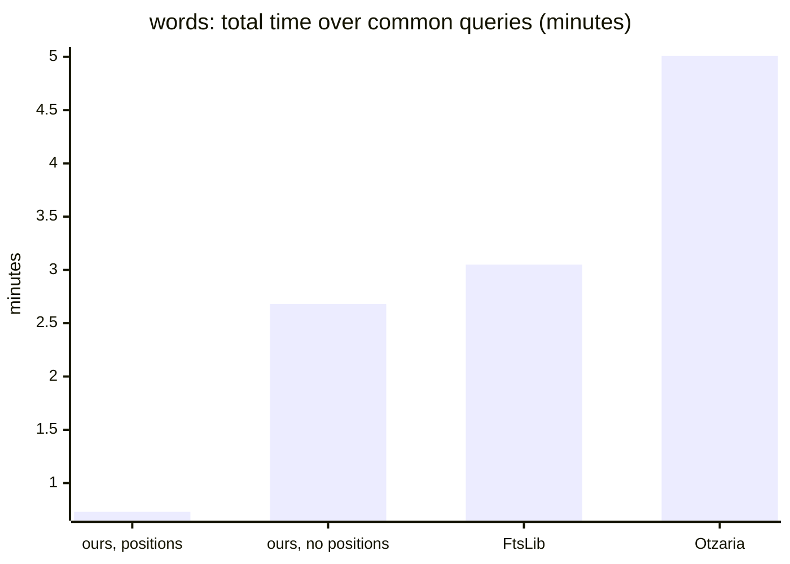

_Bars in order: bar 1 = total._

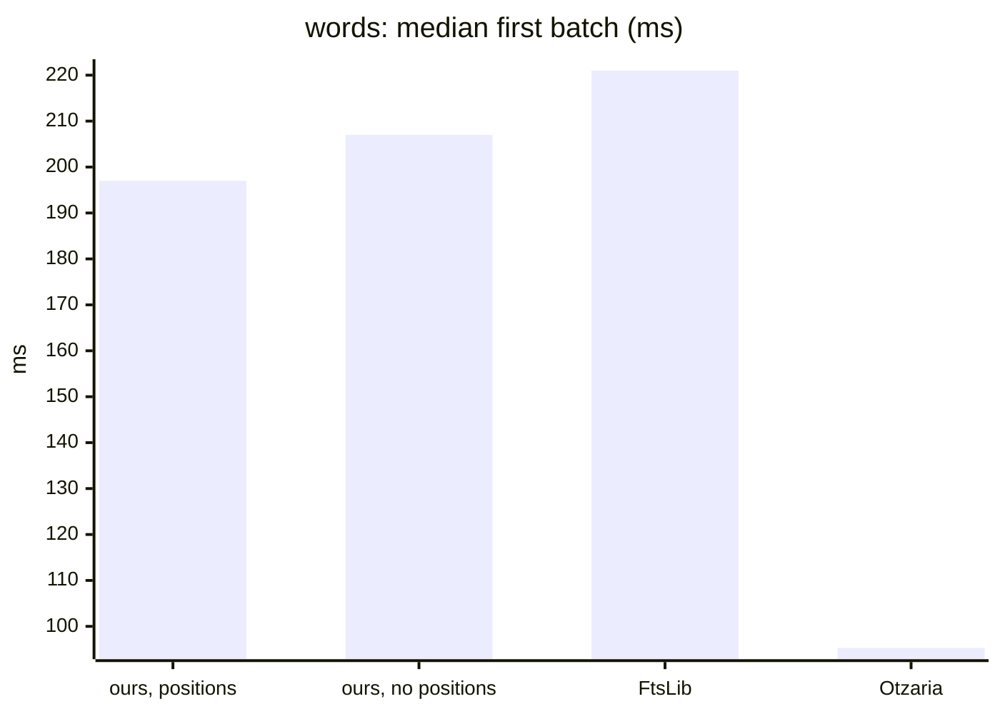

_Bars in order: bar 1 = first._

```mermaid
xychart-beta
    title "words: total per query (minutes)"
    x-axis ["q1", "q2", "q3", "q4", "q5", "q6", "q7", "q8", "q9", "q10", "q11", "q12", "q13", "q14"]
    y-axis "minutes"
    bar [0.01, 0.01, 0.01, 0.03, 0.00, 0.00, 0.00, 0.00, 0.00, 0.00, 0.01, 0.63, 0.01, 0.00]
    bar [0.06, 0.03, 0.14, 0.14, 0.03, 0.01, 0.01, 0.00, 0.00, 0.00, 0.02, 2.11, 0.14, 0.00]
    bar [0.08, 0.05, 0.17, 0.16, 0.04, 0.02, 0.01, 0.00, 0.00, 0.00, 0.03, 2.34, 0.18, 0.01]
    bar [0.15, 0.04, 0.17, 0.78, 0.01, 0.00, 0.01, 0.00, 0.00, 0.00, 0.00, 3.79, 0.06, 0.00]
```

_Bars in order: bar 1 = ours, positions / bar 2 = ours, no positions / bar 3 = FtsLib / bar 4 = Otzaria._

Per query, each stage

| q | Query | Engine | Hits | Walks + collect | Host | First batch | Total |
|---|---|---|---|---|---|---|---|
| q1 | `ה' אלהים`  | ours, positions | 45,667 | 6 ms | 848 ms | 221 ms | 854 ms |
| q1 | `ה' אלהים`  | ours, no positions | 45,667 | 18 ms | 0.06 min | 207 ms | 0.06 min |
| q1 | `ה' אלהים`  | FtsLib | 45,667 | n/a | 0.08 min | 221 ms | 0.08 min |
| q1 | `ה' אלהים`  | Otzaria | 30,638 | n/a | n/a | 118 ms | 0.15 min |
| q2 | `ר' עקיבא` 0 | ours, positions | 10,753 | 5 ms | 411 ms | 202 ms | 416 ms |
| q2 | `ר' עקיבא` 0 | ours, no positions | 10,753 | 11 ms | 0.03 min | 207 ms | 0.03 min |
| q2 | `ר' עקיבא` 0 | FtsLib | 10,753 | n/a | 0.05 min | 229 ms | 0.05 min |
| q2 | `ר' עקיבא` 0 | Otzaria | 10,701 | n/a | n/a | 82 ms | 0.04 min |
| q3 | `אמר ר` 0 | ours, positions | 40,438 | 8 ms | 811 ms | 277 ms | 818 ms |
| q3 | `אמר ר` 0 | ours, no positions | 40,438 | 28 ms | 0.14 min | 214 ms | 0.14 min |
| q3 | `אמר ר` 0 | FtsLib | 40,438 | n/a | 0.17 min | 222 ms | 0.17 min |
| q3 | `אמר ר` 0 | Otzaria | 40,309 | n/a | n/a | 106 ms | 0.17 min |
| q4 | `ב ג`  | ours, positions | 135,669 | 8 ms | 0.03 min | 267 ms | 0.03 min |
| q4 | `ב ג`  | ours, no positions | 135,669 | 32 ms | 0.14 min | 215 ms | 0.14 min |
| q4 | `ב ג`  | FtsLib | 135,669 | n/a | 0.16 min | 215 ms | 0.16 min |
| q4 | `ב ג`  | Otzaria | 166,416 | n/a | n/a | 229 ms | 0.78 min |
| q5 | `משה אהרן` 1 | ours, positions | 3,739 | 5 ms | 247 ms | 197 ms | 252 ms |
| q5 | `משה אהרן` 1 | ours, no positions | 3,739 | 10 ms | 0.03 min | 183 ms | 0.03 min |
| q5 | `משה אהרן` 1 | FtsLib | 3,739 | n/a | 0.04 min | 197 ms | 0.04 min |
| q5 | `משה אהרן` 1 | Otzaria | 3,225 | n/a | n/a | 59 ms | 612 ms |
| q6 | `משה ו אהרן` 0 | ours, positions | 1 | 6 ms | 174 ms | 172 ms | 180 ms |
| q6 | `משה ו אהרן` 0 | ours, no positions | 1 | 8 ms | 533 ms | 427 ms | 541 ms |
| q6 | `משה ו אהרן` 0 | FtsLib | 1 | n/a | 962 ms | 733 ms | 962 ms |
| q6 | `משה ו אהרן` 0 | Otzaria | 1 | n/a | n/a | 31 ms | 31 ms |
| q7 | `פרק 1`  | ours, positions | 6,390 | 5 ms | 285 ms | 197 ms | 290 ms |
| q7 | `פרק 1`  | ours, no positions | 6,390 | 7 ms | 477 ms | 199 ms | 484 ms |
| q7 | `פרק 1`  | FtsLib | 6,390 | n/a | 616 ms | 224 ms | 616 ms |
| q7 | `פרק 1`  | Otzaria | 2,334 | n/a | n/a | 124 ms | 593 ms |
| q8 | `סימן 12`  | ours, positions | 124 | 5 ms | 203 ms | 197 ms | 208 ms |
| q8 | `סימן 12`  | ours, no positions | 124 | 6 ms | 206 ms | 201 ms | 212 ms |
| q8 | `סימן 12`  | FtsLib | 124 | n/a | 241 ms | 241 ms | 241 ms |
| q8 | `סימן 12`  | Otzaria | 219 | n/a | n/a | 132 ms | 133 ms |
| q9 | `דף 2 עמוד` 1 | ours, positions | 0 | 6 ms | 102 ms | n/a | 108 ms |
| q9 | `דף 2 עמוד` 1 | ours, no positions | 0 | 7 ms | 168 ms | n/a | 175 ms |
| q9 | `דף 2 עמוד` 1 | FtsLib | 0 | n/a | 198 ms | n/a | 198 ms |
| q9 | `דף 2 עמוד` 1 | Otzaria | 0 | n/a | n/a | 27 ms | 28 ms |
| q10 | `ב5`  | ours, positions | 8 | 4 ms | 171 ms | 158 ms | 175 ms |
| q10 | `ב5`  | ours, no positions | 8 | 4 ms | 186 ms | 174 ms | 190 ms |
| q10 | `ב5`  | FtsLib | 8 | n/a | 192 ms | 191 ms | 192 ms |
| q10 | `ב5`  | Otzaria | 6 | n/a | n/a | 21 ms | 22 ms |
| q11 | `12*`  | ours, positions | 13,307 | 5 ms | 428 ms | 189 ms | 433 ms |
| q11 | `12*`  | ours, no positions | 13,307 | 8 ms | 937 ms | 191 ms | 946 ms |
| q11 | `12*`  | FtsLib | 13,307 | n/a | 0.03 min | 220 ms | 0.03 min |
| q12 | `א~1`  | ours, positions | 5,475,472 | 58 ms | 0.63 min | 0.08 min | 0.63 min |
| q12 | `א~1`  | ours, no positions | 5,475,472 | 366 ms | 2.10 min | 910 ms | 2.11 min |
| q12 | `א~1`  | FtsLib | 5,475,472 | n/a | 2.34 min | 215 ms | 2.34 min |
| q12 | `א~1`  | Otzaria | 5,308,236 | n/a | n/a | 95 ms | 3.79 min |
| q13 | `אמר ה` 2 | ours, positions | 24,428 | 9 ms | 754 ms | 284 ms | 763 ms |
| q13 | `אמר ה` 2 | ours, no positions | 24,428 | 33 ms | 0.14 min | 211 ms | 0.14 min |
| q13 | `אמר ה` 2 | FtsLib | 24,428 | n/a | 0.18 min | 213 ms | 0.18 min |
| q13 | `אמר ה` 2 | Otzaria | 16,846 | n/a | n/a | 147 ms | 0.06 min |
| q14 | `ס"ק 3` 0 | ours, positions | 1 | 4 ms | 174 ms | 170 ms | 179 ms |
| q14 | `ס"ק 3` 0 | ours, no positions | 1 | 6 ms | 293 ms | 290 ms | 299 ms |
| q14 | `ס"ק 3` 0 | FtsLib | 1 | n/a | 383 ms | 383 ms | 383 ms |
| q14 | `ס"ק 3` 0 | Otzaria | 1 | n/a | n/a | 25 ms | 26 ms |

### queries-rules.txt (21)

| Engine | Queries run | Total (sum) | Median per query | First batch median | Slowest query |
|---|---|---|---|---|---|
| ours, positions | 21 | 0.36 min | 245 ms | 209 ms | q15: 0.07 min |
| ours, no positions | 21 | 1.58 min | 0.03 min | 208 ms | q15: 0.36 min |
| FtsLib | 21 | 1.81 min | 0.05 min | 220 ms | q15: 0.39 min |
| Otzaria | 21 | 1.94 min | 375 ms | 36 ms | q14: 0.44 min |

Over the 21 queries every engine ran:

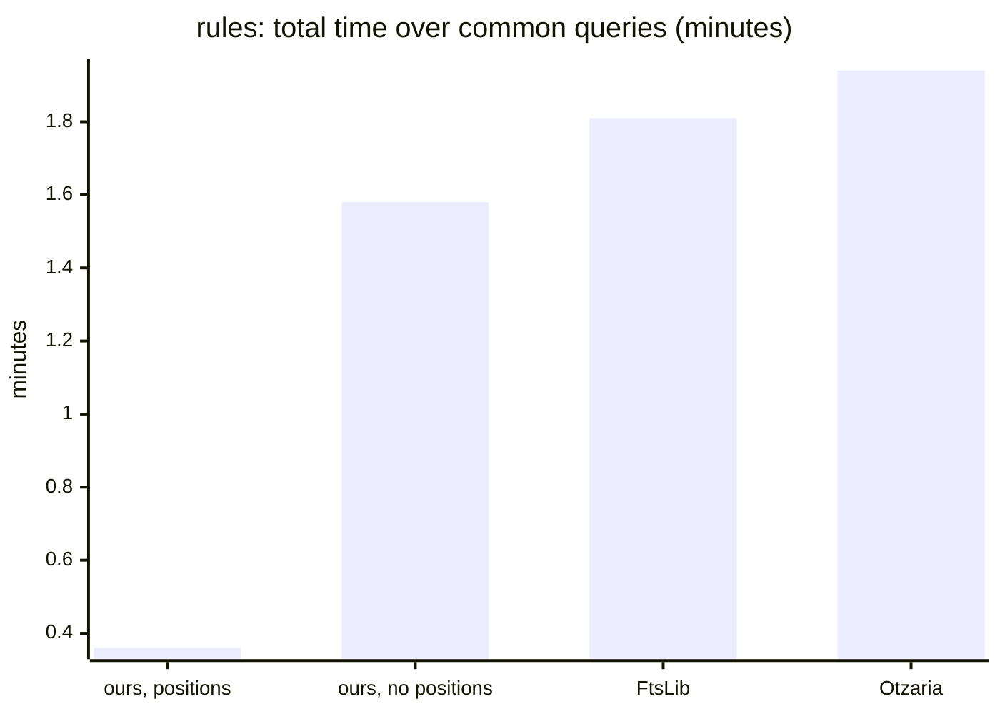

_Bars in order: bar 1 = total._

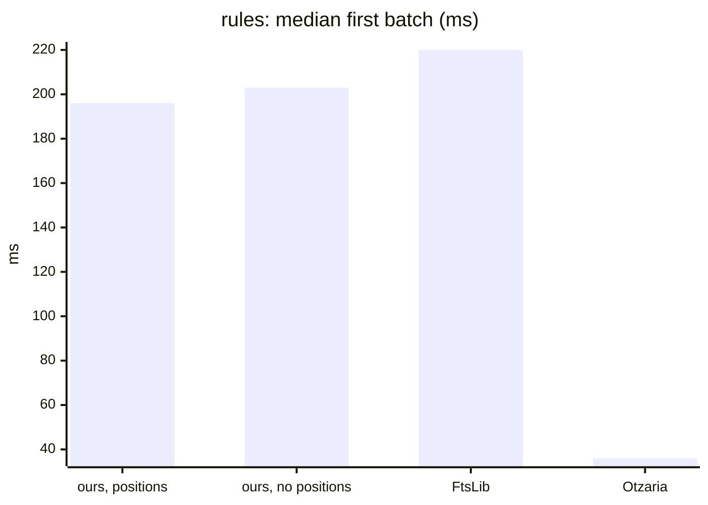

_Bars in order: bar 1 = first._

```mermaid
xychart-beta
    title "rules: total per query (minutes)"
    x-axis ["q1", "q2", "q3", "q4", "q5", "q6", "q7", "q8", "q9", "q10", "q11", "q12", "q13", "q14", "q15", "q16", "q17", "q18", "q19", "q20", "q21"]
    y-axis "minutes"
    bar [0.05, 0.04, 0.02, 0.02, 0.00, 0.00, 0.00, 0.00, 0.00, 0.00, 0.03, 0.01, 0.01, 0.06, 0.07, 0.00, 0.02, 0.00, 0.00, 0.00, 0.00]
    bar [0.22, 0.22, 0.06, 0.07, 0.03, 0.01, 0.00, 0.00, 0.00, 0.00, 0.13, 0.07, 0.07, 0.25, 0.36, 0.01, 0.06, 0.00, 0.00, 0.01, 0.01]
    bar [0.24, 0.24, 0.07, 0.09, 0.05, 0.01, 0.00, 0.00, 0.00, 0.00, 0.14, 0.08, 0.09, 0.28, 0.39, 0.01, 0.07, 0.00, 0.00, 0.02, 0.02]
    bar [0.38, 0.37, 0.09, 0.10, 0.01, 0.00, 0.00, 0.00, 0.00, 0.00, 0.20, 0.09, 0.17, 0.44, 0.00, 0.00, 0.08, 0.00, 0.00, 0.00, 0.01]
```

_Bars in order: bar 1 = ours, positions / bar 2 = ours, no positions / bar 3 = FtsLib / bar 4 = Otzaria._

Per query, each stage

| q | Query | Engine | Hits | Walks + collect | Host | First batch | Total |
|---|---|---|---|---|---|---|---|
| q1 | `ע.ש`  | ours, positions | 310,526 | 5 ms | 0.05 min | 299 ms | 0.05 min |
| q1 | `ע.ש`  | ours, no positions | 310,526 | 29 ms | 0.22 min | 232 ms | 0.22 min |
| q1 | `ע.ש`  | FtsLib | 310,526 | n/a | 0.24 min | 236 ms | 0.24 min |
| q1 | `ע.ש`  | Otzaria | 309,622 | n/a | n/a | 51 ms | 0.38 min |
| q2 | `עש`  | ours, positions | 310,526 | 5 ms | 0.04 min | 298 ms | 0.04 min |
| q2 | `עש`  | ours, no positions | 310,526 | 28 ms | 0.22 min | 231 ms | 0.22 min |
| q2 | `עש`  | FtsLib | 310,526 | n/a | 0.24 min | 234 ms | 0.24 min |
| q2 | `עש`  | Otzaria | 309,622 | n/a | n/a | 50 ms | 0.37 min |
| q3 | `א.ב`  | ours, positions | 59,125 | 4 ms | 956 ms | 209 ms | 960 ms |
| q3 | `א.ב`  | ours, no positions | 59,125 | 15 ms | 0.06 min | 203 ms | 0.06 min |
| q3 | `א.ב`  | FtsLib | 59,125 | n/a | 0.07 min | 220 ms | 0.07 min |
| q3 | `א.ב`  | Otzaria | 58,767 | n/a | n/a | 39 ms | 0.09 min |
| q4 | `וי[א]מר`  | ours, positions | 72,719 | 4 ms | 0.02 min | 210 ms | 0.02 min |
| q4 | `וי[א]מר`  | ours, no positions | 72,719 | 15 ms | 0.07 min | 197 ms | 0.07 min |
| q4 | `וי[א]מר`  | FtsLib | 72,719 | n/a | 0.09 min | 197 ms | 0.09 min |
| q4 | `וי[א]מר`  | Otzaria | 72,543 | n/a | n/a | 20 ms | 0.10 min |
| q5 | `ויאמר‏ משה` 0 | ours, positions | 3,731 | 5 ms | 240 ms | 195 ms | 245 ms |
| q5 | `ויאמר‏ משה` 0 | ours, no positions | 3,731 | 10 ms | 0.03 min | 192 ms | 0.03 min |
| q5 | `ויאמר‏ משה` 0 | FtsLib | 3,731 | n/a | 0.05 min | 207 ms | 0.05 min |
| q5 | `ויאמר‏ משה` 0 | Otzaria | 3,297 | n/a | n/a | 76 ms | 612 ms |
| q6 | `the`  | ours, positions | 2,815 | 4 ms | 208 ms | 180 ms | 212 ms |
| q6 | `the`  | ours, no positions | 2,815 | 5 ms | 313 ms | 190 ms | 318 ms |
| q6 | `the`  | FtsLib | 2,815 | n/a | 406 ms | 199 ms | 406 ms |
| q6 | `the`  | Otzaria | 2,776 | n/a | n/a | 33 ms | 83 ms |
| q7 | `torah`  | ours, positions | 53 | 4 ms | 187 ms | 181 ms | 190 ms |
| q7 | `torah`  | ours, no positions | 53 | 4 ms | 192 ms | 186 ms | 196 ms |
| q7 | `torah`  | FtsLib | 53 | n/a | 203 ms | 203 ms | 203 ms |
| q7 | `torah`  | Otzaria | 53 | n/a | n/a | 23 ms | 24 ms |
| q8 | `de la`  | ours, positions | 4 | 4 ms | 176 ms | 170 ms | 180 ms |
| q8 | `de la`  | ours, no positions | 4 | 4 ms | 176 ms | 171 ms | 181 ms |
| q8 | `de la`  | FtsLib | 4 | n/a | 191 ms | 190 ms | 191 ms |
| q8 | `de la`  | Otzaria | 3 | n/a | n/a | 26 ms | 26 ms |
| q9 | `בabc`  | ours, positions | 0 | 4 ms | 101 ms | n/a | 106 ms |
| q9 | `בabc`  | ours, no positions | 0 | 4 ms | 101 ms | n/a | 105 ms |
| q9 | `בabc`  | FtsLib | 0 | n/a | 79 ms | n/a | 79 ms |
| q9 | `בabc`  | Otzaria | 0 | n/a | n/a | 14 ms | 15 ms |
| q10 | `και`  | ours, positions | 0 | 4 ms | 100 ms | n/a | 103 ms |
| q10 | `και`  | ours, no positions | 0 | 4 ms | 103 ms | n/a | 107 ms |
| q10 | `και`  | FtsLib | 0 | n/a | 80 ms | n/a | 80 ms |
| q10 | `και`  | Otzaria | 0 | n/a | n/a | 14 ms | 14 ms |
| q11 | `תוס'`  | ours, positions | 184,320 | 4 ms | 0.03 min | 244 ms | 0.03 min |
| q11 | `תוס'`  | ours, no positions | 184,320 | 20 ms | 0.12 min | 208 ms | 0.13 min |
| q11 | `תוס'`  | FtsLib | 184,320 | n/a | 0.14 min | 217 ms | 0.14 min |
| q11 | `תוס'`  | Otzaria | 182,424 | n/a | n/a | 41 ms | 0.20 min |
| q12 | `תוס' ד״ה` 2 | ours, positions | 51,331 | 6 ms | 881 ms | 236 ms | 886 ms |
| q12 | `תוס' ד״ה` 2 | ours, no positions | 51,331 | 18 ms | 0.07 min | 220 ms | 0.07 min |
| q12 | `תוס' ד״ה` 2 | FtsLib | 51,331 | n/a | 0.08 min | 247 ms | 0.08 min |
| q12 | `תוס' ד״ה` 2 | Otzaria | 50,873 | n/a | n/a | 165 ms | 0.09 min |
| q13 | `ר' יוחנן` 0 | ours, positions | 44,017 | 5 ms | 838 ms | 232 ms | 843 ms |
| q13 | `ר' יוחנן` 0 | ours, no positions | 44,017 | 16 ms | 0.07 min | 211 ms | 0.07 min |
| q13 | `ר' יוחנן` 0 | FtsLib | 44,017 | n/a | 0.09 min | 239 ms | 0.09 min |
| q13 | `ר' יוחנן` 0 | Otzaria | 43,779 | n/a | n/a | 85 ms | 0.17 min |
| q14 | `רש”י`  | ours, positions | 367,347 | 5 ms | 0.06 min | 311 ms | 0.06 min |
| q14 | `רש”י`  | ours, no positions | 367,347 | 32 ms | 0.25 min | 220 ms | 0.25 min |
| q14 | `רש”י`  | FtsLib | 367,347 | n/a | 0.28 min | 221 ms | 0.28 min |
| q14 | `רש”י`  | Otzaria | 362,014 | n/a | n/a | 36 ms | 0.44 min |
| q15 | `ז’ל`  | ours, positions | 509,528 | 6 ms | 0.07 min | 387 ms | 0.07 min |
| q15 | `ז’ל`  | ours, no positions | 509,528 | 38 ms | 0.36 min | 226 ms | 0.36 min |
| q15 | `ז’ל`  | FtsLib | 509,528 | n/a | 0.39 min | 220 ms | 0.39 min |
| q15 | `ז’ל`  | Otzaria | 38 | n/a | n/a | 32 ms | 33 ms |
| q16 | `רמב”ם הלכות` 3 | ours, positions | 1,454 | 5 ms | 224 ms | 196 ms | 229 ms |
| q16 | `רמב”ם הלכות` 3 | ours, no positions | 1,454 | 6 ms | 416 ms | 214 ms | 422 ms |
| q16 | `רמב”ם הלכות` 3 | FtsLib | 1,454 | n/a | 593 ms | 249 ms | 593 ms |
| q16 | `רמב”ם הלכות` 3 | Otzaria | 1,417 | n/a | n/a | 84 ms | 250 ms |
| q17 | `שׂלום`  | ours, positions | 58,628 | 4 ms | 974 ms | 214 ms | 978 ms |
| q17 | `שׂלום`  | ours, no positions | 58,628 | 14 ms | 0.06 min | 203 ms | 0.06 min |
| q17 | `שׂלום`  | FtsLib | 58,628 | n/a | 0.07 min | 218 ms | 0.07 min |
| q17 | `שׂלום`  | Otzaria | 58,312 | n/a | n/a | 36 ms | 0.08 min |
| q18 | `(הוצא) [היצא]`  | ours, positions | 237 | 4 ms | 189 ms | 183 ms | 193 ms |
| q18 | `(הוצא) [היצא]`  | ours, no positions | 237 | 4 ms | 203 ms | 197 ms | 207 ms |
| q18 | `(הוצא) [היצא]`  | FtsLib | 237 | n/a | 230 ms | 229 ms | 230 ms |
| q18 | `(הוצא) [היצא]`  | Otzaria | 237 | n/a | n/a | 49 ms | 50 ms |
| q19 | `היצא אותם` 1 | ours, positions | 1 | 4 ms | 170 ms | 165 ms | 174 ms |
| q19 | `היצא אותם` 1 | ours, no positions | 1 | 5 ms | 176 ms | 171 ms | 181 ms |
| q19 | `היצא אותם` 1 | FtsLib | 1 | n/a | 200 ms | 200 ms | 200 ms |
| q19 | `היצא אותם` 1 | Otzaria | 1 | n/a | n/a | 24 ms | 24 ms |
| q20 | `משה אאאאאאאאאאאאאאאאאאאאאאאאאאאאאאאאאאאאאאאאאאאאאאאאאאאאאאאאאאאאאאאא רבנו` 1 | ours, positions | 2,422 | 5 ms | 227 ms | 194 ms | 232 ms |
| q20 | `משה אאאאאאאאאאאאאאאאאאאאאאאאאאאאאאאאאאאאאאאאאאאאאאאאאאאאאאאאאאאאאאאא רבנו` 1 | ours, no positions | 2,422 | 7 ms | 596 ms | 214 ms | 603 ms |
| q20 | `משה אאאאאאאאאאאאאאאאאאאאאאאאאאאאאאאאאאאאאאאאאאאאאאאאאאאאאאאאאאאאאאאא רבנו` 1 | FtsLib | 2,422 | n/a | 993 ms | 246 ms | 993 ms |
| q20 | `משה אאאאאאאאאאאאאאאאאאאאאאאאאאאאאאאאאאאאאאאאאאאאאאאאאאאאאאאאאאאאאאאא רבנו` 1 | Otzaria | 0 | n/a | n/a | 21 ms | 22 ms |
| q21 | `משה רבנו` 0 | ours, positions | 2,383 | 5 ms | 226 ms | 194 ms | 231 ms |
| q21 | `משה רבנו` 0 | ours, no positions | 2,383 | 7 ms | 602 ms | 213 ms | 609 ms |
| q21 | `משה רבנו` 0 | FtsLib | 2,383 | n/a | 0.02 min | 246 ms | 0.02 min |
| q21 | `משה רבנו` 0 | Otzaria | 1,738 | n/a | n/a | 78 ms | 375 ms |

## Snippets from positions

Snippet location from the index positions (`locate_lines`) against the text path, on an index with positions: median of 15 runs, first 4000 hits, 8 cores. The per-batch cost rule keeps the text path where reading positions would cost more.

| Query | Text path | From positions | Saved |
|---|---|---|---|
| two words | 23 ms | 20 ms | 16% |
| two words, distance 0 | 23 ms | 19 ms | 18% |
| two words, proximity | 25 ms | 20 ms | 19% |
| wildcard both sides | 20 ms | 15 ms | 24% |
| fuzzy ~1 | 20 ms | 15 ms | 23% |
| three words | text path (no change) | | |
| one common word | text path (no change) | | |
| prefixes + suffixes | text path (no change) | | |
| capped wildcard | text path (no change) | | |

## Search under load (concurrent searches while a writer commits)

Load mode of the speed benchmark (issue #31, `tools/bench/run-all.sh --steps load` = `search_report.py --load N`): N searcher threads in one process each run the query set several times through the host's streaming path, while one writer on the same index re-indexes a few lines (delete + add of the same documents) and commits periodically; on a copy of the positions index. A hit count that changes under the updates is a failure.

Not run yet: the user runs it on the full DB (`--steps load`, then `--steps report`).

## First-page latency (profiled 2026-10-22)

One single common word (802,677 hits), first page of 256 in both engines, fresh process per run, positions
index (no-positions in brackets). What each tool's "first batch" measures differs: ours (C# demo) starts its
clock before the search call, so it includes the per-search SQLite corpus open and every first-use (JIT)
cost; the Otzaria driver opens its index and configures its line source before the clock.

| Stage | Ours | Otzaria |
|---|---|---|
| Engine search: collect every hit (3 fast fields x 802k) | 72-98 ms | count + top-256 over 8 segments, with texts and snippets: 55-65 ms |
| Sort of all hits by catalog position (943 runs, nearly sorted) | 105-120 ms (55-70 ms) | none (top-K) |
| C# / FFI / JSON around the call | 5-50 ms | none |
| SQLite corpus open per search (provider init 40 ms, schema 10 ms, zstd dict 35 ms) | 80-120 ms cold | before the clock |
| Text fetch, 256 lines | 41-58 ms cold (6 ms warm) | in the 55-65 ms |
| Locate 256 / build hits (Parallel.For start) / neighbour widening | 10 / 13-16 / 20 ms cold (2 / 0.2 / 2 ms warm) | in the 55-65 ms |
| First batch | 350-420 ms | 55-110 ms |

A rare word (20 hits): ours 186-345 ms (engine 6-18 ms; the rest is corpus open, cold fetch and first-use
costs), Otzaria 37-58 ms. Page size is not the cause (both 256; Otzaria's call costs about the same for
1, 16 or 256 rows, +55 ms at 2048). Built since (`tantivy11`, not yet measured on the full DB): the hosts
keep the SQLite corpus open across searches and widenings (C# corpus pool, Dart kept connection with
prepared statements; reopened when the file changes), and the index is sorted by catalog position so the
merged segment's hits arrive sorted and the sort is skipped. Still proposed: first page from a top-K pass
with the full hit list built lazily; measure warm in-process (second query) alongside the cold numbers.

## Hit-count comparison with Otzaria

Every query Otzaria ran (`otz_report.py`: one word = exact, several words = advanced with the TAB distance or 1000, `w~k` = fuzzy), against ours on the positions index (current format) with Otzaria-mode options: one word plain; several words `proximity: ordered, gaps = distance` and `cross_line: true` (Otzaria's advanced mode is ordered and crosses one line break); fuzzy with `ignore_quotes: true` (Otzaria's quote is transparent). Hits = matching lines. Each difference was diffed line by line in the 2026-10-22 analysis (Otzaria v5.0.0, tantivy9); since 2026-11-13 the comparison runs against Otzaria 5babbce and also counts ours over real books only (footnote notes books excluded).

| Class | Queries |
|---|---|
| notes (intentional) | 49 |
| mixed | 11 |
| equal | 11 |
| divine names (intentional) | 3 |
| not equivalent query | 1 |
| Otzaria bug | 1 |
| deliberate deviation | 1 |

### queries-large.txt (61)

| q | Query | Otzaria mode | Otzaria hits | Ours hits | Diff | Class | Reason |
|---|---|---|---|---|---|---|---|
| q1 | `אמר`  | exact | 823,190 | 826,951 | +3,761 | notes (intentional) | footnotes are a separate virtual notes book (user decision): a line hit by its text and by its note counts twice for ours, once for Otzaria 5babbce, which rehydrates notes into the line (line-level diff 2026-11-15: every differing sample line has notes) |
| q2 | `תורה`  | exact | 256,035 | 257,637 | +1,602 | notes (intentional) | footnotes are a separate virtual notes book (user decision): a line hit by its text and by its note counts twice for ours, once for Otzaria 5babbce, which rehydrates notes into the line (line-level diff 2026-11-15: every differing sample line has notes) |
| q3 | `ישראל`  | exact | 473,503 | 476,761 | +3,258 | notes (intentional) | footnotes are a separate virtual notes book (user decision): a line hit by its text and by its note counts twice for ours, once for Otzaria 5babbce, which rehydrates notes into the line (line-level diff 2026-11-15: every differing sample line has notes) |
| q4 | `שבת`  | exact | 247,190 | 250,061 | +2,871 | notes (intentional) | footnotes are a separate virtual notes book (user decision): a line hit by its text and by its note counts twice for ours, once for Otzaria 5babbce, which rehydrates notes into the line (line-level diff 2026-11-15: every differing sample line has notes) |
| q5 | `מצוה`  | exact | 189,995 | 191,144 | +1,149 | notes (intentional) | footnotes are a separate virtual notes book (user decision): a line hit by its text and by its note counts twice for ours, once for Otzaria 5babbce, which rehydrates notes into the line (line-level diff 2026-11-15: every differing sample line has notes) |
| q6 | `פסח`  | exact | 59,200 | 59,773 | +573 | notes (intentional) | footnotes are a separate virtual notes book (user decision): a line hit by its text and by its note counts twice for ours, once for Otzaria 5babbce, which rehydrates notes into the line (line-level diff 2026-11-15: every differing sample line has notes) |
| q7 | `ירושלים`  | exact | 28,007 | 28,236 | +229 | notes (intentional) | footnotes are a separate virtual notes book (user decision): a line hit by its text and by its note counts twice for ours, once for Otzaria 5babbce, which rehydrates notes into the line (line-level diff 2026-11-15: every differing sample line has notes) |
| q8 | `אלקים`  | exact | 37,740 | 103,070 | +65,330 | divine names (intentional) | divine-name placeholder spellings are query-side alternatives in ours, always on (issue #39, user-approved): the query's placeholder spelling also matches the full spelling and vice versa; Otzaria searches the typed spelling only |
| q9 | `נבוכדנצר`  | exact | 4,381 | 4,423 | +42 | notes (intentional) | footnotes are a separate virtual notes book (user decision): a line hit by its text and by its note counts twice for ours, once for Otzaria 5babbce, which rehydrates notes into the line (line-level diff 2026-11-15: every differing sample line has notes) |
| q10 | `אחשורוש`  | exact | 5,556 | 5,598 | +42 | notes (intentional) | footnotes are a separate virtual notes book (user decision): a line hit by its text and by its note counts twice for ours, once for Otzaria 5babbce, which rehydrates notes into the line (line-level diff 2026-11-15: every differing sample line has notes) |
| q11 | `רש"י`  | exact | 362,014 | 365,877 | +3,863 | notes (intentional) | footnotes are a separate virtual notes book (user decision): a line hit by its text and by its note counts twice for ours, once for Otzaria 5babbce, which rehydrates notes into the line (line-level diff 2026-11-15: every differing sample line has notes) |
| q12 | `רמב"ם`  | exact | 40,114 | 40,440 | +326 | notes (intentional) | footnotes are a separate virtual notes book (user decision): a line hit by its text and by its note counts twice for ours, once for Otzaria 5babbce, which rehydrates notes into the line (line-level diff 2026-11-15: every differing sample line has notes) |
| q13 | `רמב"ן`  | exact | 17,780 | 17,856 | +76 | notes (intentional) | footnotes are a separate virtual notes book (user decision): a line hit by its text and by its note counts twice for ours, once for Otzaria 5babbce, which rehydrates notes into the line (line-level diff 2026-11-15: every differing sample line has notes) |
| q14 | `ז"ל`  | exact | 508,202 | 508,961 | +759 | notes (intentional) | footnotes are a separate virtual notes book (user decision): a line hit by its text and by its note counts twice for ours, once for Otzaria 5babbce, which rehydrates notes into the line (line-level diff 2026-11-15: every differing sample line has notes) |
| q15 | `ע"ש`  | exact | 308,494 | 309,397 | +903 | notes (intentional) | footnotes are a separate virtual notes book (user decision): a line hit by its text and by its note counts twice for ours, once for Otzaria 5babbce, which rehydrates notes into the line (line-level diff 2026-11-15: every differing sample line has notes) |
| q16 | `חז"ל`  | exact | 59,808 | 60,020 | +212 | notes (intentional) | footnotes are a separate virtual notes book (user decision): a line hit by its text and by its note counts twice for ours, once for Otzaria 5babbce, which rehydrates notes into the line (line-level diff 2026-11-15: every differing sample line has notes) |
| q17 | `תוס'`  | exact | 182,424 | 184,170 | +1,746 | notes (intentional) | footnotes are a separate virtual notes book (user decision): a line hit by its text and by its note counts twice for ours, once for Otzaria 5babbce, which rehydrates notes into the line (line-level diff 2026-11-15: every differing sample line has notes) |
| q18 | `רמבם`  | exact | 40,169 | 40,495 | +326 | notes (intentional) | footnotes are a separate virtual notes book (user decision): a line hit by its text and by its note counts twice for ours, once for Otzaria 5babbce, which rehydrates notes into the line (line-level diff 2026-11-15: every differing sample line has notes) |
| q19 | `רשי`  | exact | 363,477 | 367,347 | +3,870 | notes (intentional) | footnotes are a separate virtual notes book (user decision): a line hit by its text and by its note counts twice for ours, once for Otzaria 5babbce, which rehydrates notes into the line (line-level diff 2026-11-15: every differing sample line has notes); 1-2 sampled lines without notes remain |
| q20 | `זל`  | exact | 508,766 | 509,528 | +762 | notes (intentional) | footnotes are a separate virtual notes book (user decision): a line hit by its text and by its note counts twice for ours, once for Otzaria 5babbce, which rehydrates notes into the line (line-level diff 2026-11-15: every differing sample line has notes) |
| q21 | `משה רבנו`  | advanced | 3,072 | 2,996 | -76 | mixed | Otzaria-only lines in advanced mode: most are matches through a footnote rehydrated into the line (intentional, notes stay a separate book); a few sampled lines without notes are not explained yet |
| q22 | `אברהם יצחק יעקב`  | advanced | 9,656 | 9,575 | -81 | mixed | Otzaria-only lines in advanced mode: most are matches through a footnote rehydrated into the line (intentional, notes stay a separate book); a few sampled lines without notes are not explained yet |
| q23 | `בית המקדש`  | advanced | 21,393 | 21,357 | -36 | mixed | Otzaria-only lines in advanced mode: most are matches through a footnote rehydrated into the line (intentional, notes stay a separate book); a few sampled lines without notes are not explained yet |
| q24 | `קריאת שמע`  | advanced | 8,016 | 8,050 | +34 | mixed | Otzaria-only lines in advanced mode: most are matches through a footnote rehydrated into the line (intentional, notes stay a separate book); a few sampled lines without notes are not explained yet |
| q25 | `תלמוד תורה`  | advanced | 8,548 | 8,504 | -44 | mixed | Otzaria-only lines in advanced mode: most are matches through a footnote rehydrated into the line (intentional, notes stay a separate book); a few sampled lines without notes are not explained yet |
| q26 | `עבודה זרה`  | advanced | 17,786 | 17,986 | +200 | mixed | Otzaria-only lines in advanced mode: most are matches through a footnote rehydrated into the line (intentional, notes stay a separate book); a few sampled lines without notes are not explained yet |
| q27 | `יום טוב`  | advanced | 42,879 | 42,746 | -133 | mixed | Otzaria-only lines in advanced mode: most are matches through a footnote rehydrated into the line (intentional, notes stay a separate book); a few sampled lines without notes are not explained yet |
| q28 | `ארץ ישראל`  | advanced | 33,654 | 33,593 | -61 | mixed | Otzaria-only lines in advanced mode: most are matches through a footnote rehydrated into the line (intentional, notes stay a separate book); a few sampled lines without notes are not explained yet |
| q29 | `משה אהרן` (distance 0) | advanced | 628 | 630 | +2 | notes (intentional) | footnotes are a separate virtual notes book (user decision): a line hit by its text and by its note counts twice for ours, once for Otzaria 5babbce, which rehydrates notes into the line (line-level diff 2026-11-15: every differing sample line has notes) |
| q30 | `משה אהרן` (distance 3) | advanced | 4,691 | 4,702 | +11 | notes (intentional) | footnotes are a separate virtual notes book (user decision): a line hit by its text and by its note counts twice for ours, once for Otzaria 5babbce, which rehydrates notes into the line (line-level diff 2026-11-15: every differing sample line has notes) |
| q31 | `שמע ישראל` (distance 0) | advanced | 5,735 | 5,762 | +27 | notes (intentional) | footnotes are a separate virtual notes book (user decision): a line hit by its text and by its note counts twice for ours, once for Otzaria 5babbce, which rehydrates notes into the line (line-level diff 2026-11-15: every differing sample line has notes) |
| q32 | `ויאמר משה` (distance 2) | advanced | 7,230 | 7,246 | +16 | notes (intentional) | footnotes are a separate virtual notes book (user decision): a line hit by its text and by its note counts twice for ours, once for Otzaria 5babbce, which rehydrates notes into the line (line-level diff 2026-11-15: every differing sample line has notes) |
| q33 | `אמר רבי` (distance 1) | advanced | 75,891 | 76,058 | +167 | notes (intentional) | footnotes are a separate virtual notes book (user decision): a line hit by its text and by its note counts twice for ours, once for Otzaria 5babbce, which rehydrates notes into the line (line-level diff 2026-11-15: every differing sample line has notes) |
| q34 | `רבי יוחנן` (distance 0) | advanced | 35,398 | 35,732 | +334 | notes (intentional) | footnotes are a separate virtual notes book (user decision): a line hit by its text and by its note counts twice for ours, once for Otzaria 5babbce, which rehydrates notes into the line (line-level diff 2026-11-15: every differing sample line has notes) |
| q35 | `רבי עקיבא` (distance 5) | advanced | 17,010 | 17,247 | +237 | notes (intentional) | footnotes are a separate virtual notes book (user decision): a line hit by its text and by its note counts twice for ours, once for Otzaria 5babbce, which rehydrates notes into the line (line-level diff 2026-11-15: every differing sample line has notes) |
| q51 | `יצחק~1`  | fuzzy | 140,101 | 140,823 | +722 | notes (intentional) | footnotes are a separate virtual notes book (user decision): a line hit by its text and by its note counts twice for ours, once for Otzaria 5babbce, which rehydrates notes into the line (line-level diff 2026-11-15: every differing sample line has notes) |
| q52 | `ירושלים~1`  | fuzzy | 56,312 | 56,881 | +569 | notes (intentional) | footnotes are a separate virtual notes book (user decision): a line hit by its text and by its note counts twice for ours, once for Otzaria 5babbce, which rehydrates notes into the line (line-level diff 2026-11-15: every differing sample line has notes) |
| q53 | `אברהם~2`  | fuzzy | 1,055,757 | 1,064,515 | +8,758 | notes (intentional) | footnotes are a separate virtual notes book (user decision): a line hit by its text and by its note counts twice for ours, once for Otzaria 5babbce, which rehydrates notes into the line (line-level diff 2026-11-15: every differing sample line has notes); 1-2 sampled lines without notes remain |
| q54 | `שבת~1`  | fuzzy | 956,053 | 967,415 | +11,362 | notes (intentional) | footnotes are a separate virtual notes book (user decision): a line hit by its text and by its note counts twice for ours, once for Otzaria 5babbce, which rehydrates notes into the line (line-level diff 2026-11-15: every differing sample line has notes) |
| q55 | `רש"י~1`  | fuzzy | 625,202 | 1,236,935 | +611,733 | not equivalent query | quote word, fuzzy ~1: Otzaria 5babbce keeps the gershayim in the term and counts it as a character in the fuzzy automaton (plus the exact quote-free spelling only); hitcount sends ours with ignore_quotes (FtsLib behaviour), which runs the fuzzy on the quote-free form, so every quote-free word within 1 edit of the stem matches too |
| q59 | `תלמוד תורה כנגד כולם`  | advanced | 177 | 174 | -3 | notes (intentional) | footnotes are a separate virtual notes book (user decision): a line hit by its text and by its note counts twice for ours, once for Otzaria 5babbce, which rehydrates notes into the line (line-level diff 2026-11-15: every differing sample line has notes) |
| q60 | `אלו דברים שאין להם שיעור`  | advanced | 404 | 405 | +1 | mixed | Otzaria-only lines in advanced mode: most are matches through a footnote rehydrated into the line (intentional, notes stay a separate book); a few sampled lines without notes are not explained yet |
| q61 | `שמע ישראל ה' אלקינו ה' אחד`  | advanced | 616 | 1,666 | +1,050 | divine names (intentional) | divine-name placeholder spellings are query-side alternatives in ours, always on (issue #39, user-approved): the query's placeholder spelling also matches the full spelling and vice versa; Otzaria searches the typed spelling only |

### queries-words.txt (14)

| q | Query | Otzaria mode | Otzaria hits | Ours hits | Diff | Class | Reason |
|---|---|---|---|---|---|---|---|
| q1 | `ה' אלהים`  | advanced | 30,638 | 46,950 | +16,312 | divine names (intentional) | divine-name placeholder spellings are query-side alternatives in ours, always on (issue #39, user-approved): the query's placeholder spelling also matches the full spelling and vice versa; Otzaria searches the typed spelling only |
| q2 | `ר' עקיבא` (distance 0) | advanced | 10,701 | 10,713 | +12 | notes (intentional) | footnotes are a separate virtual notes book (user decision): a line hit by its text and by its note counts twice for ours, once for Otzaria 5babbce, which rehydrates notes into the line (line-level diff 2026-11-15: every differing sample line has notes) |
| q3 | `אמר ר` (distance 0) | advanced | 40,309 | 40,321 | +12 | notes (intentional) | footnotes are a separate virtual notes book (user decision): a line hit by its text and by its note counts twice for ours, once for Otzaria 5babbce, which rehydrates notes into the line (line-level diff 2026-11-15: every differing sample line has notes) |
| q4 | `ב ג`  | advanced | 166,416 | 162,589 | -3,827 | mixed | two one-letter words, ordered with distance 1000: the Otzaria-only lines (4,130) mostly match through a footnote rehydrated into the line or a parenthesised enumerator plus a note (intentional, notes stay a separate book); a few lines without notes are not explained yet |
| q5 | `משה אהרן` (distance 1) | advanced | 3,225 | 3,233 | +8 | notes (intentional) | footnotes are a separate virtual notes book (user decision): a line hit by its text and by its note counts twice for ours, once for Otzaria 5babbce, which rehydrates notes into the line (line-level diff 2026-11-15: every differing sample line has notes) |
| q6 | `משה ו אהרן` (distance 0) | advanced | 1 | 1 | +0 | equal | same count |
| q7 | `פרק 1`  | advanced | 2,334 | 2,298 | -36 | notes (intentional) | footnotes are a separate virtual notes book (user decision): a line hit by its text and by its note counts twice for ours, once for Otzaria 5babbce, which rehydrates notes into the line (line-level diff 2026-11-15: every differing sample line has notes) |
| q8 | `סימן 12`  | advanced | 219 | 137 | -82 | mixed | Otzaria-only lines in advanced mode: most are matches through a footnote rehydrated into the line (intentional, notes stay a separate book); a few sampled lines without notes are not explained yet |
| q9 | `דף 2 עמוד` (distance 1) | advanced | 0 | 0 | +0 | equal | same count |
| q10 | `ב5`  | exact | 6 | 8 | +2 | notes (intentional) | footnotes are a separate virtual notes book (user decision): a line hit by its text and by its note counts twice for ours, once for Otzaria 5babbce, which rehydrates notes into the line (line-level diff 2026-11-15: every differing sample line has notes) |
| q12 | `א~1`  | fuzzy | 5,308,236 | 5,475,472 | +167,236 | notes (intentional) | footnotes are a separate virtual notes book (user decision): a line hit by its text and by its note counts twice for ours, once for Otzaria 5babbce, which rehydrates notes into the line (line-level diff 2026-11-15: every differing sample line has notes); 1-2 sampled lines without notes remain |
| q13 | `אמר ה` (distance 2) | advanced | 16,846 | 16,868 | +22 | notes (intentional) | footnotes are a separate virtual notes book (user decision): a line hit by its text and by its note counts twice for ours, once for Otzaria 5babbce, which rehydrates notes into the line (line-level diff 2026-11-15: every differing sample line has notes) |
| q14 | `ס"ק 3` (distance 0) | advanced | 1 | 1 | +0 | equal | same count |

### queries-rules.txt (21)

| q | Query | Otzaria mode | Otzaria hits | Ours hits | Diff | Class | Reason |
|---|---|---|---|---|---|---|---|
| q1 | `ע.ש`  | exact | 309,622 | 310,526 | +904 | notes (intentional) | footnotes are a separate virtual notes book (user decision): a line hit by its text and by its note counts twice for ours, once for Otzaria 5babbce, which rehydrates notes into the line (line-level diff 2026-11-15: every differing sample line has notes) |
| q2 | `עש`  | exact | 309,622 | 310,526 | +904 | notes (intentional) | footnotes are a separate virtual notes book (user decision): a line hit by its text and by its note counts twice for ours, once for Otzaria 5babbce, which rehydrates notes into the line (line-level diff 2026-11-15: every differing sample line has notes) |
| q3 | `א.ב`  | exact | 58,767 | 59,125 | +358 | notes (intentional) | footnotes are a separate virtual notes book (user decision): a line hit by its text and by its note counts twice for ours, once for Otzaria 5babbce, which rehydrates notes into the line (line-level diff 2026-11-15: every differing sample line has notes) |
| q4 | `וי[א]מר`  | exact | 72,543 | 72,719 | +176 | notes (intentional) | footnotes are a separate virtual notes book (user decision): a line hit by its text and by its note counts twice for ours, once for Otzaria 5babbce, which rehydrates notes into the line (line-level diff 2026-11-15: every differing sample line has notes) |
| q5 | `ויאמר‏ משה` (distance 0) | advanced | 3,297 | 3,301 | +4 | notes (intentional) | footnotes are a separate virtual notes book (user decision): a line hit by its text and by its note counts twice for ours, once for Otzaria 5babbce, which rehydrates notes into the line (line-level diff 2026-11-15: every differing sample line has notes) |
| q6 | `the`  | exact | 2,776 | 2,815 | +39 | Otzaria bug | Otzaria strips a bare `&` through the next `;` (entity rule), deleting the words between |
| q7 | `torah`  | exact | 53 | 53 | +0 | equal | same count |
| q8 | `de la`  | advanced | 3 | 3 | +0 | equal | same count |
| q9 | `בabc`  | exact | 0 | 0 | +0 | equal | same count |
| q10 | `και`  | exact | 0 | 0 | +0 | equal | same count |
| q11 | `תוס'`  | exact | 182,424 | 184,170 | +1,746 | notes (intentional) | footnotes are a separate virtual notes book (user decision): a line hit by its text and by its note counts twice for ours, once for Otzaria 5babbce, which rehydrates notes into the line (line-level diff 2026-11-15: every differing sample line has notes) |
| q12 | `תוס' ד״ה` (distance 2) | advanced | 50,873 | 50,981 | +108 | notes (intentional) | footnotes are a separate virtual notes book (user decision): a line hit by its text and by its note counts twice for ours, once for Otzaria 5babbce, which rehydrates notes into the line (line-level diff 2026-11-15: every differing sample line has notes) |
| q13 | `ר' יוחנן` (distance 0) | advanced | 43,779 | 43,880 | +101 | notes (intentional) | footnotes are a separate virtual notes book (user decision): a line hit by its text and by its note counts twice for ours, once for Otzaria 5babbce, which rehydrates notes into the line (line-level diff 2026-11-15: every differing sample line has notes) |
| q14 | `רש”י`  | exact | 362,014 | 365,877 | +3,863 | notes (intentional) | footnotes are a separate virtual notes book (user decision): a line hit by its text and by its note counts twice for ours, once for Otzaria 5babbce, which rehydrates notes into the line (line-level diff 2026-11-15: every differing sample line has notes) |
| q15 | `ז’ל`  | exact | 38 | 38 | +0 | equal | same count |
| q16 | `רמב”ם הלכות` (distance 3) | advanced | 1,417 | 1,419 | +2 | notes (intentional) | footnotes are a separate virtual notes book (user decision): a line hit by its text and by its note counts twice for ours, once for Otzaria 5babbce, which rehydrates notes into the line (line-level diff 2026-11-15: every differing sample line has notes) |
| q17 | `שׂלום`  | exact | 58,312 | 58,628 | +316 | notes (intentional) | footnotes are a separate virtual notes book (user decision): a line hit by its text and by its note counts twice for ours, once for Otzaria 5babbce, which rehydrates notes into the line (line-level diff 2026-11-15: every differing sample line has notes) |
| q18 | `(הוצא) [היצא]`  | advanced | 237 | 237 | +0 | equal | same count |
| q19 | `היצא אותם` (distance 1) | advanced | 1 | 1 | +0 | equal | same count |
| q20 | `משה אאאאאאאאאאאאאאאאאאאאאאאאאאאאאאאאאאאאאאאאאאאאאאאאאאאאאאאאאאאאאאאא רבנו` (distance 1) | advanced | 0 | 1,786 | +1,786 | deliberate deviation | intentional, documented difference (user decision 2026-11-15): a query word of 128 bytes or more is unindexable; ours drops it from the query and keeps its position, Otzaria keeps it as a required word and finds nothing |
| q21 | `משה רבנו` (distance 0) | advanced | 1,738 | 1,738 | +0 | equal | same count |

**Causes, with evidence:**

- (2026-10-22, v5.0.0) Footnote markers (most rows, ours +0.02..0.1%): Otzaria removes inline tags with no separator (`strip_html_for_indexing`; `sup` is inline), so `word5` indexes as one token `word5` and the word is lost; ours ends a word at ``/`` (FtsLib's scanner rule). Every ours-only line of the exact rows has a `` (checked all; samples 8576169, 7692606, 2451902).
- (2026-10-22, v5.0.0) Bare `&` (Otzaria bug): line 3760145 `Shiur & made ... pocket;` - Otzaria's entity rule `&[^;]+;` deletes everything up to the next `;`.
- (2026-10-22, v5.0.0) Without `cross_line` our multi-word counts are lower by up to 39% (e.g. words q4: 87,256 vs 143,836): Otzaria's advanced mode always crosses one line break.
- Fixed since 2026-10-22 (rows re-checked by the 2026-11-13 run, classes removed): cross-line enumerators (tantivy10 content edges), unterminated `<`, fuzzy swap = one edit (transposition).
- rules q19: intentional (user decision 2026-11-15): a query word of 128 bytes or more is dropped from the query (its position kept); Otzaria's advanced mode keeps it as a required word and returns 0.
- Footnotes (2026-11-15 line-level diff): Otzaria 5babbce rehydrates each line's notes into the line text; ours keeps them as a separate virtual notes book (intentional, user decision). Mapping our note hits to their line, most rows match Otzaria exactly except for those notes.
